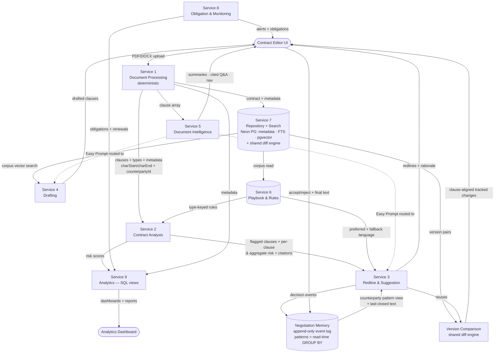
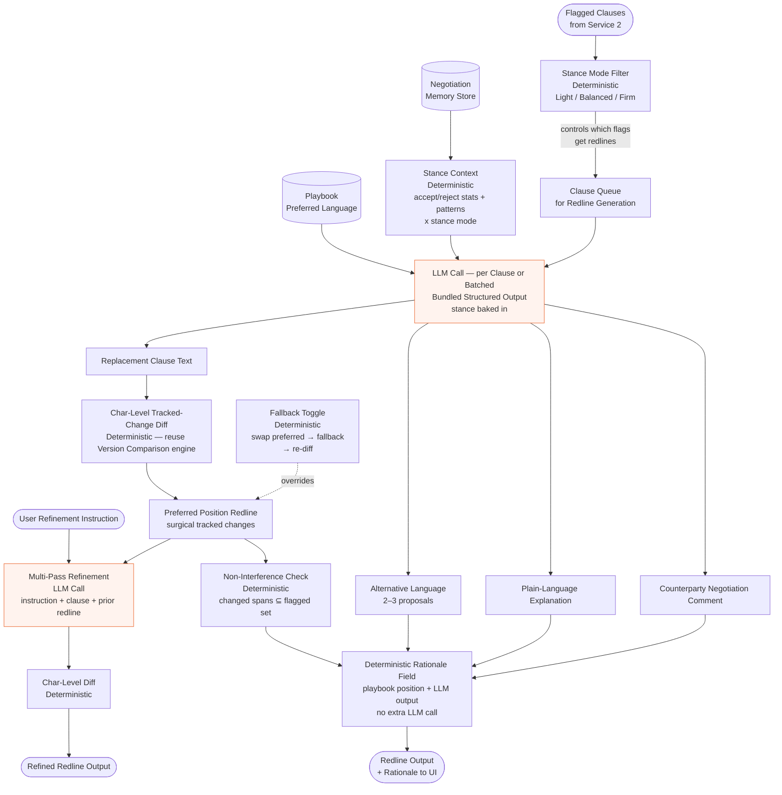
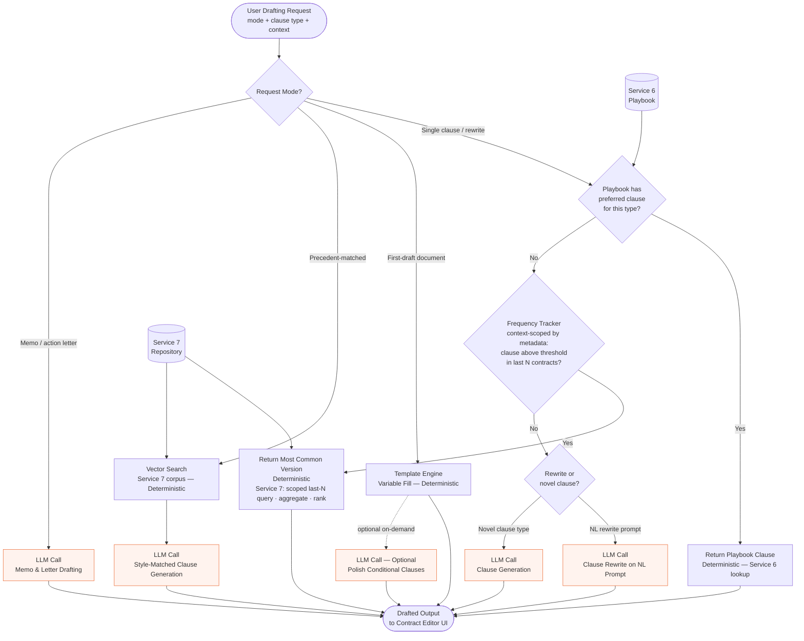
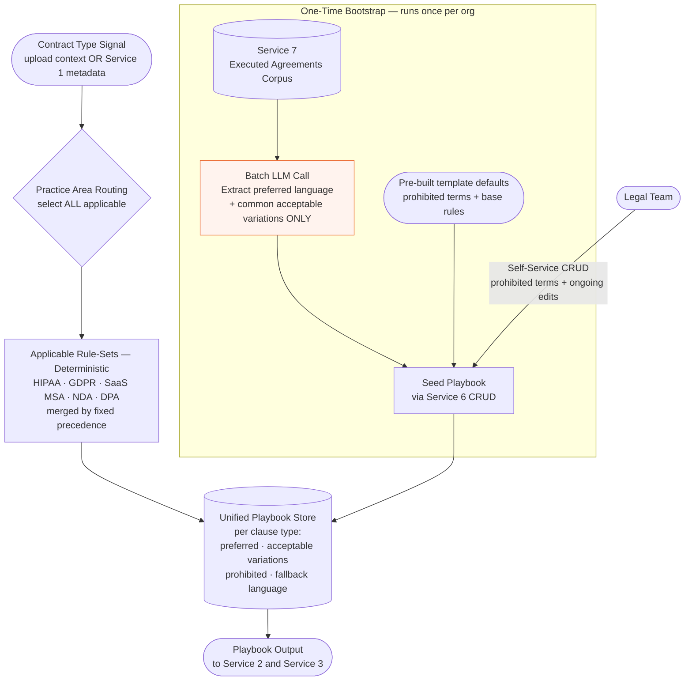
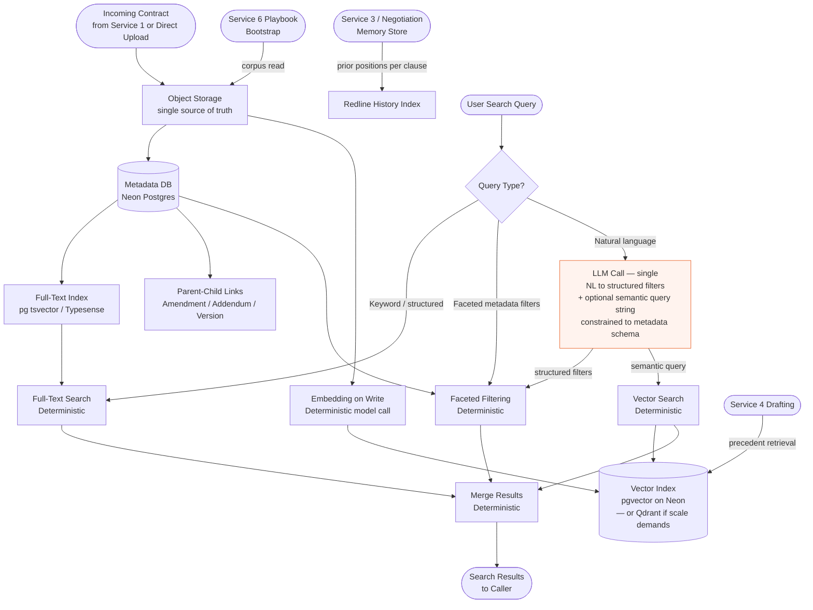
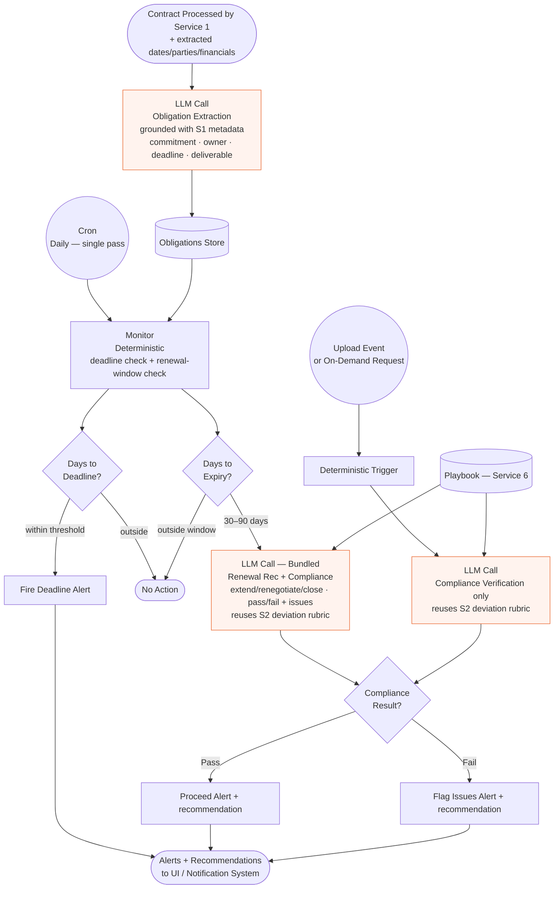
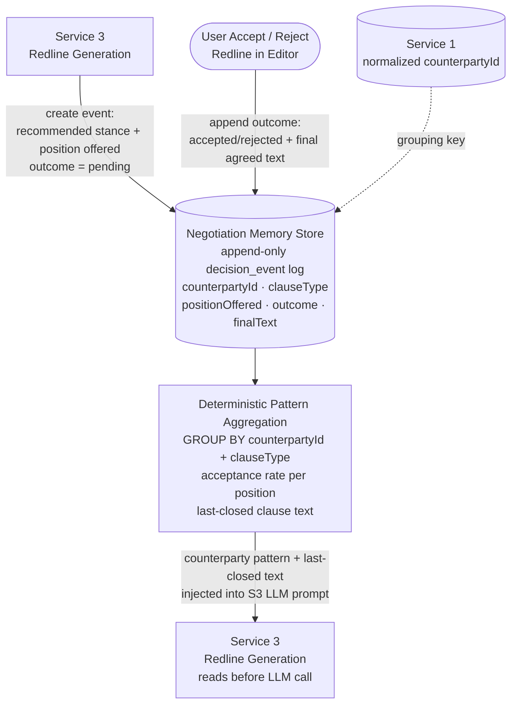

# Architecture Diagrams — Contract Intelligence Platform

Deterministic-first architecture: LLMs are used only where semantic understanding is genuinely required; everything structural (segmentation, typing, diffing, scoring, aggregation, monitoring) is pure code. Orange-bordered nodes are LLM calls; all others are deterministic. Node-shape conventions are in the Legend at the bottom.

## Platform-wide notes

- **One database — Neon Postgres.** Holds contract metadata, `tsvector` full-text, `pgvector` embeddings, the Negotiation Memory Store (append-only event log), the obligations store, and the analytics view layer. Object storage holds source documents as the single source of truth.
- **Clause-type normalizer (S1) is shared infrastructure.** The canonical clause `type` is consumed by S2 (rule matching + structural checks), S5 (navigation), S7 (redline history), and the Version Comparison workflow (diff alignment). Its vocabulary stays in sync with S6's clause-type taxonomy.
- **Shared diff engine (S7).** One char-level, clause-aligned diff engine is reused by S3 (redline markup) and the Version Comparison workflow. It aligns clauses by stable S1 clause id before diffing.
- **Severity-weighted risk.** Scoring weights live in S6 config, are applied by S2 per-clause, and are rolled up severity-weighted (never averaged) by S9.
- **Normalized `counterpartyId` (S1)** is the grouping key for the Negotiation Memory Store.

---

## Diagram 1 — System-Wide Overview

All 9 backend services, cross-cutting workflows, data stores, and the frontend, showing primary data flows.



---

## Diagram 2 — Service 1: Document Processing

**Purpose:** Deterministic ingestion — parse the document, segment into clauses with character offsets, tag clause types, and extract ~50 structured metadata fields. Foundation every downstream citation and structural check depends on. Zero LLM.

**Integrations:** Feeds S2 (analysis), S5 (clause array for Q&A), S7 (storage), and S9 (metadata). Emits the canonical clause types, `charStart`/`charEnd` offsets, and normalized `counterpartyId` used platform-wide. Scanned/OCR PDFs are out of scope by design.

```mermaid
flowchart TD
    A([Document Upload\nPDF or DOCX]) --> FMT{Format?}
    FMT -->|DOCX| DX[DOCX Parser\nDeterministic\ntext + explicit heading styles + numbering]
    FMT -->|PDF| B[PDF Parser\nDeterministic\nraw text + font sizes · bold · whitespace · coords]

    DX --> C[Canonical Text + Structure Signal\nsingle source for charStart/charEnd]
    B --> C

    C --> D[Heading & Structure Detector\nDeterministic\ndecimal · alpha · roman · ALL CAPS · bold\nfallback: blank-line paragraphs]
    D --> E[Clause Boundary Segmentation\nDeterministic]
    E --> TN[Clause-Type Normalizer\nDeterministic\nsynonym/fuzzy dictionary: heading text → canonical type]
    TN --> F[Clause Array\nid · type · text · charStart · charEnd]

    C --> G[NER + Pattern Matching Engine\nDeterministic]
    G --> G1[Party & Org Extraction\n+ normalized counterpartyId]
    G --> G2[Date Extraction]
    G --> G3[Financial Field Extraction]
    G --> G4[Governing Law Detection]
    G --> G5[Notice & Address Extraction]

    G1 --> H[Metadata Object\n~50 fields]
    G2 --> H
    G3 --> H
    G4 --> H
    G5 --> H

    UPL([Upload Context]) --> PO[Paper Origin Flag\nDeterministic\nown · counterparty]

    F --> OUT([Output Contract\nclauses[] + metadata + paperOrigin + canonical text\nto Service 2 / Service 7])
    H --> OUT
    PO --> OUT
```

---

## Diagram 3 — Service 2: Contract Analysis Decision Cycle

**Purpose:** Analyzes segmented clauses to flag issues (missing, prohibited, non-standard, high-risk, vague, inconsistent) and produce per-clause + per-contract risk scores, switching analysis mode by `paperOrigin`. Layer 1 is deterministic (clause-type list only); Layer 2 uses batched LLM calls on clause bodies.

**Integrations:** Consumes S1 clauses/types and S6 type-keyed rules (matched per-clause to shrink prompts). Emits flagged clauses + risk scores to S3 and S9. Scoring weights come from S6 config.

```mermaid
flowchart TD
    IN([Input from Service 1\nclauses[] · types · metadata · paperOrigin])
    PB[(Playbook\nService 6)]

    subgraph L1 [Layer 1 — Heading-Level Structural Checks — Deterministic]
        HL[Extract Clause Type List\nheadings only]
        MC[Missing Clause Detection\ntypes vs required list]
        PC[Prohibited Clause Detection\ntypes vs prohibited list]
        HL --> MC
        HL --> PC
    end

    RM[Clause↔Rule Matcher\nDeterministic\nattach matching playbook rule\nper clause by type]

    subgraph L2 [Layer 2 — Content Analysis — Full Clause Text]
        CPO{paperOrigin?}
        RE[Regex Pre-filter\nInconsistent Term Candidates]
        OWN[LLM Batch Call — Own Paper\nNon-standard · High-risk · Vague\n+ confirm inconsistent terms]
        CPY[LLM Batch Call — Counterparty Paper\nDeviation vs Preferred\n+ High-risk · Vague\n+ confirm inconsistent terms]
        CPO -->|own paper| RE
        RE --> OWN
        CPO -->|counterparty paper| CPY
    end

    IN --> HL
    IN --> RM
    PB --> HL
    PB --> RM
    RM --> CPO
    RM --> OWN
    RM --> CPY

    MC --> AGG[Deterministic Aggregation + Risk Scoring\nseverity flags → numeric score\nweights from playbook config]
    PC --> AGG
    OWN --> AGG
    CPY --> AGG

    AGG --> OUT([Flagged Clauses + Risk Scores\n+ charStart/charEnd citations\n+ deviation flags\nto Service 3])

    style OWN fill:#fff3ee,stroke:#eb6c36
    style CPY fill:#fff3ee,stroke:#eb6c36
```

---

## Diagram 4 — Service 3: Redline & Suggestion Pipeline

**Purpose:** Turns flagged clauses from S2 into surgical tracked-change redlines with alternatives, plain-language rationale, and counterparty-ready comments, governed by stance mode, playbook language, and negotiation memory. One bundled LLM call per clause; the LLM emits replacement text, and the deterministic diff engine renders the tracked changes.

**Integrations:** Consumes S2 flags, S6 preferred/fallback language, and NMS counterparty patterns. Reuses the shared diff engine (also used by the Version Comparison workflow). Writes decision events to NMS.



---

## Diagram 5 — Service 4: Drafting Paths

**Purpose:** Generates contract language (single clauses, first-draft documents, memos, precedent-matched clauses) via a cost-tiered cascade — playbook lookup → frequency reuse → LLM only as last resort. Requests branch on mode first; only single-clause requests enter the cascade.

**Integrations:** Reads S6 playbook and S7 (context-scoped last-N frequency query + precedent vector search).



---

## Diagram 6 — Service 5: Document Intelligence Flows

**Purpose:** In-editor intelligence: risk-aware contract summarization, redline-thread summarization, cited Q&A, Easy Prompt (NL→structured legal prompt), Chat2 web research, and deterministic clause navigation. Single-document Q&A reads the S1 clause array directly (no vector RAG).

**Integrations:** Reads S1 clause array and S2 risk flags (for risk-aware summaries). Easy Prompt routes its structured output into S3/S4. Ad-hoc Q&A answers are cached for S9 tabular review.


---

## Diagram 7 — Service 6: Playbook Routing + One-Time Bootstrap

**Purpose:** Selects the applicable standards for an incoming contract (all matching practice areas, merged by fixed precedence) and serves preferred/acceptable/prohibited language + fallbacks from a unified store. A one-time LLM bootstrap seeds preferred language + acceptable variations from the existing corpus; humans own all edits thereafter via CRUD. No versioning/audit (out of scope).

**Integrations:** Serves S2 and S3. Bootstrap reads the S7 corpus. Prohibited terms are seeded from template defaults + human CRUD (not mined from executed agreements).



---

## Diagram 8 — Service 7: Contract Repository & Search Flow

**Purpose:** Single source of truth for all contracts — stores documents + metadata, exposes keyword/faceted/NL search, amendment linking, redline-history lookup, and version-pair fetch. Smart Search is the only LLM call (NL → constrained structured filters + optional semantic query). Consolidated on Neon Postgres + pgvector with embedding-on-write.

**Integrations:** Stores contracts from S1. Serves S4 (precedent vector search) and S6 (corpus read). Hosts the shared diff engine reused by S3 and the Version Comparison workflow. Redline History Index is fed by S3 decision logs / NMS.



---

## Diagram 9 — Service 8: Obligation & Monitoring Decision Cycle

**Purpose:** Extracts every commitment/deadline/deliverable once at ingest (LLM, grounded on S1 metadata), then runs a single daily deterministic monitor pass that fires deadline alerts and renewal recommendations. On the renewal path, recommendation + compliance are one bundled LLM call; compliance can also be triggered on upload/on-demand.

**Integrations:** Consumes S1 metadata and S6 playbook. Reuses S2's counterparty-deviation rubric for compliance consistency. Feeds S9.



---

## Diagram 10 — Service 9: Analytics Aggregation

**Purpose:** Turns upstream data (S1 metadata, S2 risk scores, S8 obligations/renewals) into dashboards and reports via deterministic SQL views over the shared Neon Postgres. Zero LLM. Portfolio risk is severity-weighted, not averaged.

**Integrations:** Pure consumer of S1/S2/S8 schemas (frozen as a read contract via DB views). Ad-hoc tabular columns read an S5-written cached-answers table — no LLM in S9.


---

## Diagram 11 — Review Pipeline & Autonomous Review Trigger

**Purpose:** Event-triggered, code-orchestrated pipeline that runs S1→S6→S2→S3 on upload (S1 parse and S6 playbook fetch run concurrently), then a deterministic threshold gate either auto-applies redlines or escalates to a human. "Autonomous" means event-triggered, not LLM-directed — code owns all flow. The gate applies hard-stops (any prohibited/missing clause, quality failure, or single high-risk clause forces escalation), not just an aggregate score.

**Integrations:** Orchestrates S1, S6, S2, S3. S3 reads NMS itself for counterparty context; human accept/reject decisions are logged to NMS.

```mermaid
sequenceDiagram
    participant U as User / Upload Event
    participant ART as Autonomous Review Trigger
    participant NMS as Negotiation Memory Store
    participant S6 as Service 6 — Playbook & Rules
    participant S1 as Service 1 — Document Processing
    participant S2 as Service 2 — Contract Analysis
    participant S3 as Service 3 — Redline & Suggestion
    participant GATE as Threshold Gate (Deterministic)
    participant UI as Contract Editor UI

    U->>ART: Upload event (webhook / queue)

    par Parse and playbook fetch run concurrently
        ART->>S1: Process PDF/DOCX
        Note over S1: Deterministic parse → NER/regex/layout<br/>→ clauses[] + metadata + charStart/charEnd
        S1-->>ART: clauses[] + metadata + paperOrigin
    and
        ART->>S6: Fetch playbook for contract type<br/>(from upload context)
        S6-->>ART: Preferred language, rules, prohibited terms
    end

    ART->>S2: Analyze clauses (+ playbook)
    Note over S2: Deterministic structural gates first,<br/>then batched LLM content analysis
    S2-->>ART: Flagged clauses + per-clause & aggregate<br/>risk + prohibited/missing flags + citations

    ART->>S3: Generate redlines
    Note over S3: S3 reads NMS itself for counterparty context,<br/>then LLM: redlines, explanations, comments
    S3->>NMS: Read counterparty pattern view (deterministic)
    NMS-->>S3: Counterparty context
    S3-->>ART: Redlines + rationale + quality result

    ART->>GATE: Apply deterministic rules

    alt Hard-stop (prohibited/missing clause,<br/>quality fail, or max per-clause risk high)
        GATE->>UI: Escalate to human + attach rationale
        Note over UI: Human accepts / rejects;<br/>decisions logged to NMS
    else Aggregate AND max per-clause risk below threshold
        GATE->>UI: Auto-apply redlines (semi-autonomous)
        Note over UI: Rationale attached to every change
    end

    UI-->>U: Review results displayed in editor
```

---

## Diagram 12 — Negotiation Memory Store

**Purpose:** A deterministic, append-only decision log giving the platform negotiation memory. Counterparty patterns are derived at read time (GROUP BY over the event log), not maintained as a separate entity. Zero LLM.

**Integrations:** Written by S3 (decision events) and the editor (accept/reject + final agreed text). Read only by S3, before its LLM call. Requires a normalized `counterpartyId` from S1 as the grouping key.



**Data shape — `decision_event`:** `id`, `contractId`, `counterpartyId` (normalized), `clauseType`, `positionOffered` (preferred/fallback-N), `recommendedStance`, `outcome` (accepted/rejected/countered, nullable until user acts), `finalText`, `timestamp`. Patterns are a view: `GROUP BY counterpartyId, clauseType → acceptance rate per position, most-recent finalText`.

---

## Diagram 13 — Version Comparison Workflow

**Purpose:** Diff any two stored contract versions into tracked changes for the editor, with an optional on-demand LLM semantic-change summary. Clauses are aligned by stable S1 clause id before the character diff (robust to insertion/deletion/reorder). Diff and version-write are deterministic and live in Service 7 — this is the shared diff engine reused by S3.

**Integrations:** Reads version pairs from S7's version-aware repository. Depends on stable S1 clause ids. Diff engine is reused by S3 for redline markup.


---

## Legend

| Symbol | Meaning |
|---|---|
| `[ ]` | Service, processing step, or deterministic component |
| `{ }` | Decision point / branch |
| `[( )]` / `(( ))` | Database or event trigger |
| `([ ])` | Terminal: system input or output |
| Orange node border | LLM Call (non-deterministic content generation) |
| Plain node border | Deterministic (pure code, no LLM) |
| Dashed arrow `-.->` | Optional / override path |

## Service Type Summary

| Service | Type | LLM Calls |
|---|---|---|
| S1 — Document Processing | Deterministic | 0 |
| S2 — Contract Analysis | Fixed Workflow | 1 (batched) |
| S3 — Redline & Suggestion | LLM Calls | 1 per clause |
| S4 — Drafting | Cascade | 0–1 per request |
| S5 — Document Intelligence | LLM + Fixed Workflows | 1 per request |
| S6 — Playbook & Rules | Deterministic | 0 ongoing; 1 batch bootstrap |
| S7 — Repository & Search | Deterministic + versioning | 1 (Smart Search) |
| S8 — Obligation & Monitoring | LLM + Scheduled Jobs | 1–2 per event |
| S9 — Analytics | Deterministic | 0 |
| Review Pipeline (Diagram 11) | Orchestration | 0 (own layer) |
| Negotiation Memory Store (Diagram 12) | Deterministic | 0 |
| Version Comparison (Diagram 13) | Fixed Workflow | 0–1 (optional) |
