# Architecture Diagrams — Contract Intelligence Platform

Deterministic-first architecture: LLMs are used only where semantic understanding is genuinely required; everything structural (segmentation, typing, diffing, scoring, aggregation, monitoring) is pure code. Orange-bordered nodes are LLM calls; all others are deterministic. Node-shape conventions are in the Legend at the bottom.

## Platform-wide notes

- **One database — Neon Postgres.** Holds contract metadata, `tsvector` full-text, `pgvector` embeddings, the Negotiation Memory Store (append-only event log), the obligations store, and the analytics view layer. Object storage holds source documents as the single source of truth.
- **Project namespace on shared infrastructure.** The database and storage accounts are shared with other projects. One setting, `PROJECT_NAMESPACE` (`precedent`), drives both partitions: every table, view and the migration history live in a Postgres schema of that name (nothing in `public` except the shared `vector` extension), and every object key is stored under a `precedent/` prefix applied inside the storage backend. See Diagram 14.
- **Cloud only.** There is one database (cloud Postgres) and one storage backend (S3-compatible). No local database, no local file backend, no browser storage. The application refuses to start if the database URL or any of the four object-storage settings is missing.
- **Clause-type normalizer (S1) is shared infrastructure.** The canonical clause `type` is consumed by S2 (rule matching + structural checks), S5 (navigation), S7 (redline history), and the Version Comparison workflow (diff alignment). Its vocabulary is S6's taxonomy: the `clause_family` table (29 families, inserted by migration) is the source of truth, and each family has `clause_issue` rows for the negotiable points inside it.
- **The playbook is data, not prose.** A rule is a record with a ladder of positions, numeric parameters, testable red lines, objections and test cases, held in an immutable published version. Every finding, redline and approval cites the rule, position and version that produced it.
- **Three zones.** Every governed finding is green, yellow or red. The zone is assigned by deterministic code and decides routing; the numeric score is for reporting only.
- **Shared diff engine (S7).** One char-level, clause-aligned diff engine is reused by S3 (redline markup) and the Version Comparison workflow. It aligns clauses by stable S1 clause id before diffing.
- **Severity-weighted risk.** Scoring weights (`risk_weight`, 1–10) live on S6 rules, are applied by S2 per-clause, and are rolled up severity-weighted (never averaged) by S9. The contract score is normalised to 0–1.
- **Normalized `counterpartyId` (S1)** is the grouping key for the Negotiation Memory Store.
- **Seed is separate from the application.** Company content (playbooks, rules, roles, synthetic contracts and history) lives in `backend/seed/` and is loaded by its own commands. Reference data the application needs to run (agreement types, clause families) comes from migrations. Deleting the seed folder changes nothing about the application.

### Playbook build status (2026-11-16)

The playbook diagrams below (3, 4, 5, 7, 11, 12, 14) show the target design from `playbook_plan.md`. What exists in the code today:

| Area | State |
|---|---|
| Project namespace, schema-aware models and migrations, cloud-only storage, partition check, namespace guard | Built |
| Playbook schema: migrations `010`–`012`, ORM models, repositories, response schemas, PATCH null semantics | Built |
| Seed folder: isolation guard, file models, validator, coverage report, Halcyon content (7 playbooks, 130 rules, 9 versions) | Built |
| Seed loader; synthetic contract corpus; negotiation history | Not yet built |
| Contract type and context capture; resolution engine; zone evaluator; Layer 2 extraction; score normalisation and three-zone gate; ladder redlines; drafting lookup; versions and children API; rule test runner; bootstrap into drafts | Not yet built (phase 4). The running pipeline already reads positions/red_lines, not legacy columns, but still uses the two-outcome gate |
| Drop of the five legacy rule columns (migration `015`); DB-backed clause-type synonym cache (`load_synonym_cache`, replacing the in-code `_SYNONYMS` dict) | Done in the model, schemas and frontend (task 5.5); migration authored and dry-run tested, not yet applied to a live database |

---

## Diagram 1 — System-Wide Overview

All 9 backend services, cross-cutting workflows, data stores, and the frontend, showing primary data flows.

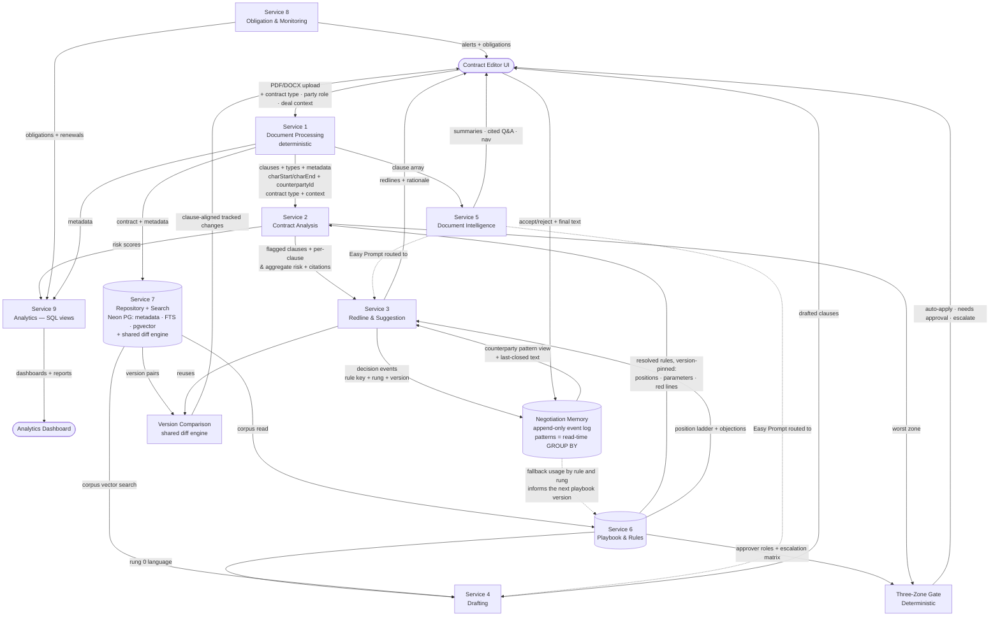

---

## Diagram 2 — Service 1: Document Processing

**Purpose:** Deterministic ingestion — parse the document, segment into clauses with character offsets, tag clause types, and extract ~50 structured metadata fields. Foundation every downstream citation and structural check depends on. Zero LLM for parsing, segmentation and extraction. The one exception is contract-type classification, a single fast-tier call made only when the uploader did not supply the type; its result is stored, left null when confidence is low, and never used for control flow inside S1.

**Integrations:** Feeds S2 (analysis), S5 (clause array for Q&A), S7 (storage), and S9 (metadata). Emits the canonical clause types, `charStart`/`charEnd` offsets, and normalized `counterpartyId` used platform-wide. Scanned/OCR PDFs are out of scope by design.

```mermaid
flowchart TD
    A([Document Upload\nPDF or DOCX]) --> FMT{Format?}
    FMT -->|DOCX| DX[DOCX Parser\nDeterministic\ntext + explicit heading styles + numbering]
    FMT -->|PDF| B[PDF Parser\nDeterministic\nraw text + font sizes · bold · whitespace · coords]

    DX --> C[Canonical Text + Structure Signal\nsingle source for charStart/charEnd]
    B --> C

    C --> D[Heading & Structure Detector\nDeterministic\ndecimal · alpha · roman · ALL CAPS · bold\nfallback: blank-line paragraphs]
    D --> E[Clause Boundary Segmentation\nDeterministic]
    E --> TN[Clause-Type Normalizer\nDeterministic\nsynonym/fuzzy dictionary: heading text → canonical type]
    TN --> F[Clause Array\nid · type · text · charStart · charEnd]

    C --> G[NER + Pattern Matching Engine\nDeterministic]
    G --> G1[Party & Org Extraction\n+ normalized counterpartyId]
    G --> G2[Date Extraction]
    G --> G3[Financial Field Extraction]
    G --> G4[Governing Law Detection]
    G --> G5[Notice & Address Extraction]

    G1 --> H[Metadata Object\n~50 fields]
    G2 --> H
    G3 --> H
    G4 --> H
    G5 --> H

    UPL([Upload Context]) --> PO[Paper Origin Flag\nDeterministic\nown · counterparty]

    UPL --> CTQ{Contract type\nsupplied?}
    CTQ -->|Yes| CT[Contract Type + Party Role\nvalidated against agreement_type]
    CTQ -->|No| CLS[LLM Call — fast tier\nClassify contract type\ntitle + first 3,000 chars\nnull when confidence is low]
    CLS --> CT
    C --> CLS
    UPL --> CX[Deal Context — Deterministic\nregimes by keyword rules: hipaa · gdpr\ndeal value band from band boundaries\nvalidated against context_dimension]
    C --> CX

    F --> OUT([Output Contract\nclauses[] + metadata + paperOrigin + canonical text\n+ contract type · party role · context\nto Service 2 / Service 6 / Service 7])
    H --> OUT
    PO --> OUT
    CT --> OUT
    CX --> OUT

    style CLS fill:#fff3ee,stroke:#eb6c36
```

---

## Diagram 3 — Service 2: Contract Analysis Decision Cycle

**Purpose:** Analyzes segmented clauses against the resolved playbook and produces findings, each with a zone (green, yellow, red), plus a normalised contract score. Layer 1 is deterministic: missing required clauses and `phrase`/`regex` red lines. Layer 2 is one batched LLM call per contract that *extracts* — which position the text matches, parameter values with quotes, a yes/no per semantic red line — and still flags risk and vagueness on clauses no rule governs. A deterministic evaluator then assigns the zone. **The model never assigns a zone.**

**Integrations:** Consumes S1 clauses/types and the S6 resolved rule set (matched per clause family to shrink prompts). Emits findings with `rule_key`, zone and matched position or red line to S3, the gate and S9.

```mermaid
flowchart TD
    IN([Input from Service 1\nclauses[] · types · metadata · paperOrigin · context])
    PB[(Resolved Rule Set\nService 6 — version-pinned)]

    subgraph L1 [Layer 1 — Structural Checks — Deterministic]
        MC[Missing Clause Detection\nper required rule\nreported once per clause family]
        PC[Phrase and Regex Red Lines\nrule · playbook · global scope\nnegation guard: skip a match preceded by\nnot · no · nothing · neither · never · without\nin the same sentence]
    end

    RM[Clause↔Rule Matcher\nDeterministic\nattach resolved rules\nper clause by family]

    subgraph L2 [Layer 2 — Content Extraction — Full Clause Text]
        CPO{paperOrigin?}
        RE[Regex Pre-filter\nInconsistent Term Candidates]
        OWN[LLM Batch Call — Own Paper\nper rule: matched position · parameter values + quote\nsemantic red-line yes/no + quote\n+ non-standard · high-risk · vague]
        CPY[LLM Batch Call — Counterparty Paper\nper rule: matched position · parameter values + quote\nsemantic red-line yes/no + quote\n+ high-risk · vague]
        CPO -->|own paper| RE
        RE --> OWN
        CPO -->|counterparty paper| CPY
    end

    IN --> MC
    IN --> PC
    IN --> RM
    PB --> MC
    PB --> PC
    PB --> RM
    RM --> CPO

    EV[Zone Evaluator — Deterministic\nfirst match decides:\n1 red line matches → red\n2 parameter beyond yellow limit → red · beyond green limit → yellow\n3 preferred or acceptable variant → no finding\n4 fallback rung → that rung's zone\n5 otherwise → rule's default zone]

    OWN --> EV
    CPY --> EV
    PC --> EV
    MC -->|missing required clause\nred by default| AGG

    EV --> AGG[Deterministic Aggregation + Scoring\npoints = severity base 1·3·9 × risk weight 1–10\nscore = points ÷ 9 × sum of weights, capped at 1.0\nworst zone recorded]

    AGG --> OUT([Findings: rule key · zone · position or red line\n+ parameter values + charStart/charEnd citations\n+ normalised score + max zone\nto Service 3 and the gate])

    style OWN fill:#fff3ee,stroke:#eb6c36
    style CPY fill:#fff3ee,stroke:#eb6c36
```

**Parameter limits and context.** A parameter carries a `preferred_value`, a `green_limit` and a `yellow_limit`, with a direction (`higher_is_better`, `lower_is_better`, `exact`, `set_membership`). `context_overrides` change the limits for a matching deal context — for example a 36-month liability cap is yellow rather than red on a `strategic` deal.

---

## Diagram 4 — Service 3: Redline & Suggestion Pipeline

**Purpose:** Turns flagged clauses from S2 into surgical tracked-change redlines with alternatives, plain-language rationale, and counterparty-ready comments, governed by stance mode, the playbook ladder, and negotiation memory. One bundled LLM call per clause; the LLM adapts the playbook's rung 0 language to the contract's defined terms, and the deterministic diff engine renders the tracked changes. Alternatives are the rule's fallback rungs, filtered by their conditions — the model adapts wording but does not invent positions.

**Integrations:** Consumes S2 findings, the S6 position ladder and objections, and NMS counterparty patterns. Reuses the shared diff engine (also used by the Version Comparison workflow). Writes decision events to NMS with the rule, rung and playbook version; accepting a yellow rung opens a `playbook_exception`.

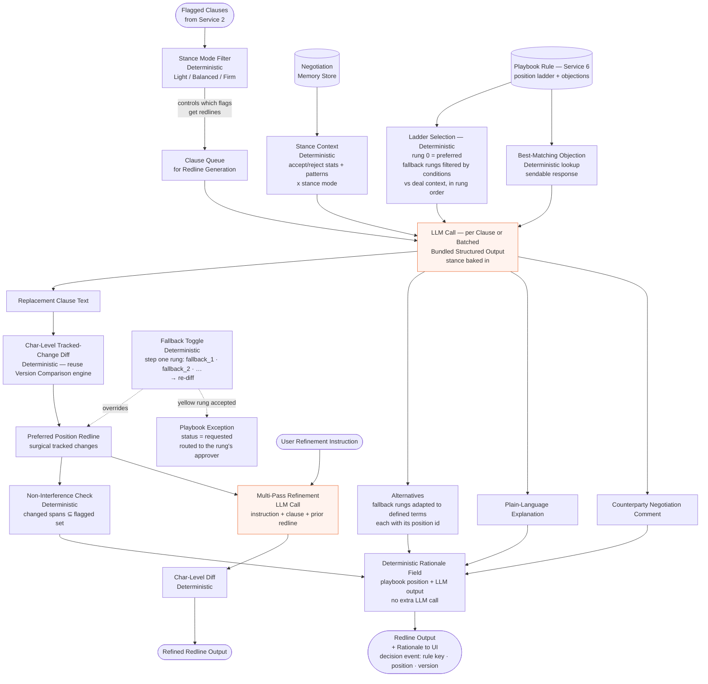

---

## Diagram 5 — Service 4: Drafting Paths

**Purpose:** Generates contract language (single clauses, first-draft documents, memos, precedent-matched clauses) via a cost-tiered cascade — playbook lookup → frequency reuse → LLM only as last resort. Requests branch on mode first; only single-clause requests enter the cascade.

**Integrations:** Reads S6 playbook and S7 (context-scoped last-N frequency query + precedent vector search). The playbook step resolves the rule set from the request's contract type, party role and deal context and returns the rule's rung 0 language with no model call; a caller-supplied preferred text still overrides it.

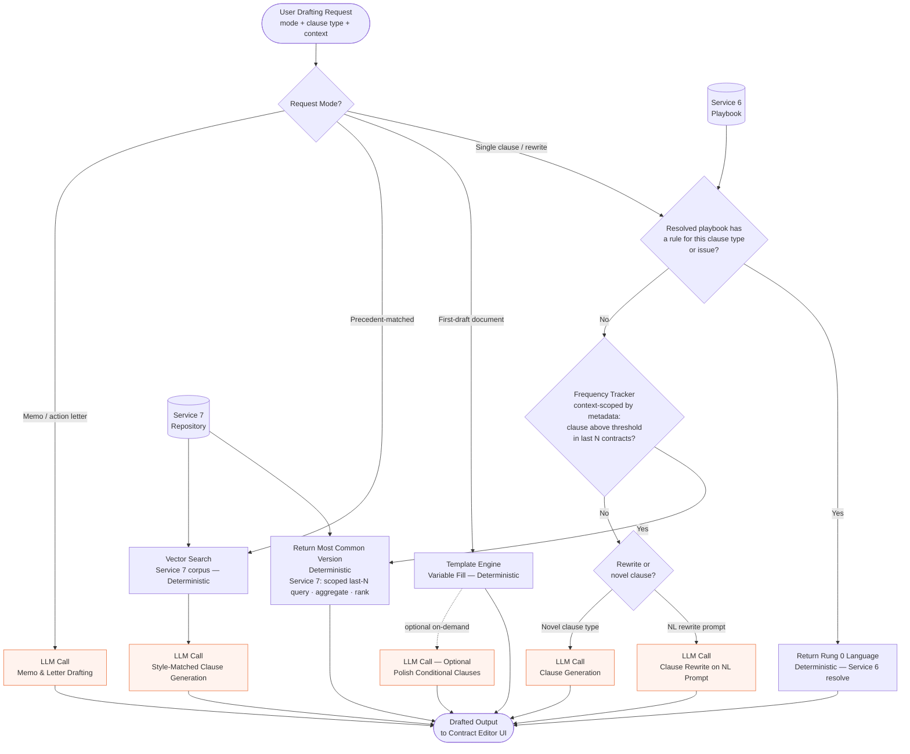

---

## Diagram 6 — Service 5: Document Intelligence Flows

**Purpose:** In-editor intelligence: risk-aware contract summarization, redline-thread summarization, cited Q&A, Easy Prompt (NL→structured legal prompt), Chat2 web research, and deterministic clause navigation. Single-document Q&A reads the S1 clause array directly (no vector RAG).

**Integrations:** Reads S1 clause array and S2 risk flags (for risk-aware summaries). Easy Prompt routes its structured output into S3/S4. Ad-hoc Q&A answers are cached for S9 tabular review.

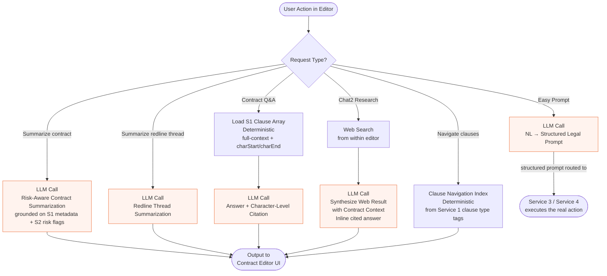

---

## Diagram 7 — Service 6: Playbook Resolution, Versioning + Bootstrap

**Purpose:** Holds the organization's negotiating policy as structured, versioned data and resolves the rule set that applies to one contract. Resolution layers a company baseline, one agreement playbook and any matching regulatory overlays, merges them by precedence, and returns rules with their children and the version each came from. Playbooks change only through a draft → test → publish cycle; published versions are immutable and every rule-level change is logged. Versioning and audit of the playbook are **in scope** (this reverses the earlier decision).

**Integrations:** Serves S2 (rules, parameters, red lines), S3 (ladder, objections), S4 (rung 0 language) and the gate (approver roles, escalation matrix). Bootstrap reads the S7 corpus. Outcome data from NMS and `playbook_exception` feeds the next version.

### 7a — Resolution

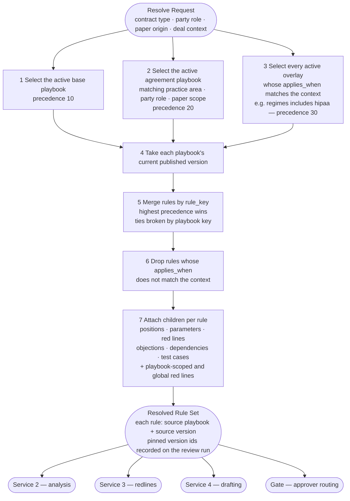

All of resolution is deterministic. An unknown contract type resolves to the baseline only; with no playbooks loaded the result is empty, which every consumer handles.

### 7b — Information model

Thirteen buckets; the tables are defined in Data_Model.md §6.

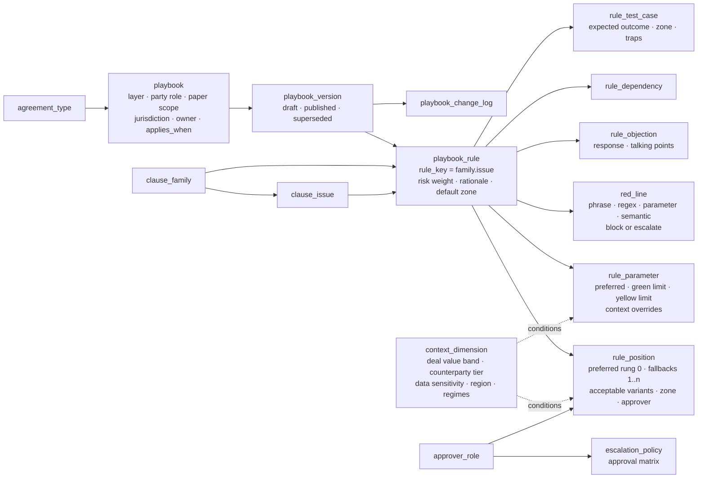

### 7c — Version lifecycle and bootstrap

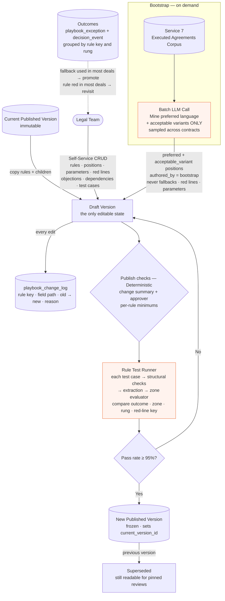

The test runner has two modes. Deterministic mode covers cases decidable without the model (phrase and regex red lines, missing clauses). The default mode calls the analysis model for extraction and is cost-bearing.

**Governance.** Each playbook has an owning role and a review cadence: 90 days for the baseline and commercial playbooks, 180 days (or on a regulatory change) for regulatory overlays.

---

## Diagram 8 — Service 7: Contract Repository & Search Flow

**Purpose:** Single source of truth for all contracts — stores documents + metadata, exposes keyword/faceted/NL search, amendment linking, redline-history lookup, and version-pair fetch. Smart Search is the only LLM call (NL → constrained structured filters + optional semantic query). Consolidated on Neon Postgres + pgvector with embedding-on-write.

**Integrations:** Stores contracts from S1. Serves S4 (precedent vector search) and S6 (corpus read). Hosts the shared diff engine reused by S3 and the Version Comparison workflow. Redline History Index is fed by S3 decision logs / NMS.

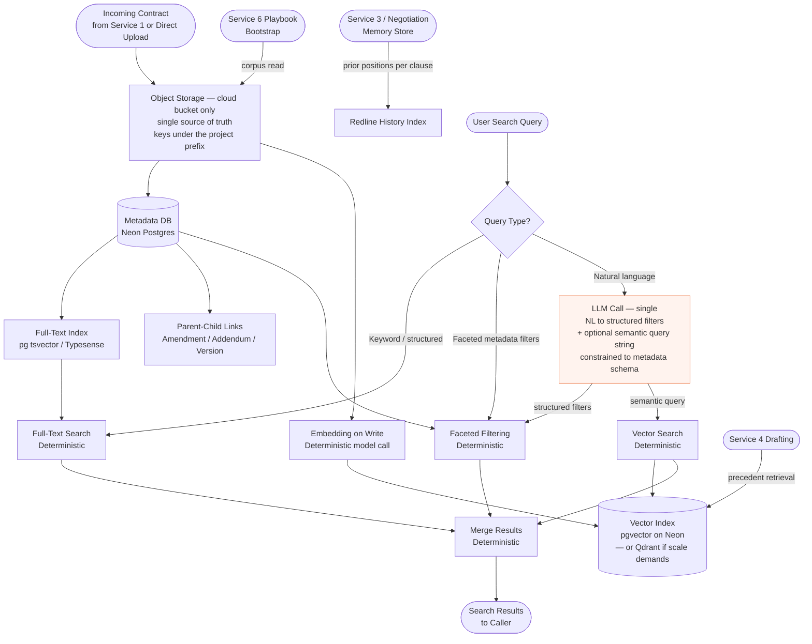

---

## Diagram 9 — Service 8: Obligation & Monitoring Decision Cycle

**Purpose:** Extracts every commitment/deadline/deliverable once at ingest (LLM, grounded on S1 metadata), then runs a single daily deterministic monitor pass that fires deadline alerts and renewal recommendations. On the renewal path, recommendation + compliance are one bundled LLM call; compliance can also be triggered on upload/on-demand.

**Integrations:** Consumes S1 metadata and S6 playbook. Reuses S2's counterparty-deviation rubric for compliance consistency. Feeds S9. (Today the obligations service makes no playbook call; compliance against the resolved rule set is not part of the current playbook work.)


---

## Diagram 10 — Service 9: Analytics Aggregation

**Purpose:** Turns upstream data (S1 metadata, S2 risk scores, S8 obligations/renewals) into dashboards and reports via deterministic SQL views over the shared Neon Postgres. Zero LLM. Portfolio risk is severity-weighted, not averaged.

**Integrations:** Pure consumer of S1/S2/S8 schemas (frozen as a read contract via DB views). Ad-hoc tabular columns read an S5-written cached-answers table — no LLM in S9.

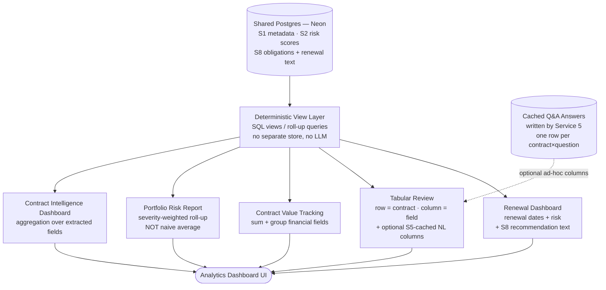

---

## Diagram 11 — Review Pipeline & Autonomous Review Trigger

**Purpose:** Event-triggered, code-orchestrated pipeline that runs S1→S6→S2→S3 on upload, then a deterministic three-zone gate. "Autonomous" means event-triggered, not LLM-directed — code owns all flow. The gate is driven by the **worst zone** across the findings, not by the aggregate score: none or green auto-applies, yellow needs a named approver, red escalates. A quality failure in redline generation still forces escalation.

**Integrations:** Orchestrates S1, S6, S2, S3. Playbook resolution needs the contract type and deal context, which come from the upload form or from S1, so S6 resolves after S1 unless the type was supplied at upload. The run records the playbook versions it was pinned to. S3 reads NMS itself for counterparty context; human decisions are logged to NMS.

```mermaid
sequenceDiagram
    participant U as User / Upload Event
    participant ART as Autonomous Review Trigger
    participant NMS as Negotiation Memory Store
    participant S6 as Service 6 — Playbook & Rules
    participant S1 as Service 1 — Document Processing
    participant S2 as Service 2 — Contract Analysis
    participant S3 as Service 3 — Redline & Suggestion
    participant GATE as Three-Zone Gate (Deterministic)
    participant UI as Contract Editor UI

    U->>ART: Upload event (webhook / queue)<br/>+ optional contract type, party role, context

    ART->>S1: Process PDF/DOCX
    Note over S1: Deterministic parse → clauses[] + metadata<br/>contract type (supplied or classified) + context
    S1-->>ART: clauses[] + metadata + paperOrigin<br/>+ contract type + party role + context

    ART->>S6: Resolve(contract type, party role,<br/>paper origin, context)
    Note over S6: base + agreement + matching overlays<br/>merged by rule_key and precedence
    S6-->>ART: Resolved rules with children<br/>+ pinned version ids

    ART->>S2: Analyze clauses (+ resolved rules)
    Note over S2: Structural checks and red lines first,<br/>then batched LLM extraction,<br/>then deterministic zone evaluator
    S2-->>ART: Findings with rule key + zone<br/>+ normalised score + worst zone

    ART->>S3: Generate redlines
    Note over S3: S3 reads NMS itself for counterparty context,<br/>then LLM adapts ladder language
    S3->>NMS: Read counterparty pattern view (deterministic)
    NMS-->>S3: Counterparty context
    S3-->>ART: Redlines from the ladder + rationale + quality result

    ART->>GATE: Worst zone + quality result

    alt Worst zone red, or redline quality failure
        GATE->>S6: Match escalation matrix
        S6-->>GATE: Approver role, time limit, required info
        GATE->>UI: escalated — attach rationale
        Note over GATE,UI: A block red line cannot be approved<br/>below the top legal role
    else Worst zone yellow
        GATE->>S6: Approver from the position,<br/>else the escalation matrix
        S6-->>GATE: Approver role, time limit, required info
        GATE->>UI: needs_approval — routed to the approver
    else No findings, or green only
        GATE->>UI: auto_applied (semi-autonomous)
        Note over UI: Rationale attached to every change
    end

    Note over UI: Human accepts / rejects;<br/>decisions logged to NMS with rule key and rung
    UI-->>U: Review results displayed in editor
```

**Gate table.**

| Worst zone | Gate decision | Routing |
|---|---|---|
| None or green | `auto_applied` | None |
| Yellow | `needs_approval` | Approver from the matched position, else the escalation matrix (most specific match, then priority) |
| Red | `escalated` | Escalation matrix; `block` red lines cannot be approved below the top legal role |

With no seed data loaded there is no position approver and no escalation policy. The gate still returns its decision and records that no approver is configured.

**Why the gate changed.** The earlier gate compared an unbounded raw score against thresholds of 0.4 and 0.7, so every flagged contract escalated and auto-apply could only happen with nothing to apply. The score is now normalised to 0–1 for reporting, and routing follows the zone.

---

## Diagram 12 — Negotiation Memory Store

**Purpose:** A deterministic, append-only decision log giving the platform negotiation memory. Counterparty patterns are derived at read time (GROUP BY over the event log), not maintained as a separate entity. Zero LLM. Each event also records the playbook rule, the ladder rung offered and the playbook version, which closes the loop back into the playbook: the data shows which fallbacks are used and which positions are out of step.

**Integrations:** Written by S3 (decision events) and the editor (accept/reject + final agreed text). Read only by S3, before its LLM call. Requires a normalized `counterpartyId` from S1 as the grouping key.

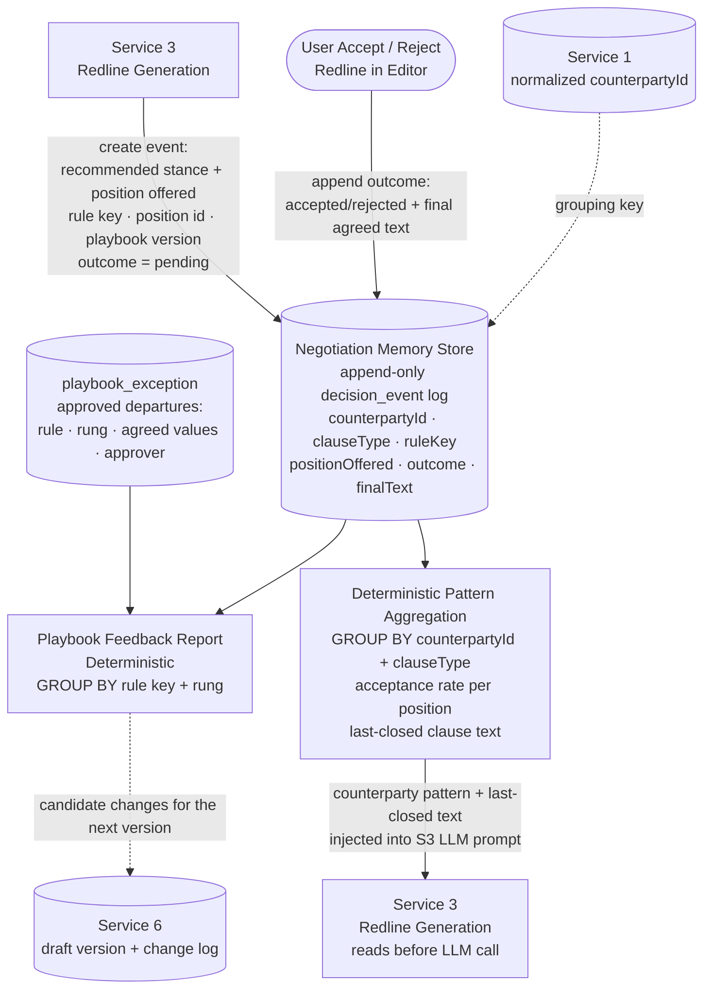

**Data shape — `decision_event`:** `id`, `contractId`, `counterpartyId` (normalized), `clauseType`, `positionOffered` (`preferred`, `fallback_1`, `fallback_2`, …), `ruleId`, `ruleKey`, `positionId`, `playbookVersionId`, `recommendedStance`, `outcome` (accepted/rejected/countered, nullable until user acts), `finalText`, `timestamp`. Patterns are a view: `GROUP BY counterpartyId, clauseType → acceptance rate per position, most-recent finalText`.

---

## Diagram 13 — Version Comparison Workflow

**Purpose:** Diff any two stored contract versions into tracked changes for the editor, with an optional on-demand LLM semantic-change summary. Clauses are aligned by stable S1 clause id before the character diff (robust to insertion/deletion/reorder). Diff and version-write are deterministic and live in Service 7 — this is the shared diff engine reused by S3.

**Integrations:** Reads version pairs from S7's version-aware repository. Depends on stable S1 clause ids. Diff engine is reused by S3 for redline markup.

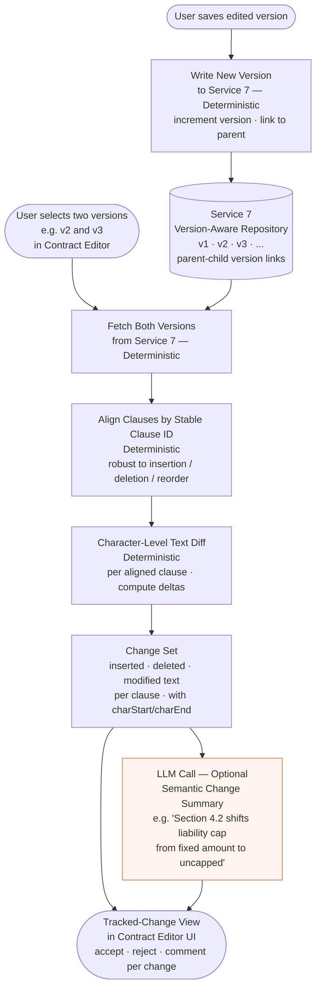

---

## Diagram 14 — Project Partitioning & Seed Isolation

**Purpose:** Keeps this project's data apart from other projects on the same free-tier accounts, and keeps seed tooling apart from the application. One setting drives every partition; a read-only check proves nothing sits outside it; dependencies between seed and application run one way.

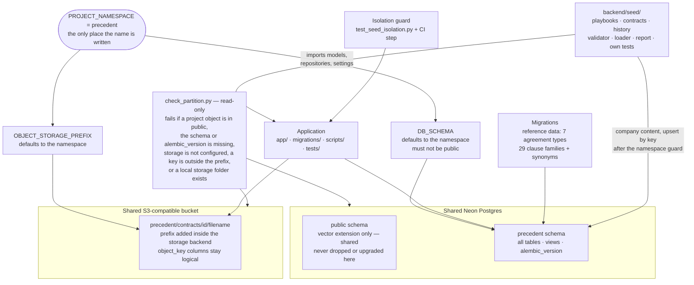

**Rules.**

- Dependencies run one way: seed code imports from `app`; nothing in `app`, `migrations`, `scripts` or the application tests imports from `seed`, reads its files or calls its commands.
- Nothing owned by this project is created in `public`; hand-written SQL names the schema from the setting.
- Seed loaders and data-writing scripts call `assert_namespace()` first and refuse to run when the schema is unset, `public` or missing.
- The application suite passes, the application starts and every feature works with `backend/seed/` absent and no seed data loaded.
- Product features are not seed: the playbook bootstrap, the rule test runner and the publish flow live in `app` and never read seed files.

---

## Legend

| Symbol | Meaning |
|---|---|
| `[ ]` | Service, processing step, or deterministic component |
| `{ }` | Decision point / branch |
| `[( )]` / `(( ))` | Database or event trigger |
| `([ ])` | Terminal: system input or output |
| Orange node border | LLM Call (non-deterministic content generation) |
| Plain node border | Deterministic (pure code, no LLM) |
| Dashed arrow `-.->` | Optional / override path |

## Service Type Summary

| Service | Type | LLM Calls |
|---|---|---|
| S1 — Document Processing | Deterministic | 0; 1 fast-tier classification only when the contract type is not supplied |
| S2 — Contract Analysis | Fixed Workflow | 1 (batched; split by clause batch if the prompt is too large) |
| S3 — Redline & Suggestion | LLM Calls | 1 per clause |
| S4 — Drafting | Cascade | 0–1 per request |
| S5 — Document Intelligence | LLM + Fixed Workflows | 1 per request |
| S6 — Playbook & Rules | Deterministic | 0 for resolution; 1 batch bootstrap; rule test runner calls the model in its default mode |
| S7 — Repository & Search | Deterministic + versioning | 1 (Smart Search) |
| S8 — Obligation & Monitoring | LLM + Scheduled Jobs | 1–2 per event |
| S9 — Analytics | Deterministic | 0 |
| Review Pipeline + three-zone gate (Diagram 11) | Orchestration | 0 (own layer) |
| Negotiation Memory Store (Diagram 12) | Deterministic | 0 |
| Version Comparison (Diagram 13) | Fixed Workflow | 0–1 (optional) |
