# Data Model — Precedent Backend

Single **Neon Postgres** database (with `pgvector`). This document defines every table, its columns, relationships, indexes, and the corresponding Pydantic/ORM domain models. It is the contract between services — all persistence conforms to this.

**Playbook redesign (2026-11-16).** Section 6 and the playbook-related columns elsewhere describe the structured, versioned playbook from `playbook_plan.md`. The schema is written as migrations `010`–`012` with matching ORM models. Columns marked *(set by phase 4)* exist but nothing writes them until the wiring tasks in `playbook_implementation.md` phase 4 land. The five legacy `playbook_rule` columns were dropped by migration `015` (§6.4); that content now lives only in `rule_position` and `red_line` rows.

Conventions:
- Primary keys are UUIDs (`uuid` type, generated app-side or `gen_random_uuid()`).
- Timestamps are `timestamptz`, default `now()`.
- Enumerated values are Postgres enums or `text` + `CHECK` (noted per column).
- `charStart`/`charEnd` are integer character offsets into the contract's canonical text (FR-2).
- No user/tenant columns (no multi-user — Non-Goals). Fields such as `authored_by` and `approved_by` are text until authentication exists.
- **Project schema.** The database account is shared with other projects, so every table, view and the `alembic_version` table lives in the Postgres schema named by the `DB_SCHEMA` setting (default: `PROJECT_NAMESPACE`, i.e. `precedent`), never in `public`. Only the shared `vector` extension stays in `public`. `Base.metadata` carries the schema, so models and unqualified foreign-key strings (`"playbook.id"`) resolve inside it; hand-written SQL names the schema explicitly from the setting.
- All tables carry `created_at`; mutable tables also carry `updated_at`, maintained on update.
- A **condition** (`applies_when`, `conditions`, `context_overrides[].when`) is a JSON object mapping a `context_dimension` key to the list of values it matches. All keys must match. An empty or null condition always matches.

## 1. Entity-relationship overview

```mermaid
erDiagram
    CONTRACT ||--o{ CONTRACT_VERSION : "has versions"
    CONTRACT_VERSION ||--o{ CLAUSE : "segmented into"
    CONTRACT_VERSION ||--o{ CONTRACT_FIELD : "has values"
    CONTRACT_VERSION ||--o{ CONTRACT_SIGNATORY : "signed by"
    CONTRACT_VERSION ||--o{ INGEST_RUN : "processed by"
    CONTRACT ||--o{ CONTRACT_PARTY : "has"
    PARTY ||--o{ CONTRACT_PARTY : "is"
    CONTRACT_PARTY ||--o{ CONTRACT_SIGNATORY : "for"
    CLAUSE ||--o{ CONTRACT_FIELD : "evidence in"
    CLAUSE ||--o{ CLAUSE : "parent of"
    CONTRACT ||--|| CONTRACT_METADATA : "typed summary of current version"
    CONTRACT ||--o{ FLAG : "analyzed into"
    CONTRACT ||--o{ REDLINE : "redlined into"
    CONTRACT ||--o{ OBLIGATION : "extracted into"
    CONTRACT ||--o{ QA_CACHE : "answered"
    CONTRACT }o--|| PARTY : "counterparty"
    CLAUSE ||--o{ FLAG : "flagged"
    FLAG ||--o| REDLINE : "produces"
    AGREEMENT_TYPE ||--o{ PLAYBOOK : "typed by"
    PLAYBOOK ||--o{ PLAYBOOK : "inherits from"
    PLAYBOOK ||--o{ PLAYBOOK_VERSION : "has"
    PLAYBOOK_VERSION ||--o{ PLAYBOOK_RULE : "contains"
    PLAYBOOK_VERSION ||--o{ PLAYBOOK_CHANGE_LOG : "records"
    CLAUSE_FAMILY ||--o{ CLAUSE_ISSUE : "has"
    CLAUSE_FAMILY ||--o{ CLAUSE : "types"
    CLAUSE_FAMILY ||--o{ PLAYBOOK_RULE : "classifies"
    CLAUSE_ISSUE ||--o{ PLAYBOOK_RULE : "classifies"
    PLAYBOOK_RULE ||--o{ RULE_POSITION : "ladder"
    PLAYBOOK_RULE ||--o{ RULE_PARAMETER : "limits"
    PLAYBOOK_RULE ||--o{ RED_LINE : "guards"
    PLAYBOOK_RULE ||--o{ RULE_OBJECTION : "anticipates"
    PLAYBOOK_RULE ||--o{ RULE_DEPENDENCY : "links"
    PLAYBOOK_RULE ||--o{ RULE_TEST_CASE : "verified by"
    APPROVER_ROLE ||--o{ RULE_POSITION : "approves"
    APPROVER_ROLE ||--o{ ESCALATION_POLICY : "assigned"
    PLAYBOOK ||--o{ ESCALATION_POLICY : "scoped to"
    PLAYBOOK ||--o{ RED_LINE : "playbook-wide"
    RULE_POSITION ||--o{ RULE_OBJECTION : "recommended move"
    CONTRACT ||--o{ PLAYBOOK_EXCEPTION : "granted on"
    PLAYBOOK_RULE ||--o{ PLAYBOOK_EXCEPTION : "deviates from"
    RULE_POSITION ||--o{ DECISION_EVENT : "offered"
    REVIEW_RUN }o--o{ PLAYBOOK_VERSION : "pinned to"
    CLAUSE ||--o{ CLAUSE_EMBEDDING : "embedded"
    REDLINE ||--o{ DECISION_EVENT : "logged"
    PARTY ||--o{ DECISION_EVENT : "keyed by"
    CONTRACT_VERSION ||--o{ CONTRACT_VERSION : "parent-child"
    REVIEW_RUN ||--o{ FLAG : "produced"
    REVIEW_RUN ||--o{ REDLINE : "produced"
```



## 2. Core ingestion tables (S1 / S7)

**Transitional note (2026-11-18).** This section describes the new schema from `document_processing_plan.md` §7.3, which is live. Migration `015` (task 5.2 of `document_processing_implementation.md`, destructive, not yet applied) drops the old untyped columns listed under "dropped, pending migration" below; until then they still physically exist on their tables alongside the new typed ones, and `clause.contract_version_id` is still nullable because old rows (if any) predate it.

### `contract`
The repository record. The bytes live in object storage; this row is the metadata + pointers.

| Column | Type | Notes |
|---|---|---|
| `id` | uuid PK | |
| `title` | text | from the document (Extract's title field) or the uploaded filename |
| `original_filename` | text | the filename as uploaded, nullable |
| `object_key` | text | logical key in object storage (source of truth), e.g. `contracts/{id}/v1/{filename}`. Stored unprefixed; the storage backend adds the project prefix |
| `source_format` | text | `pdf` \| `docx` |
| `canonical_text` | text | a copy of the current version's text, written in the same transaction that sets `current_version_id`; `contract_version.canonical_text` is the source of truth |
| `paper_origin` | text | `own` \| `counterparty` (CHECK) — set from upload context |
| `contract_type` | text FK → agreement_type.key | e.g. `saas_msa`, `nda`, `dpa`. Nullable. A user-supplied value wins; otherwise the value Extend's Extract returned |
| `contract_type_source` | text | `user` \| `extracted` (CHECK) |
| `party_role` | text | `vendor` \| `customer` \| `mutual` — which side the organization is on. Nullable |
| `context` | jsonb | deal facts keyed by `context_dimension.key`: `deal_value_band`, `counterparty_tier`, `data_sensitivity`, `region`, `regimes`. Nullable |
| `counterparty_id` | uuid FK → party.id | a shortcut to the `contract_party` row with role `counterparty`, written in the same transaction; nullable |
| `current_version_id` | uuid FK → contract_version.id | nullable |
| `status` | text | `processing` \| `failed` \| `ready` \| `analyzed` \| `redlined` \| `executed` (CHECK) |
| `status_reason` | text | nullable; set when `status = failed` (`password_protected`, `unsupported_format`, `too_large`, `unreadable`, `no_text`, `extraction_failed`, `timeout`, `provider_unavailable`) |
| `created_at` / `updated_at` | timestamptz | `updated_at` has an `onupdate` |

Indexes: GIN on `to_tsvector('english', canonical_text)` (full-text); btree on `contract_type`, `counterparty_id`, `status`. Every child foreign key to `contract.id` is `ON DELETE CASCADE`.

### `clause`
One row per segmented clause, scoped to a version. Load-bearing for S2/S5/S7/Version Comparison (FR-3).

| Column | Type | Notes |
|---|---|---|
| `id` | uuid PK | |
| `contract_id` | uuid FK → contract.id | kept for cheap filtering |
| `contract_version_id` | uuid FK → contract_version.id | nullable only until migration `015` makes it not null |
| `clause_key` | uuid, not null | a fresh value per clause today; reserved for the versioning pillar to carry across versions. Indexed on `(contract_id, clause_key)` |
| `ordinal` | int | document order within the version, parents before children |
| `level` | int | `1` = top-level section, `2+` = sub-clause (e.g. `(a)`, `6.1`) |
| `parent_id` | uuid FK → clause.id, self-referential | nullable; set for level 2+ |
| `section_number` | text | e.g. `"6"`, `"6.1"`; nullable |
| `title` | text | clean title, numbering stripped; nullable |
| `heading_text` | text | the raw heading as written, before cleanup |
| `clause_type` | text FK → clause_family.key | the family — Extract's section family when valid, else a dictionary/fuzzy match, else `other`; `preamble` and `signature_block` are also families, so the whole document is covered |
| `type_source` | text | `extract` \| `dictionary` \| `none` (CHECK) |
| `issue_keys` | jsonb | list of `clause_issue.key` values a compound title also maps to. Nullable |
| `text` | text | the exact slice of canonical text for this clause's range |
| `char_start` / `char_end` | int | offsets into `contract_version.canonical_text`; CHECK `char_end > char_start`, `char_start >= 0` |
| `page_start` / `page_end` | int | nullable |
| `text_sha256` | text | nullable |

Reading rule for every consumer: **current version, level 1**, unless it explicitly asks for `level=all` or another version — `clause_repo.get_clauses_for_contract` applies this by default. Unique on `(contract_version_id, ordinal)`; `ON DELETE CASCADE` from both `contract_version_id` and `parent_id`. `flag.clause_id` and `redline.clause_id` are now real foreign keys to `clause.id` (`ON DELETE SET NULL`).

### `contract_field` (new)
One row per extracted value — the source of truth for fields. Keyed by the field registry in `document_processing/fields.py`.

| Column | Type | Notes |
|---|---|---|
| `id` | uuid PK | |
| `contract_id` / `contract_version_id` | uuid FK, cascade | |
| `field_key` | text | a field registry key, e.g. `liability_cap_amount` |
| `value` | jsonb, not null | the typed value: number, string, boolean, ISO date or list |
| `source` | text | `extract` \| `derived` \| `user` (CHECK) |
| `confidence` | text | `high` (quote found in canonical text), `low` (not found), or null for `user` (CHECK) |
| `quote`, `page`, `char_start`, `char_end` | text/int | evidence; offsets are into the version's canonical text, null when the quote wasn't found |
| `clause_id` | uuid FK → clause.id | the clause the evidence falls in; `ON DELETE SET NULL` |
| `ingest_run_id` | uuid FK → ingest_run.id | which run produced it; null for `user` |
| `created_at` | timestamptz | |

Unique on `(contract_version_id, field_key, source)`. The value in force is `user` over `extract` over `derived` — a user correction is a new row, never an overwrite, so re-processing never touches it. Index on `(field_key, contract_id)`.

### `contract_metadata`
A small **typed summary** of the values in force in `contract_field` for the current version — written by one function, in the same transaction, and by nothing else. Everything not listed here is read from `contract_field`; a field is promoted to a column only when something needs to query it in SQL.

| Column | Type | Notes |
|---|---|---|
| `contract_id` | uuid PK/FK → contract.id | |
| `contract_version_id` | uuid FK → contract_version.id | which version this summarises |
| `effective_date` / `expiry_date` | date | nullable |
| `expiry_is_derived` | boolean | true when `expiry_date` was computed from `effective_date` + `initial_term_months` rather than stated |
| `initial_term_months` / `renewal_term_months` / `renewal_notice_days` | int | months and days, not years × 365 |
| `auto_renewal` | boolean | nullable |
| `governing_law` / `dispute_resolution` | text | nullable |
| `total_value_amount` / `liability_cap_amount` | numeric | nullable; paired with `currency` |
| `currency` | text | shared by both amount columns |
| `liability_cap_basis` | text | nullable |
| `payment_terms_days` | int | nullable |
| `termination_for_convenience` | boolean | nullable |
| `termination_notice_days` | int | nullable |

**Dropped, pending migration `015`** (still physically present today, read by nothing once task 3.6 lands): `parties` (jsonb list of `{name, role: "unknown"}`, replaced by `contract_party`), `liability_cap` (jsonb `{value, currency}`, replaced by the typed columns above), `financial_fields` (jsonb, keys never matched what the analytics views read), `milestone_dates` (jsonb, belongs to the obligations service), `notice_period_days`, `payment_terms`, `extracted` (catch-all jsonb).

### `contract_party` (new)
Replaces `contract_metadata.parties`.

| Column | Type | Notes |
|---|---|---|
| `id` | uuid PK | |
| `contract_id` | uuid FK → contract.id, cascade | |
| `party_id` | uuid FK → party.id | |
| `role` | text | `own` \| `counterparty` \| `other` (CHECK) |
| `role_label` | text | the name used in the document, e.g. "Supplier" |
| `entity_type`, `jurisdiction`, `address` | text | nullable |
| `ordinal` | int | |

Unique on `(contract_id, party_id)`.

### `contract_signatory` (new)

| Column | Type | Notes |
|---|---|---|
| `id` | uuid PK | |
| `contract_version_id` | uuid FK → contract_version.id, cascade | |
| `contract_party_id` | uuid FK → contract_party.id | nullable |
| `printed_name`, `title` | text | nullable |
| `is_signed` | boolean | nullable |
| `signed_date` | date | nullable |

### `party`
Normalized counterparty (for NMS grouping — FR requires a stable key).

| Column | Type | Notes |
|---|---|---|
| `id` | uuid PK | |
| `normalized_name` | text UNIQUE | e.g. "acme inc" after dedupe |
| `display_name` | text | e.g. "Acme, Inc." |
| `is_own_org` | boolean, not null default false | set from the `OWN_ORG_NAMES` setting during party resolution |

Insert uses `ON CONFLICT (normalized_name) DO NOTHING` through `contract_repo.upsert_party`, so concurrent ingests can't race on the unique name.

### `clause_embedding` (pgvector)
Embeddings computed at ingest (S1, after the main transaction) for S4 precedent retrieval. Single fixed dimension (384).

| Column | Type | Notes |
|---|---|---|
| `id` | uuid PK | |
| `clause_id` | uuid FK → clause.id, cascade, UNIQUE | re-embedding replaces the row rather than duplicating it |
| `contract_id` | uuid FK → contract.id | denormalized for filtering |
| `clause_type` | text | denormalized for scoped search |
| `model` | text | the embedding model that produced the vector |
| `embedding` | vector(384) | pgvector |

Index: `USING hnsw (embedding vector_cosine_ops)` (or ivfflat) for ANN search. Written for level 1 clauses only, skipping `preamble` and `signature_block`.

### `ingest_run` (new)
One row per processing attempt. What produced a contract's data, and whether anything went wrong.

| Column | Type | Notes |
|---|---|---|
| `id` | uuid PK | |
| `contract_version_id` | uuid FK → contract_version.id | |
| `provider` | text | `extend` |
| `processor`, `processor_version`, `parse_engine_version` | text | the pinned Extend processor/version in force for this run |
| external ids | text | Extend file id, extract run id, parse run id |
| `status` | text | `running` \| `succeeded` \| `failed` (CHECK) |
| `failure_reason` | text | nullable |
| `warnings` | jsonb, not null default `[]` | e.g. unanchored sections, dropped field values, counterparty not resolved |
| `credits_used` | numeric | nullable |
| `started_at` / `finished_at` | timestamptz | |
| bucket keys | text | where the raw `parse.json` and `extract.json` responses are stored |

## 3. Versioning tables (S7 / Version Comparison)

### `contract_version`
Every stored version with parent-child links (amendments/addenda/edits). The first upload is written as version 1 by document processing; later versions remain the versioning pillar's responsibility (out of scope here — see `document_processing_plan.md` §1.1).

| Column | Type | Notes |
|---|---|---|
| `id` | uuid PK | |
| `contract_id` | uuid FK → contract.id | |
| `version_number` | int | monotonic per contract; unique on `(contract_id, version_number)` |
| `parent_version_id` | uuid FK → contract_version.id | nullable (self-referential) |
| `object_key` | text | bytes for this version |
| `canonical_text` | text | the source of truth for this version's offsets |
| `relation` | text | `version` \| `amendment` \| `addendum` (CHECK) |
| `file_sha256` | text | indexed; drives the duplicate-upload check (409 unless `force=true`) |
| `file_size_bytes`, `page_count` | int | nullable |
| `source_format`, `original_filename` | text | nullable |
| `created_at` | timestamptz | |

Index: btree `(contract_id, version_number)`; index on `file_sha256`.

## 4. Analysis tables (S2)

### `flag`
One row per detected issue on a clause.

| Column | Type | Notes |
|---|---|---|
| `id` | uuid PK | |
| `contract_id` | uuid FK | |
| `clause_id` | uuid FK → clause.id | nullable (missing-clause flags have no clause) |
| `review_run_id` | uuid FK → review_run.id | nullable |
| `flag_type` | text | `missing` \| `prohibited` \| `non_standard` \| `high_risk` \| `vague` \| `inconsistent` \| `deviation` (CHECK) |
| `severity` | text | `low` \| `medium` \| `high` (CHECK) — LLM- or rule-assigned |
| `source` | text | `deterministic` \| `llm` |
| `char_start` / `char_end` | int | citation offsets (nullable for structural flags) |
| `detail` | jsonb | gap description, deviation vs preferred, etc. |
| `matched_rule_id` | uuid FK → playbook_rule.id | nullable |
| `rule_key` | text | `{clause_type}.{issue_key}` of the rule that produced the finding. Nullable *(set by phase 4)* |
| `zone` | text | `green` \| `yellow` \| `red`. Assigned by the deterministic evaluator, never by the model. Nullable *(set by phase 4)* |
| `position_id` | uuid FK → rule_position.id | the position the clause text matched, if any. Nullable |
| `red_line_id` | uuid FK → red_line.id | the red line that fired, if any. Nullable |
| `parameter_values` | jsonb | extracted parameter values with their verbatim quotes. Nullable |
| `created_at` | timestamptz | |

### `risk_score`
Per-contract (and optionally per-clause) numeric risk. Severity-weighted (FR-4).

| Column | Type | Notes |
|---|---|---|
| `id` | uuid PK | |
| `contract_id` | uuid FK | |
| `clause_id` | uuid FK | nullable → contract-level when null |
| `score` | numeric | normalised to 0–1 under weights `v2`: total flag points ÷ (9 × sum of `risk_weight` over resolved rules), capped at 1.0. Flag points = severity base (1, 3 or 9) × `risk_weight` (1–10); ungoverned flags use weight 1. Reporting only — the gate is driven by the zone. (The `v1` scorer still in the code returns a raw unbounded sum) |
| `max_clause_severity` | text | fed to the gate hard-stop logic |
| `max_zone` | text | worst zone across the contract's findings; drives the gate. Nullable *(set by phase 4)* |
| `weights_version` | text | which scoring scheme produced it: `v1` (raw sum) or `v2` (normalised) |
| `created_at` | timestamptz | |

## 5. Redline tables (S3)

### `redline`
One row per generated redline for a flagged clause.

| Column | Type | Notes |
|---|---|---|
| `id` | uuid PK | |
| `contract_id` | uuid FK | |
| `clause_id` | uuid FK → clause.id | |
| `flag_id` | uuid FK → flag.id | nullable |
| `review_run_id` | uuid FK → review_run.id | nullable |
| `stance_mode` | text | `light` \| `balanced` \| `firm` |
| `position` | text | `preferred` or `fallback_1`..`fallback_n` (CHECK: `position = 'preferred' OR position ~ '^fallback_[0-9]+$'`). The toggle steps one rung at a time |
| `position_id` | uuid FK → rule_position.id | the ladder rung this redline offers. Nullable *(set by phase 4)* |
| `objection_id` | uuid FK → rule_objection.id | the objection whose response seeded the counterparty comment. Nullable *(set by phase 4)* |
| `replacement_text` | text | LLM-produced target text |
| `tracked_changes` | jsonb | deterministic diff output (insert/delete/modify spans w/ offsets) |
| `alternatives` | jsonb | the rule's fallback rungs allowed by their `conditions`, in rung order, each with its `position_id`. The model adapts defined terms; it does not invent positions |
| `explanation` | text | plain-language |
| `counterparty_comment` | text | negotiation comment |
| `rationale` | jsonb | deterministic: playbook position + LLM output |
| `status` | text | `proposed` \| `accepted` \| `rejected` \| `auto_applied` \| `escalated` (CHECK) |
| `created_at` | timestamptz | |

## 6. Playbook tables (S6)

The playbook is a structured, versioned policy dataset: every rule is a record a lawyer can read and the review pipeline can execute. It is organised into thirteen buckets.

| # | Bucket | What it answers | Tables |
|---|---|---|---|
| 1 | Taxonomy | What clause and issue is this? | `clause_family`, `clause_issue` |
| 2 | Playbook header | Which agreement, which side, which jurisdiction, who owns it? | `agreement_type`, `playbook` |
| 3 | Versions | Which rule set was in force, and what changed? | `playbook_version`, `playbook_change_log` |
| 4 | Rules | What is our position on this issue, and why? | `playbook_rule` |
| 5 | Positions | What language do we offer or accept, in what order? | `rule_position` |
| 6 | Parameters | What are the numeric limits? | `rule_parameter` |
| 7 | Red lines | What do we never accept? | `red_line` |
| 8 | Objections | What will the other side say, and how do we answer? | `rule_objection` |
| 9 | Dependencies | Which other rules move with this one? | `rule_dependency` |
| 10 | Test cases | How do we know the rule works? | `rule_test_case` |
| 11 | Context | Which deal facts change the answer? | `context_dimension`, `contract.context` |
| 12 | Authority | Who can approve what, and how fast? | `approver_role`, `escalation_policy` |
| 13 | Outcomes | What did we concede, to whom, under which rule? | `playbook_exception`, `decision_event` |

Buckets 1–12 are the playbook. Bucket 13 is produced by the features that use it, and feeds back into it.

### 6.1 Taxonomy

#### `clause_family`
The canonical clause type and the source of truth for the S1 normaliser's vocabulary. **Reference data**: 29 rows inserted by migration `010` (the 20 original canonical types, `other`, and `service_levels`, `security`, `subprocessors`, `breach_notification`, `data_transfers`, `publicity`, `non_solicitation`, `suspension`), with synonyms added by migration `014`. The in-code `_SYNONYMS` dictionary is gone (task 5.5); the normaliser reads a process-wide cache populated from these `synonyms` rows at app startup (`load_synonym_cache`, called from `app.main`'s lifespan).

| Column | Type | Notes |
|---|---|---|
| `key` | text PK | e.g. `limitation_of_liability`. Matches `clause.clause_type` |
| `name` | text | display name |
| `category` | text | `commercial` \| `risk_allocation` \| `data_and_security` \| `term_and_exit` \| `boilerplate` |
| `description` | text | one or two sentences |
| `synonyms` | jsonb | heading synonyms used by the S1 normaliser; no synonym maps to two families |
| `external_refs` | jsonb | optional mappings, e.g. `{"cuad": "Cap On Liability"}` |
| `sort_order` | int | |

#### `clause_issue`
The negotiable point inside a family. Rules attach here, so findings are at the level lawyers negotiate, not whole clauses.

| Column | Type | Notes |
|---|---|---|
| `id` | uuid PK | |
| `family_key` | text FK → clause_family.key | |
| `key` | text | e.g. `cap_amount`. UNIQUE with `family_key` |
| `name` | text | |
| `description` | text | what the issue is and why it is negotiated |
| `detection_hints` | text | how to recognise it; what absence means |

### 6.2 Playbook header

#### `agreement_type`
Lookup replacing the old five-value CHECK on `playbook.practice_area`. **Reference data**: 7 rows inserted by migration `010`.

| Column | Type | Notes |
|---|---|---|
| `key` | text PK | `baseline`, `nda`, `saas_msa`, `dpa`, `vendor_msa`, `hipaa`, `gdpr` |
| `name` | text | |
| `kind` | text | `agreement` \| `regime` \| `baseline` |

#### `playbook`
| Column | Type | Notes |
|---|---|---|
| `id` | uuid PK | |
| `name` | text | |
| `key` | text UNIQUE | stable slug, e.g. `halcyon-saas-msa-vendor` |
| `practice_area` | text FK → agreement_type.key | |
| `layer` | text | `base` \| `agreement` \| `overlay` |
| `precedence` | int | merge order; convention: base 10, agreement 20, overlay 30 |
| `party_role` | text | `vendor` \| `customer` \| `mutual` |
| `paper_scope` | text | `own` \| `counterparty` \| `both` |
| `jurisdiction` | text | e.g. `US`, `EU`, `global` |
| `business_unit` | text | nullable |
| `owner_role_id` | uuid FK → approver_role.id | who maintains it; nullable |
| `parent_playbook_id` | uuid FK → playbook.id | explicit inheritance; nullable |
| `applies_when` | jsonb | context condition for overlays, e.g. `{"regimes": ["hipaa"]}` |
| `description` | text | nullable |
| `status` | text | `draft` \| `active` \| `archived` |
| `current_version_id` | uuid FK → playbook_version.id | the published version in force; nullable |
| `review_cadence_days` | int | e.g. 90; overlays 180 |
| `next_review_at` | date | nullable |
| `created_at` / `updated_at` | timestamptz | |

### 6.3 Versions

#### `playbook_version`
A snapshot of a playbook's rules.

| Column | Type | Notes |
|---|---|---|
| `id` | uuid PK | |
| `playbook_id` | uuid FK → playbook.id | cascade delete |
| `version` | text | e.g. `1.0`, `1.1`. UNIQUE with `playbook_id` |
| `status` | text | `draft` \| `published` \| `superseded` |
| `effective_from` / `effective_to` | timestamptz | `effective_to` null while in force |
| `change_summary` | text | |
| `created_by` / `approved_by` | text | names or role keys |
| `published_at` | timestamptz | nullable |

Lifecycle: only a `draft` version is editable. Publishing freezes its rules and their children, sets `playbook.current_version_id`, and marks the previous version `superseded`. A new draft is created by copying the current version. A review pins the versions it ran against (`review_run.playbook_version_ids`), so results are reproducible.

#### `playbook_change_log`
One row per rule-level change between versions.

| Column | Type | Notes |
|---|---|---|
| `id` | uuid PK | |
| `playbook_version_id` | uuid FK → playbook_version.id | the version that introduced the change |
| `rule_key` | text | stable rule identity |
| `change_type` | text | `added` \| `modified` \| `removed` |
| `field_path` | text | e.g. `parameters.cap_multiple_months.green_limit`; nullable |
| `old_value` / `new_value` | jsonb | |
| `reason` | text | why, including any deviation data that prompted it |
| `changed_by` | text | |

### 6.4 Rules

#### `playbook_rule`
One row per issue per playbook version.

| Column | Type | Notes |
|---|---|---|
| `id` | uuid PK | |
| `playbook_id` | uuid FK → playbook.id | kept for query convenience; cascade delete |
| `playbook_version_id` | uuid FK → playbook_version.id | |
| `clause_type` | text FK → clause_family.key | join key to `clause.clause_type` |
| `issue_id` | uuid FK → clause_issue.id | |
| `rule_key` | text | `{clause_type}.{issue_key}`, e.g. `limitation_of_liability.cap_amount`. UNIQUE with `playbook_version_id`. The merge key across layers |
| `title` | text | short human title |
| `position_summary` | text | plain-language statement of the outcome wanted |
| `risk_rationale` | text | why the position exists; what harm it prevents |
| `required` | boolean | drives missing-clause detection |
| `risk_weight` | numeric | 1–10 scale; severity multiplier for scoring (FR-4) |
| `negotiable` | boolean | false for mandatory regulatory terms |
| `default_zone` | text | zone for a deviation that matches no position and no red line; usually `yellow` |
| `needs_human_judgment` | boolean | surface the issue; do not auto-decide |
| `judgment_note` | text | what the human must weigh; nullable |
| `applies_when` | jsonb | context condition for the whole rule; nullable |
| `detection_guidance` | text | rule-specific recognition notes for the analysis prompt |
| `source_ref` | text | policy, regulation or insurer requirement behind it; nullable |
| `authored_by` / `approved_by` | text | |
| `last_reviewed_at` | date | |

Indexes: btree `(playbook_id, clause_type)`; UNIQUE `(playbook_version_id, rule_key)`.

**Legacy columns (removed).** `preferred_language`, `acceptable_variations`, `prohibited_terms`, `fallback_language` and `escalation_threshold` used to live on this table. Migration `011` backfilled them into child rows — `preferred_language` → a `preferred` position; each `acceptable_variations` entry → an `acceptable_variant`; `fallback_language` → a rung 1 fallback (yellow, no approver); each `prohibited_terms` entry → a rule-scoped `phrase` red line with `negation_guard: true` and action `block` — giving legacy rules `rule_key = clause_type || '.general'` and a published `1.0` version. Migration `015` re-ran that same mapping (catching up any rule written through the CRUD API after `011` with no child rows yet) and then dropped the five columns. `escalation_threshold` had no child-table equivalent and no code ever read it; its values were discarded. The negotiating-language content for every rule now lives only in `rule_position` and rule-scoped `red_line` rows (§6.5, §6.7).

### 6.5 Positions

#### `rule_position`
The ladder — one preferred position and an ordered set of fallbacks — plus language accepted when the other side proposes it.

| Column | Type | Notes |
|---|---|---|
| `id` | uuid PK | |
| `rule_id` | uuid FK → playbook_rule.id | cascade delete |
| `kind` | text | `preferred` \| `fallback` \| `acceptable_variant` |
| `rung` | int | 0 for preferred; 1..n for fallbacks in the order conceded; null for variants |
| `label` | text | e.g. "Fallback 1: 18-month cap" |
| `language` | text | complete, contract-ready clause text |
| `summary` | text | one-sentence plain-language description |
| `zone` | text | `green` (pre-approved) \| `yellow` (needs the approver) |
| `approver_role_id` | uuid FK → approver_role.id | required when `zone = yellow`; nullable |
| `conditions` | jsonb | when this rung may be used, e.g. `{"deal_value_band": ["enterprise", "strategic"]}`; nullable |
| `give_get` | text | what to ask for in return; nullable |
| `internal_note` | text | nullable |

Invariants: exactly one `preferred` per rule; fallback rungs run 1..n with no gaps; a `yellow` position names an approver. These are checked by the seed validator, not by a database constraint.

### 6.6 Parameters

#### `rule_parameter`
A structured, comparable value extracted from the clause. Thresholds are numbers, not prose.

| Column | Type | Notes |
|---|---|---|
| `id` | uuid PK | |
| `rule_id` | uuid FK → playbook_rule.id | cascade delete |
| `key` | text | e.g. `cap_multiple_months`. UNIQUE with `rule_id` |
| `label` | text | |
| `value_type` | text | `number` \| `duration_days` \| `percent` \| `currency_usd` \| `enum` \| `boolean` |
| `unit` | text | nullable |
| `direction` | text | `higher_is_better` \| `lower_is_better` \| `exact` \| `set_membership` |
| `preferred_value` | jsonb | |
| `green_limit` | jsonb | furthest value still green |
| `yellow_limit` | jsonb | furthest value still yellow; beyond it is red |
| `allowed_values` | jsonb | for `enum`; nullable |
| `extraction_hint` | text | how to read the value from clause text |
| `context_overrides` | jsonb | per-context limits, e.g. `[{"when": {"deal_value_band": ["strategic"]}, "yellow_limit": 36}]`; nullable |

### 6.7 Red lines

#### `red_line`
Something never accepted without the named approval, or never at all. Replaces literal `prohibited_terms`.

| Column | Type | Notes |
|---|---|---|
| `id` | uuid PK | |
| `scope` | text | `rule` \| `playbook` \| `global` |
| `rule_id` | uuid FK → playbook_rule.id | set when `scope = rule`; cascade delete |
| `playbook_id` | uuid FK → playbook.id | set when `scope = playbook` |
| `key` | text | stable identifier, e.g. `lol-uncapped` |
| `description` | text | plain statement of what is prohibited |
| `condition_type` | text | `phrase` \| `regex` \| `parameter` \| `semantic` |
| `condition` | jsonb | see below |
| `action` | text | `block` (prohibited outright) \| `escalate` (needs the named approver) |
| `approver_role_id` | uuid FK → approver_role.id | for `escalate`; nullable |
| `rationale` | text | |

Condition shapes:

- `phrase`: `{"any": ["..."], "negation_guard": true}`. The guard suppresses a match preceded by a negation word in the same sentence. Deterministic (Layer 1).
- `regex`: `{"pattern": "...", "flags": "i"}`. Deterministic (Layer 1).
- `parameter`: `{"parameter_key": "cap_multiple_months", "op": "is_absent"}` or a comparison. Deterministic, over extracted values.
- `semantic`: `{"test": "The clause makes the vendor's liability uncapped for any category other than the listed carve-outs."}`. Evaluated by the analysis model (Layer 2) and returned as a yes or no with a quote.

### 6.8 Objections

#### `rule_objection`
| Column | Type | Notes |
|---|---|---|
| `id` | uuid PK | |
| `rule_id` | uuid FK → playbook_rule.id | cascade delete |
| `objection` | text | what the counterparty says |
| `their_rationale` | text | why they say it |
| `response` | text | our reply, in language that can be sent |
| `talking_points` | jsonb | short list for a call |
| `recommended_position_id` | uuid FK → rule_position.id | where to move if the objection holds; nullable |
| `frequency` | text | `common` \| `occasional` \| `rare` |
| `counterparty_profile` | text | e.g. "large hospital systems"; nullable |

### 6.9 Dependencies

#### `rule_dependency`
| Column | Type | Notes |
|---|---|---|
| `id` | uuid PK | |
| `rule_id` | uuid FK → playbook_rule.id | cascade delete |
| `related_rule_key` | text | resolved within the merged rule set, so it may live in another layer |
| `relation` | text | `read_with` \| `trade_against` \| `requires` \| `conflicts_with` |
| `note` | text | e.g. "A higher cap is acceptable only if the indemnity is inside the cap" |

### 6.10 Test cases

#### `rule_test_case`
Example clauses with expected outcomes, so a rule change can be regression-tested before it is published.

| Column | Type | Notes |
|---|---|---|
| `id` | uuid PK | |
| `rule_id` | uuid FK → playbook_rule.id | cascade delete |
| `name` | text | |
| `sample_text` | text | a clause as it might appear in a contract; empty for a missing-clause case |
| `context` | jsonb | deal context for the case; nullable |
| `expected_outcome` | text | `compliant` \| `acceptable_variant` \| `fallback` \| `deviation` \| `red_line` \| `missing` |
| `expected_zone` | text | `green` \| `yellow` \| `red` |
| `expected_position_rung` | int | for `fallback`; nullable |
| `expected_red_line_key` | text | for `red_line`; nullable |
| `is_trap` | boolean | true for negated or look-alike wording that must not trigger |

### 6.11 Context

#### `context_dimension`
| Column | Type | Notes |
|---|---|---|
| `key` | text PK | `deal_value_band`, `counterparty_tier`, `data_sensitivity`, `region`, `regimes` |
| `name` | text | |
| `value_type` | text | `enum` \| `multi_enum` |
| `values` | jsonb | allowed values with definitions, e.g. band boundaries in dollars |
| `source` | text | `upload` \| `metadata` \| `derived` |

Company-specific, so rows come from seed or the API, not a migration. With no dimensions defined, the application accepts `contract.context` as given and skips validation and band derivation.

### 6.12 Authority

#### `approver_role`
| Column | Type | Notes |
|---|---|---|
| `id` | uuid PK | |
| `key` | text UNIQUE | e.g. `commercial_counsel` |
| `name` | text | |
| `function` | text | `legal` \| `security` \| `privacy` \| `finance` \| `sales` \| `delivery` |
| `level` | int | seniority; higher approves more |
| `default_sla_hours` | int | |

#### `escalation_policy`
The approval matrix.

| Column | Type | Notes |
|---|---|---|
| `id` | uuid PK | |
| `playbook_id` | uuid FK → playbook.id | null means all playbooks |
| `clause_type` | text FK → clause_family.key | null means any clause |
| `zone` | text | `yellow` \| `red` |
| `conditions` | jsonb | context match; nullable |
| `approver_role_id` | uuid FK → approver_role.id | decision owner |
| `consult_role_ids` | jsonb | functions reviewed in parallel |
| `sla_hours` | int | |
| `required_info` | jsonb | what the approver must be given |
| `priority` | int | most specific match wins; ties broken by priority |

A position's own `approver_role_id` takes precedence over the matrix. The matrix covers deviations that match no position, and red lines with `action = escalate`.

### 6.13 Outcomes

#### `playbook_exception`
An approved departure from the playbook. Created in `requested` status when a yellow rung is accepted.

| Column | Type | Notes |
|---|---|---|
| `id` | uuid PK | |
| `contract_id` | uuid FK → contract.id | |
| `review_run_id` | uuid FK → review_run.id | nullable |
| `rule_id` | uuid FK → playbook_rule.id | the exact frozen rule row |
| `rule_key` | text | for grouping across versions |
| `position_id` | uuid FK → rule_position.id | the rung agreed, if any; nullable |
| `zone` | text | |
| `agreed_text` | text | |
| `parameter_values` | jsonb | values actually agreed |
| `approver_role_id` | uuid FK → approver_role.id | |
| `approved_by` | text | |
| `rationale` | text | |
| `give_get_obtained` | text | nullable |
| `expires_at` | date | nullable |
| `status` | text | `requested` \| `approved` \| `rejected` \| `expired` |

Indexes: btree `contract_id`, btree `rule_key`.

### 6.14 Reference data versus seed data

| Data | Needed for the application to run? | Source |
|---|---|---|
| Agreement types (7) | Yes; playbooks and contracts reference them | Migration `010` |
| Clause families (29) and synonyms | Yes; the document pipeline classifies clauses with them | Migration `010` |
| Clause issues | No | Seed, or created through the API |
| Context dimensions, approver roles, escalation policies | No; company-specific | Seed, or created through the API |
| Playbooks, versions, rules and all rule children | No | Seed, or created through the API |
| Synthetic contracts and negotiation history | No | Seed |

Empty playbook, role and policy tables are a valid state: every feature works with no seed data loaded.

## 7. Negotiation Memory Store (NMS)

### `decision_event`
Append-only log. Patterns are a **read-time view**, not a maintained table.

| Column | Type | Notes |
|---|---|---|
| `id` | uuid PK | |
| `contract_id` | uuid FK | |
| `counterparty_id` | uuid FK → party.id | grouping key |
| `clause_type` | text | |
| `position_offered` | text | `preferred` \| `fallback_1` \| `fallback_2` \| ... |
| `rule_id` | uuid FK → playbook_rule.id | the frozen rule row behind the redline. Nullable *(set by phase 4)* |
| `rule_key` | text | for grouping across versions. Nullable *(set by phase 4)* |
| `position_id` | uuid FK → rule_position.id | the rung offered. Nullable *(set by phase 4)* |
| `playbook_version_id` | uuid FK → playbook_version.id | the version in force. Nullable *(set by phase 4)* |
| `recommended_stance` | text | what S3 recommended |
| `outcome` | text | `pending` \| `accepted` \| `rejected` \| `countered` (CHECK; nullable until user acts) |
| `final_text` | text | the language that actually closed (nullable) |
| `created_at` | timestamptz | |

**Pattern view** (SQL view, not a table):
```sql
CREATE VIEW counterparty_pattern AS
SELECT counterparty_id, clause_type,
       count(*) FILTER (WHERE outcome='accepted')::float / NULLIF(count(*),0) AS accept_rate,
       (array_agg(final_text ORDER BY created_at DESC) FILTER (WHERE final_text IS NOT NULL))[1] AS last_closed_text
FROM decision_event
GROUP BY counterparty_id, clause_type;
```
The view is created in the project schema and its definition names that schema explicitly.

**Feedback loop.** Grouping `decision_event` and `playbook_exception` by `rule_key` and rung shows which fallbacks are actually used. A fallback accepted in most deals is a candidate to become the preferred position; a rule that is red in most deals is out of step with the market. Those findings become `playbook_change_log` reasons in the next version.

## 8. Obligation & monitoring (S8)

### `obligation`
| Column | Type | Notes |
|---|---|---|
| `id` | uuid PK | |
| `contract_id` | uuid FK | |
| `commitment` | text | |
| `owner` | text | |
| `deadline` | date | nullable |
| `deliverable` | text | |
| `char_start` / `char_end` | int | citation |
| `status` | text | `open` \| `met` \| `overdue` (CHECK) |
| `created_at` | timestamptz | |

### `alert`
Emitted by the daily monitor / compliance checks.

| Column | Type | Notes |
|---|---|---|
| `id` | uuid PK | |
| `contract_id` | uuid FK | |
| `alert_type` | text | `deadline` \| `renewal` \| `compliance_pass` \| `compliance_fail` (CHECK) |
| `payload` | jsonb | recommendation text, issues, dates |
| `fired_at` | timestamptz | |
| `acknowledged` | boolean | default false |

## 9. Orchestration (Review Pipeline)

### `review_run`
Records one end-to-end pipeline execution.

| Column | Type | Notes |
|---|---|---|
| `id` | uuid PK | |
| `contract_id` | uuid FK | |
| `trigger` | text | `manual` \| `upload_event` (CHECK) |
| `gate_decision` | text | `auto_applied` \| `needs_approval` \| `escalated` (CHECK; nullable while running) |
| `gate_reason` | jsonb | worst zone, which hard-stop fired, normalised score, and for yellow/red the approver role, time limit and required information (or a note that no approver is configured) |
| `playbook_version_ids` | jsonb | the playbook versions this run was pinned to. Nullable *(set by phase 4)* |
| `status` | text | `running` \| `completed` \| `failed` (CHECK) |
| `started_at` / `completed_at` | timestamptz | |

## 10. Document-intelligence cache (S5 / S9)

### `qa_cache`
Cached NL Q&A answers — also the source for S9 tabular ad-hoc columns.

| Column | Type | Notes |
|---|---|---|
| `id` | uuid PK | |
| `contract_id` | uuid FK | |
| `question` | text | |
| `answer` | text | |
| `citations` | jsonb | char offsets |
| `created_at` | timestamptz | |

Unique index `(contract_id, question)`.

## 11. Analytics (S9)

S9 owns **no tables** — it is deterministic SQL views/materialized views over the tables above:

- `v_contract_intelligence` — join `contract` + `contract_metadata`.
- `v_portfolio_risk` — severity-weighted roll-up over `flag` + `risk_score` (NOT a naive average; weight by `high` severity count / max).
- `v_contract_value` — sum/group `contract_metadata.total_value_amount` + `currency` (not the dropped `financial_fields` jsonb).
- `v_tabular_review` — one row per contract, columns = promoted metadata fields, plus optional NL columns joined from `qa_cache`.
- `v_renewal_dashboard` — `contract_metadata` expiry + latest `risk_score` + latest renewal `alert` payload.

## 12. Domain (Pydantic) models

Each table has a paired Pydantic model for API I/O and internal transfer, plus the SQLAlchemy ORM class. Key non-persisted transfer objects:

- `ResolvedRule` — S6 resolution output: a merged rule with its children (positions, parameters, red lines, objections, dependencies, test cases) plus `source_playbook_id`, `source_playbook_name` and `source_version`.
- Response models for every playbook entity (`PlaybookVersionResponse`, `RulePositionResponse`, `RedLineResponse`, `EscalationPolicyResponse`, …) in `app/schemas/playbook.py`. PATCH bodies are applied with `model_dump(exclude_unset=True)`, so a nullable field can be cleared by sending `null`.
- `ProcessedContract` — S1 output: `{ clauses: list[ClauseDTO], metadata: MetadataDTO, paper_origin, counterparty_id, canonical_text }`.
- `AnalysisResult` — S2 output: `{ flags: list[FlagDTO], risk: RiskDTO }`.
- `RedlineResult` — S3 output: `{ redlines: list[RedlineDTO] }`.
- `LLM structured-output schemas** — Pydantic models per LLM task (e.g. `ClauseAnalysisOut`, `RedlineOut`, `ObligationOut`, `SmartSearchFilters`), used with `messages.parse()` (Tech_Stack §4.3). These live beside their gateway task, not in the DB layer.

## 13. Migrations

- Alembic. The migration environment creates the project schema if needed, keeps `alembic_version` in it (`version_table_schema`), and runs `SET LOCAL search_path TO <schema>, public` inside the migration transaction, so no migration names a schema in `op.create_table`. `public` stays on the path only so the `vector` type resolves. Runtime code does not rely on a session search path (the pooled Neon endpoint does not preserve one).
- `001` enables the `vector` extension (in `public`, shared) and creates `party`, `contract`, `contract_metadata`, `clause`, `contract_version`. `002`–`009` add playbook, analysis, NMS, redline, review_run, qa_cache and obligation tables and the analytics views.
- `010_playbook_lookups` — `agreement_type`, `clause_family`, `clause_issue`, `context_dimension`, `approver_role`, `escalation_policy`, plus the reference rows (7 agreement types, 29 clause families) as literals.
- `011_playbook_structure` — extends `playbook` and `playbook_rule`; creates `playbook_version`, `playbook_change_log` and the six rule child tables; backfills legacy rows into versions and children; cascade delete from playbook to rules.
- `012_playbook_outcomes` — new columns on `contract`, `clause`, `flag`, `risk_score`, `redline`, `decision_event`, `review_run`; widened `redline.position` and `review_run.gate_decision` checks; `clause.clause_type` FK; `playbook_exception`.
- `013_decision_event_counterparty_nullable` — widens `decision_event.counterparty_id` to nullable, matching `contract.counterparty_id`, and removes the zero/nil-UUID placeholder the application used to write for an unknown counterparty; unrelated to the playbook rule shape.
- `014_term_survival_synonym` — adds the `"term and survival"` heading synonym to `clause_family.synonyms` (a gap between migration `010`'s seed and the in-code `_SYNONYMS` dict, needed before `_SYNONYMS` is retired).
- `015_drop_legacy_rule_columns` (destructive, task 5.5) — catches up any rule written through the CRUD API after `011` with no child rows yet, then drops the five legacy `playbook_rule` columns (`preferred_language`, `acceptable_variations`, `prohibited_terms`, `fallback_language`, `escalation_threshold`). Authored and dry-run tested; not yet applied to a live database.
- Document processing's own migrations (`document_processing_implementation.md` phases 1 and 5, referred to there as Migration A, B and C) are serialized against the same head as the playbook migrations above. Migration A adds the `contract`/`contract_version`/`clause` columns and cascades in §2 above (`contract_version_id` on `clause` stays nullable here). Migration B adds `contract_field`, `contract_party`, `contract_signatory`, `ingest_run` and the new `contract_metadata` columns, without dropping the old ones. Migration C (destructive, task 5.2, needs the user's go-ahead) re-ingests or deletes clause/metadata/embedding rows with no `contract_version_id`, makes `clause.contract_version_id` not null, and drops the seven old `contract_metadata` columns listed under "dropped, pending migration" in §2.
- Every schema change is a migration; no manual DDL. Migrations are written serially: one author at a time, `down_revision` set to the current head.
- **Reference data comes from migrations; seed data does not.** A migration never reads a file under `backend/seed/`. Company content — clause issues, context dimensions, roles, policies, playbooks, rules, synthetic contracts and history — is loaded by the seed loaders in `backend/seed/` (Backend_Structure §6), which upsert by stable key, never modify a published version, and refuse to run outside the project schema.
- Operational scripts: `scripts/move_to_schema.py` (one-time move of the original 17 tables and 6 views from `public` into the project schema, dry-run by default) and `scripts/check_partition.py` (read-only check that nothing of this project sits outside its namespace).
