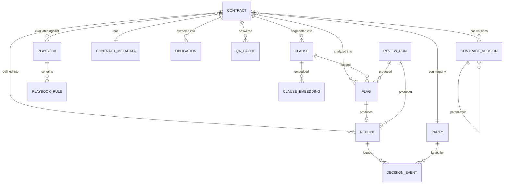

# Data Model — Precedent Backend

Single **Neon Postgres** database (with `pgvector`). This document defines every table, its columns, relationships, indexes, and the corresponding Pydantic/ORM domain models. It is the contract between services — all persistence conforms to this.

Conventions:
- Primary keys are UUIDs (`uuid` type, generated app-side or `gen_random_uuid()`).
- Timestamps are `timestamptz`, default `now()`.
- Enumerated values are Postgres enums or `text` + `CHECK` (noted per column).
- `charStart`/`charEnd` are integer character offsets into the contract's canonical text (FR-2).
- No user/tenant columns (no multi-user — Non-Goals).

## 1. Entity-relationship overview



## 2. Core ingestion tables (S1 / S7)

### `contract`
The repository record. The bytes live in object storage; this row is the metadata + pointers.

| Column | Type | Notes |
|---|---|---|
| `id` | uuid PK | |
| `title` | text | derived from metadata or filename |
| `object_key` | text | key in object storage (source of truth) |
| `source_format` | text | `pdf` \| `docx` |
| `canonical_text` | text | the single reference text for all offsets |
| `paper_origin` | text | `own` \| `counterparty` (CHECK) — set from upload context |
| `contract_type` | text | e.g. `saas_msa`, `nda`, `dpa` (nullable; from metadata/routing) |
| `counterparty_id` | uuid FK → party.id | normalized; nullable |
| `current_version_id` | uuid FK → contract_version.id | nullable |
| `status` | text | `processing` \| `analyzed` \| `redlined` \| `executed` (CHECK) |
| `created_at` / `updated_at` | timestamptz | |

Indexes: GIN on `to_tsvector('english', canonical_text)` (full-text); btree on `contract_type`, `counterparty_id`, `status`.

### `clause`
One row per segmented clause. Load-bearing for S2/S5/S7/Version Comparison (FR-3).

| Column | Type | Notes |
|---|---|---|
| `id` | uuid PK | stable across versions where possible (used for diff alignment) |
| `contract_id` | uuid FK → contract.id | |
| `ordinal` | int | order within the contract |
| `clause_type` | text | canonical type from S1 normalizer (e.g. `indemnification`) |
| `heading_text` | text | raw heading as found |
| `text` | text | clause body |
| `char_start` | int | offset into `contract.canonical_text` |
| `char_end` | int | offset |

Indexes: btree `(contract_id, ordinal)`, btree `clause_type`.

### `contract_metadata`
The ~50 extracted fields (S1, deterministic). One row per contract.

| Column | Type | Notes |
|---|---|---|
| `contract_id` | uuid PK/FK → contract.id | |
| `parties` | jsonb | list of {name, role} |
| `effective_date` / `expiry_date` | date | nullable |
| `governing_law` | text | nullable |
| `liability_cap` | jsonb | {value, currency} nullable |
| `notice_period_days` | int | nullable |
| `auto_renewal` | boolean | nullable |
| `payment_terms` | text | nullable |
| `financial_fields` | jsonb | values/fees/penalties/rates |
| `milestone_dates` | jsonb | list of dates |
| `extracted` | jsonb | catch-all for the remaining core fields |

Rationale: a few high-value fields are promoted to columns for querying/faceting; the long tail lives in `extracted` jsonb. S9 analytics reads these.

### `party`
Normalized counterparty (for NMS grouping — FR requires a stable key).

| Column | Type | Notes |
|---|---|---|
| `id` | uuid PK | |
| `normalized_name` | text UNIQUE | e.g. "acme inc" after dedupe |
| `display_name` | text | e.g. "Acme, Inc." |

### `clause_embedding` (pgvector)
Embeddings computed on write (S7) for S4 precedent retrieval. Single fixed dimension (384).

| Column | Type | Notes |
|---|---|---|
| `id` | uuid PK | |
| `clause_id` | uuid FK → clause.id | |
| `contract_id` | uuid FK → contract.id | denormalized for filtering |
| `clause_type` | text | denormalized for scoped search |
| `embedding` | vector(384) | pgvector |

Index: `USING hnsw (embedding vector_cosine_ops)` (or ivfflat) for ANN search.

## 3. Versioning tables (S7 / Version Comparison)

### `contract_version`
Every stored version with parent-child links (amendments/addenda/edits).

| Column | Type | Notes |
|---|---|---|
| `id` | uuid PK | |
| `contract_id` | uuid FK → contract.id | |
| `version_number` | int | monotonic per contract |
| `parent_version_id` | uuid FK → contract_version.id | nullable (self-referential) |
| `object_key` | text | bytes for this version |
| `canonical_text` | text | |
| `relation` | text | `version` \| `amendment` \| `addendum` (CHECK) |
| `created_at` | timestamptz | |

Index: btree `(contract_id, version_number)`.

## 4. Analysis tables (S2)

### `flag`
One row per detected issue on a clause.

| Column | Type | Notes |
|---|---|---|
| `id` | uuid PK | |
| `contract_id` | uuid FK | |
| `clause_id` | uuid FK → clause.id | nullable (missing-clause flags have no clause) |
| `review_run_id` | uuid FK → review_run.id | nullable |
| `flag_type` | text | `missing` \| `prohibited` \| `non_standard` \| `high_risk` \| `vague` \| `inconsistent` \| `deviation` (CHECK) |
| `severity` | text | `low` \| `medium` \| `high` (CHECK) — LLM- or rule-assigned |
| `source` | text | `deterministic` \| `llm` |
| `char_start` / `char_end` | int | citation offsets (nullable for structural flags) |
| `detail` | jsonb | gap description, deviation vs preferred, etc. |
| `matched_rule_id` | uuid FK → playbook_rule.id | nullable |
| `created_at` | timestamptz | |

### `risk_score`
Per-contract (and optionally per-clause) numeric risk. Severity-weighted (FR-4).

| Column | Type | Notes |
|---|---|---|
| `id` | uuid PK | |
| `contract_id` | uuid FK | |
| `clause_id` | uuid FK | nullable → contract-level when null |
| `score` | numeric | computed from weighted severity of flags |
| `max_clause_severity` | text | fed to the gate hard-stop logic |
| `weights_version` | text | which S6 weight config produced it |
| `created_at` | timestamptz | |

## 5. Redline tables (S3)

### `redline`
One row per generated redline for a flagged clause.

| Column | Type | Notes |
|---|---|---|
| `id` | uuid PK | |
| `contract_id` | uuid FK | |
| `clause_id` | uuid FK → clause.id | |
| `flag_id` | uuid FK → flag.id | nullable |
| `review_run_id` | uuid FK → review_run.id | nullable |
| `stance_mode` | text | `light` \| `balanced` \| `firm` |
| `position` | text | `preferred` \| `fallback` (toggle) |
| `replacement_text` | text | LLM-produced target text |
| `tracked_changes` | jsonb | deterministic diff output (insert/delete/modify spans w/ offsets) |
| `alternatives` | jsonb | 2–3 proposals |
| `explanation` | text | plain-language |
| `counterparty_comment` | text | negotiation comment |
| `rationale` | jsonb | deterministic: playbook position + LLM output |
| `status` | text | `proposed` \| `accepted` \| `rejected` \| `auto_applied` \| `escalated` (CHECK) |
| `created_at` | timestamptz | |

## 6. Playbook tables (S6)

### `playbook`
| Column | Type | Notes |
|---|---|---|
| `id` | uuid PK | |
| `name` | text | e.g. "SaaS MSA", "HIPAA" |
| `practice_area` | text | `hipaa` \| `gdpr` \| `saas_msa` \| `nda` \| `dpa` (CHECK) |
| `precedence` | int | for merge order when multiple apply |
| `created_at` / `updated_at` | timestamptz | |

### `playbook_rule`
Unified store keyed by clause type: preferred / acceptable / prohibited / fallback + weight.

| Column | Type | Notes |
|---|---|---|
| `id` | uuid PK | |
| `playbook_id` | uuid FK → playbook.id | |
| `clause_type` | text | join key to `clause.clause_type` |
| `preferred_language` | text | |
| `acceptable_variations` | jsonb | list |
| `prohibited_terms` | jsonb | list (seeded from templates + human, NOT mined from executed corpus) |
| `fallback_language` | text | nullable |
| `required` | boolean | drives missing-clause detection |
| `risk_weight` | numeric | severity weight for scoring (FR-4) |
| `escalation_threshold` | numeric | nullable |

Index: btree `(playbook_id, clause_type)`.

## 7. Negotiation Memory Store (NMS)

### `decision_event`
Append-only log. Patterns are a **read-time view**, not a maintained table.

| Column | Type | Notes |
|---|---|---|
| `id` | uuid PK | |
| `contract_id` | uuid FK | |
| `counterparty_id` | uuid FK → party.id | grouping key |
| `clause_type` | text | |
| `position_offered` | text | `preferred` \| `fallback_1` \| ... |
| `recommended_stance` | text | what S3 recommended |
| `outcome` | text | `pending` \| `accepted` \| `rejected` \| `countered` (CHECK; nullable until user acts) |
| `final_text` | text | the language that actually closed (nullable) |
| `created_at` | timestamptz | |

**Pattern view** (SQL view, not a table):
```sql
CREATE VIEW counterparty_pattern AS
SELECT counterparty_id, clause_type,
       count(*) FILTER (WHERE outcome='accepted')::float / NULLIF(count(*),0) AS accept_rate,
       (array_agg(final_text ORDER BY created_at DESC) FILTER (WHERE final_text IS NOT NULL))[1] AS last_closed_text
FROM decision_event
GROUP BY counterparty_id, clause_type;
```

## 8. Obligation & monitoring (S8)

### `obligation`
| Column | Type | Notes |
|---|---|---|
| `id` | uuid PK | |
| `contract_id` | uuid FK | |
| `commitment` | text | |
| `owner` | text | |
| `deadline` | date | nullable |
| `deliverable` | text | |
| `char_start` / `char_end` | int | citation |
| `status` | text | `open` \| `met` \| `overdue` (CHECK) |
| `created_at` | timestamptz | |

### `alert`
Emitted by the daily monitor / compliance checks.

| Column | Type | Notes |
|---|---|---|
| `id` | uuid PK | |
| `contract_id` | uuid FK | |
| `alert_type` | text | `deadline` \| `renewal` \| `compliance_pass` \| `compliance_fail` (CHECK) |
| `payload` | jsonb | recommendation text, issues, dates |
| `fired_at` | timestamptz | |
| `acknowledged` | boolean | default false |

## 9. Orchestration (Review Pipeline)

### `review_run`
Records one end-to-end pipeline execution.

| Column | Type | Notes |
|---|---|---|
| `id` | uuid PK | |
| `contract_id` | uuid FK | |
| `trigger` | text | `manual` \| `upload_event` (CHECK) |
| `gate_decision` | text | `auto_applied` \| `escalated` (CHECK; nullable while running) |
| `gate_reason` | jsonb | which hard-stop fired, aggregate score, max clause severity |
| `status` | text | `running` \| `completed` \| `failed` (CHECK) |
| `started_at` / `completed_at` | timestamptz | |

## 10. Document-intelligence cache (S5 / S9)

### `qa_cache`
Cached NL Q&A answers — also the source for S9 tabular ad-hoc columns.

| Column | Type | Notes |
|---|---|---|
| `id` | uuid PK | |
| `contract_id` | uuid FK | |
| `question` | text | |
| `answer` | text | |
| `citations` | jsonb | char offsets |
| `created_at` | timestamptz | |

Unique index `(contract_id, question)`.

## 11. Analytics (S9)

S9 owns **no tables** — it is deterministic SQL views/materialized views over the tables above:

- `v_contract_intelligence` — join `contract` + `contract_metadata`.
- `v_portfolio_risk` — severity-weighted roll-up over `flag` + `risk_score` (NOT a naive average; weight by `high` severity count / max).
- `v_contract_value` — sum/group `contract_metadata.financial_fields`.
- `v_tabular_review` — one row per contract, columns = promoted metadata fields, plus optional NL columns joined from `qa_cache`.
- `v_renewal_dashboard` — `contract_metadata` expiry + latest `risk_score` + latest renewal `alert` payload.

## 12. Domain (Pydantic) models

Each table has a paired Pydantic model for API I/O and internal transfer, plus the SQLAlchemy ORM class. Key non-persisted transfer objects:

- `ProcessedContract` — S1 output: `{ clauses: list[ClauseDTO], metadata: MetadataDTO, paper_origin, counterparty_id, canonical_text }`.
- `AnalysisResult` — S2 output: `{ flags: list[FlagDTO], risk: RiskDTO }`.
- `RedlineResult` — S3 output: `{ redlines: list[RedlineDTO] }`.
- `LLM structured-output schemas** — Pydantic models per LLM task (e.g. `ClauseAnalysisOut`, `RedlineOut`, `ObligationOut`, `SmartSearchFilters`), used with `messages.parse()` (Tech_Stack §4.3). These live beside their gateway task, not in the DB layer.

## 13. Migrations

- Alembic; first migration enables `vector` extension and creates `party`, `contract`, `contract_metadata`, `clause`, `contract_version`.
- Subsequent migrations add analysis, redline, playbook, NMS, obligation, review_run, qa_cache tables and the analytics views.
- Every schema change is a migration; no manual DDL. Seed data (pre-built playbook templates for NDA/DPA/SaaS MSA/HIPAA/GDPR with default prohibited terms) is loaded via a seed script, not a migration.
