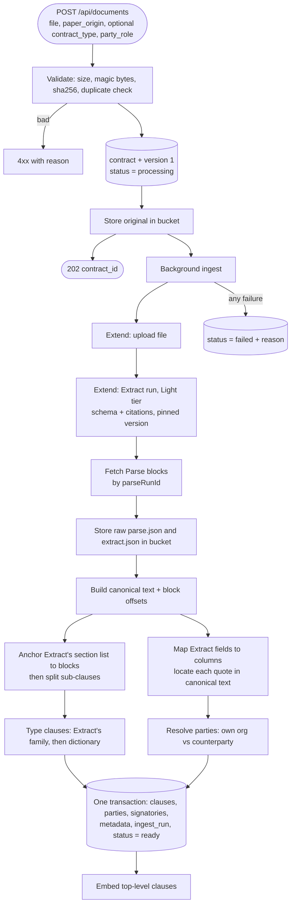
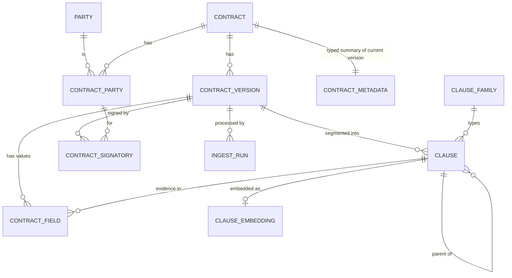

# Document processing plan

Date: 2026-11-16. Companion to `document_processing_status.md` (what exists today) and `extend_ai.md` (the API notes). This document is the plan only. Step-by-step tasks belong in a later `document_processing_implementation.md`.

Finding numbers such as "F1" refer to section 9 of `document_processing_status.md`.

## 1. Decision

**Extend AI is adopted, on the Light tier, using Parse and Extract together.** This was decided from a live test on 2026-11-16 (section 3.5), not from documentation alone.

1. **Fields come from Extract.** On the test contract, 27 of 28 fields were right on all six runs, and parties, signatories and the section list were right on every run. The one field marked wrong was the same on every run and comes from how the question was worded, not from a misread.
2. **Text comes from Parse.** It rebuilt paragraphs from PDF lines, kept the fee table, kept Word's automatic numbers and read a scanned copy as well as the original.
3. **Clauses are cut by our own code**, using both: Extract says which sections exist (number, title, family), Parse gives the text, and our code finds where each section starts. Extract's clause text is not used, so offsets stay exact. This replaces `extend_ai.md`'s "Extract only" approach.
4. **Parse's own heading tags are not trusted.** It tagged an ALL CAPS disclaimer as a section heading and tagged the running page header as a heading on later pages. Both are handled in section 5.
5. **The weak local code is deleted.** `parsers.py` (pdfplumber, python-docx) and `extraction.py` (spaCy and 34 regex extractors) go. `segmentation.py` is deleted and replaced by `sections.py`. `clause_types.py` is deleted and replaced by `clause_typing.py`. `context_capture.py`'s model call is removed.
6. **The tables are fixed in the same change** (section 7).

Limits of the test: one three-page contract that I wrote, in four forms. Long documents, messy real-world contracts and hand-signed pages were not tested. Section 6 stays as the fallback if those turn out badly.

### 1.1 Scope of this plan

Document processing is the pillar that takes an uploaded contract file and turns it into stored, structured data that every other pillar reads. The original planning docs draw the same line: versioning, the diff engine and version comparison belong to the repository pillar (S7) and the Version Comparison workflow (`Architecture.md` diagrams 9 and 13, `Implementation_Plan_Backend.md` T-032 and T-090).

| In scope | Out of scope, left for their own pillars |
|---|---|
| Upload, validation, storing the original file | Uploading later versions, amendments and addenda (S7) |
| Parsing, canonical text, clauses, clause types | Matching clauses across versions; the unused `core/diff/aligner.py` (S7) |
| Fields, parties, signatories, evidence | Diff engine and version comparison workflow |
| The tables that hold all of the above | Review pipeline, analysis, redlines, obligations, analytics logic |
| Writing clause embeddings at ingest (the planning docs put the call in S1) | Search and precedent retrieval over those embeddings (S7) |
| The read endpoints under `/api/documents` | Everything under `/api/repository` and `/api/versions` |

Versioning is not analysed or improved here. Three things are still done so that work is not blocked later, and they are the only places this plan touches it:

1. **The tables are version-ready.** Clauses and fields carry a `contract_version_id`, and clauses carry a `clause_key`. The versioning work can then be done without another schema change.
2. **The first upload is stored as version 1.** That is part of storing a contract correctly, and file-level facts (hash, size, pages) need a row to live on.
3. **One import is repointed.** `repository/service.py::store_version` imports the old `parse` function, which is being deleted. It switches to the new text-only entry point (section 5.7) and otherwise behaves exactly as it does today.

Other pillars' tables are changed only where they point at a table this pillar owns (section 7.3).

## 2. What "good enough" means

You said this is a project, documents are not complex, and decent accuracy on the main fields is fine. The plan uses these marks:

| Area | Mark |
|---|---|
| Tier 1 fields (section 4) | Right on at least 85% of the test documents, per field |
| Tier 2 fields | Right on at least 70%; a blank is acceptable, a confident wrong value is not |
| Top-level clause boundaries | At least 90% found; at most one false split per document |
| Clause typing | At least 85% of clauses whose family exists in the taxonomy |
| Failures | Corrupt, password-locked, empty and oversized files give a clear error, never a stored empty contract |

## 3. Extend AI evaluation

### 3.1 What the documentation establishes

Read from docs.extend.ai on 2026-11-16. Section 3.5 records which of these the live test confirmed or contradicted.

| Topic | What the docs say |
|---|---|
| File types | PDF, DOCX, DOC, images and more. Password-protected PDFs are supported. Word files are converted to PDF before parsing |
| Parse output | Chunks made of blocks. Block types: `text`, `heading`, `section_heading`, `table`, `figure`, `key_value`, `page_number`, `header`, `footer`, `formula`, `barcode`. Each block has markdown content, a page number, a bounding box and OCR confidence |
| Parse tiers | `parse_light` costs a quarter of `parse_performance`. Light is "not recommended" for hard form regions and complex tables |
| Extract output | `output.value` shaped like the schema. `output.metadata` keyed by field path (`parties[0].name`) with citations |
| Citations | Page, polygon and `referenceText`. **No character offsets.** Enabling them also returns `ocrConfidence` |
| Parsed text in Extract | **Not returned.** The response carries a `parseRunId` only |
| Schema | Strings, numbers, booleans, objects, arrays, enums; nesting to 5 levels. Special types: `date`, `currency`, `signature` (printed name, title, signed or not, signature date) |
| `extraction_light` | No model confidence score (`logprobsConfidence` is null). "Struggles with more complex extraction tasks". The configuration page says Light drops signature detection, figure parsing and page rotation |
| Large arrays | Options exist for long arrays. No stated maximum array length or output size |
| Determinism | Processor versions can be pinned with `baseVersion`. No statement that repeat runs give identical output |
| Cost | Light: 0.7 (extract) + 0.5 (parse) = 1.2 credits a page. Performance: 3 + 2 = 5 credits a page. About $0.0125 a credit pay-as-you-go, first 10,000 credits free. Pricing pages disagreed slightly; check before relying on it |
| Limits | 10 requests a second and 80 files a minute on pay-as-you-go. Sync endpoint has a 5-minute timeout. No file size or page limit stated |
| Data handling | Not used for training. Retention is configurable; 24-hour deletion is available on request |

### 3.2 Fit against what the product needs

| Need | Today | Extract only | Parse + Extract |
|---|---|---|---|
| Canonical text with real paragraphs | PDF: one paragraph per line | Not available | Yes, from blocks |
| Headers, footers, page numbers removed | No | Not available | Yes, tagged blocks |
| Tables in the text | Dropped (DOCX) | Values only | Yes, as markdown |
| Word automatic numbering | Lost | n/a | Yes (tested) |
| Scanned PDFs | Stored empty | Yes (OCR) | Yes (OCR) |
| Clause boundaries with exact offsets | Offsets exact, boundaries poor | **No** | Yes, with our segmenter over blocks |
| Clause type | Fuzzy heading match | Possible as an enum | Extract's enum first, dictionary as fallback |
| Parties with roles | First entity found | Yes | Yes |
| Dates, term, law, money | Regex, unreliable | Yes | Yes |
| Signatories | Not extracted | Yes; "signed or not" may need Performance tier | Same |
| Contract type | Never set | Yes, as an enum | Yes |
| Evidence for each field | None | Quote and page | Quote and page; we map the quote to offsets |

### 3.3 Why Extract alone is not enough

The schema in `extend_ai.md` asks Extract for `clauses: [{title, text}]`. Three problems:

- **No offsets.** Flags, redlines, the editor highlight, navigation, citations and version diff all address text by character offset into `canonical_text`. Extract returns values and page polygons, not offsets, and does not return the parsed text at all.
- **Clause text would be model output.** A model asked to copy 30 clauses of several hundred words each can paraphrase, trim or stop early. A redline generated against text that differs from the document by a few characters cannot be applied back. The docs give no guarantee of verbatim copy and no stated output limit.
- **Nothing left to search.** Full-text search and the editor need the whole document text, which Extract does not give.

So the answer to "can we build entirely on the API's response" is: **yes for parsing and fields, no for clauses**. Clauses must be cut by us from Parse blocks. That segmenter is small, because Parse has already done the hard part (paragraphs, headings, headers, footers, tables).

### 3.4 What can be removed

| Code | Fate |
|---|---|
| `parsers.py`, `pdfplumber`, `python-docx` dependency for parsing | Removed |
| `extraction.py`, spaCy, `en_core_web_sm`, `dateutil` fuzzy parsing | Removed. This also removes the date parser that depends on today's date (F19) |
| `segmentation.py` | Deleted. Replaced by `sections.py` over typed blocks. Font-size and bold heuristics go |
| `clause_types.py` | Deleted. Replaced by `clause_typing.py`; synonyms move to the `clause_family` table (playbook work) |
| `context_capture.py` | `classify_contract_type` model call removed; contract type comes from Extract. Validators stay if used downstream |
| `service.py` | Rewritten as an ingest orchestrator |

There is no OCR code in the project today, so nothing to remove there; Extend adds OCR we did not have. Section 11 is the full removal checklist.

### 3.5 Live test results

Run on 2026-11-16 against the real API. About 51 credits were used of the free 10,000.

**Test documents.** One synthetic Master Services Agreement with 14 sections, a fee table, a running header and footer, and a signature block, written with known answers. It includes the traps that broke the current code: body lines starting "30 days…" and "90 days…", an ALL CAPS disclaimer, a sentence starting "I.", and "arbitration shall not apply". Four forms:

| Form | What it tests |
|---|---|
| DOCX with Word heading styles | The easy case |
| DOCX with bold run-in headings, no styles | The case where today's code typed every clause `other` |
| The same, saved as PDF | PDF line wrapping |
| The same PDF turned into page images, slightly rotated and blurred | OCR; no text layer at all |

Six runs: all four forms on Light, and the PDF and the scanned PDF on Performance.

**Fields (Extract).**

| Result | Detail |
|---|---|
| 27 of 28 fields right on all six runs | Contract type, effective date, term, renewal term and notice, governing law, dispute resolution (`litigation`, not fooled by the arbitration sentence), venue, liability cap amount and basis, exclusions, total value from the table, currency, payment days, termination for convenience and which party holds it, notice days, cure period, confidentiality, warranty, SLA figures, breach notice hours, DPA, GDPR |
| Expiry date left blank on all six | Correct: the contract states no end date and the field said not to compute one |
| Parties right on all six | Both names, role labels, entity types, jurisdictions and addresses |
| Signatories right on all six | Names, titles, party, dates. `is_signed` was true for a typed "/s/" signature. A handwritten signature was not tested |
| Section list right on all six | 14 of 14 numbers, titles and families, including the run-in and scanned forms |
| One field marked wrong on all six | `assignment_allowed_without_consent` came back true; the answer file says false. The clause forbids assignment "except to a successor in a merger", so the question was ambiguous. A wording problem in our schema, fixed by asking two questions (consent required; exceptions) |

**Text (Parse).**

| Check | Result |
|---|---|
| PDF lines rebuilt into paragraphs | Yes |
| Table kept | Yes, as a markdown table. In the four-page form the table crossed a page break and came back as two tables, the second without its header row |
| Word automatic numbers kept | Yes ("1. Definitions", "2. Services"). A Word bullet came through as a stray symbol character |
| Scanned PDF | Read correctly; fields were identical to the text PDF |
| Footers and page numbers tagged | Yes, on every page |
| Running header tagged | **Only on page 1.** On later pages it came back as a `heading` or plain `text` block |
| Run-in headings ("2. Services. Supplier shall…") | **Not separate blocks.** They stay inside the paragraph, as predicted |
| ALL CAPS disclaimer paragraph | **Wrongly tagged `section_heading`** in three of the four forms |
| Signature blocks | Tagged `key_value` |
| Paragraph breaks across forms | Not identical. The PDF form merged two short paragraphs into their neighbours; the scanned and Word forms did not. Canonical text will differ slightly between a PDF and a DOCX of the same contract |
| Line-break hyphen | "third-party" split across a PDF line came back as "third- party" |

**Mechanics.**

| Check | Result |
|---|---|
| Parsed blocks retrievable from Extract's `parseRunId` | Yes, `GET /parse_runs/{id}`, no extra charge. One Extract call gives both fields and text |
| Cost | 1.2 credits a page on Light (confirmed on the bill), 5 on Performance |
| Speed | Parse 6 seconds, Extract about 19 seconds (Light) to 28 seconds (Performance) for three pages |
| Light against Performance | Same field values and same blocks on this contract. Performance cited 89 values; Light cited 27 |
| Citations | Every quote returned was found character for character in the parsed text, so evidence offsets work. On Light, top-level fields get a quote but items inside lists (party names, signatory fields) do not |
| Same file run twice | Blocks identical. Every number, date, boolean and enum identical. Three free-text values differed in wording or capitals ("New York County, New York" against "State and federal courts located in New York County, New York") |
| Versions | Extract reported `baseVersion` 3.8.0 and Parse 1.0.0; both can be pinned |
| Corrupt PDF | `FAILED`, reason `CORRUPT_FILE` |
| Corrupt DOCX | **Reported `PROCESSED`**, not failed. We must check for empty text ourselves |
| Blank page | `PROCESSED` with zero blocks. Same check |

**What this decides.**

- Light is enough. Performance bought nothing here except more citations.
- Free-text answers vary between runs, so anything we filter or group on must be an enum, a number, a date or a boolean. Free-text fields are for display.
- Extract's section list is reliable enough to drive segmentation (section 5.3) and typing (section 5.4), which is a stronger design than the heading rules first planned.
- Parse's `header` and heading tags need a guard of ours.

**Not tested, and worth a second pass against the 12 seed contracts that already exist under `backend/seed/contracts/data/halcyon/docx/`:** documents over 25 pages (Extract splits work into 25-page chunks), real-world contracts with messy formatting, handwritten signatures, two-column layouts, and sub-clause numbering such as 2.1 and 2.1.1. Run those as a regression set; they do not block starting.

The test documents, answer file, raw responses and scripts are kept in `backend/tests/fixtures/extend_eval/` so they can become the first replay fixtures.

### 3.6 Consequences of adopting it

- **The zero-LLM rule for document processing changes.** The PRD says document processing makes no model calls and gives the same output for the same input. Extend is a model behind an API. The replacement rule: *each file version is processed once, with pinned processor versions, and the raw responses are stored; nothing downstream regenerates text or offsets.* The PRD and `Architecture.md` need that edit.
- **The CI guard stays.** The Extend client lives in `core/extend/`, not `core/llm/`, so the existing check still passes. Add a second check that only the ingest module imports it.
- **Contract type stops being a conflict.** The playbook plan adds a model call inside document processing to classify contract type. That becomes one enum field in the Extract schema, so no call to our own gateway is needed there.
- **Upload becomes asynchronous.** Extend takes seconds to a minute. `POST /api/documents` returns 202 with the contract id and status `processing`; the client polls. This is an API change the frontend must follow.
- **Tests must not call the network.** Record real Parse and Extract responses once and replay them as fixtures.
- **A new required secret,** `EXTEND_API_KEY`, and a new outside dependency for every upload. If Extend is down, uploads fail with a clear, retryable status.
- **Contracts leave your infrastructure.** Fine for synthetic data. Request the 24-hour deletion setting if real contracts are ever used.

## 4. Field catalogue

Target fields, and how today's extractor does on each. "Probe" means run in the status document; "read" means judged from the regex only.

### Tier 1: must be decent

| Field | Today | Verdict on today's logic |
|---|---|---|
| Contract type | Not extracted | Missing |
| Title | Filename is used | Missing |
| Parties: name, role label in the document (e.g. "Supplier"), entity type, jurisdiction | Every PERSON and ORG in the first 50,000 characters, role always `unknown` | Broken (probe): returned `LLC`, `Customer`, `the State of Delaware` |
| Which party is us, which is the counterparty | First entity found | Broken (probe) |
| Signatories: name, title, party, signed, date | Not extracted | Missing |
| Effective date | Three keyword patterns then fuzzy date parse | Works on plain phrasing (probe); can invent dates from today's date |
| Expiry date | "expires" / "terminates" then fuzzy parse | Same risk; "terminates" matches unrelated sentences (read) |
| Initial term | One phrasing; years × 365 | Fragile (read). Stored in days, which is the wrong unit |
| Auto-renewal, renewal term, renewal notice days | Keyword anywhere; no notice field | "shall not automatically renew" reads as true (read) |
| Governing law | "governed by" pattern | Works on plain phrasing (probe) |
| Dispute resolution, venue | First keyword found anywhere | Broken (probe): "arbitration is excluded" gave `arbitration` |
| Liability cap: amount, currency, basis | Needs "liability cap of" or "liability limit shall not exceed" | Broken (probe): missed "aggregate liability shall exceed $1,000,000". Cannot express "12 months of fees" |
| Total contract value, currency | Three fixed phrases | Missed the value in a table (probe) |
| Payment terms | "net N" anywhere | Works (probe); "net 30" in another context would also match |
| Termination for convenience, termination notice days | Fixed phrases | Broken (probe): missed "upon 60 days written notice" |

### Tier 2: useful

| Field | Today | Verdict |
|---|---|---|
| Notice period, notice addresses | First "N days notice" anywhere | Unscoped; picks whichever comes first (read) |
| Indemnification cap | One phrasing | Fragile (read) |
| Liability exclusions (carve-outs) | Keyword anywhere in the document | "fraud" anywhere counts as a carve-out (read) |
| Assignment allowed | "without prior written consent" anywhere means false | That phrase appears in many unrelated clauses (read) |
| Confidentiality period | One phrasing, years only | Fragile (read) |
| IP ownership | Four fixed phrases | Fragile (read) |
| Non-compete, non-solicitation months | Number within 60 characters | Fragile (read) |
| SLA uptime, response time | "N% uptime", "respond within N hours" | Fragile (read) |
| Warranty period | One phrasing | Fragile (read) |
| DPA present, GDPR applies | Keyword present | True or blank only; never false |
| Force majeure, entire agreement, amendments in writing | Keyword present | Redundant: the clause list already says whether these clauses exist |
| Survival clauses | Split of one sentence | Fragile (read) |
| Insurance requirements, exclusivity, most-favoured-customer, change of control, audit rights | Not extracted | Missing |

Dropped from metadata: `milestone_dates` (belongs to the obligations service, which has its own table) and `financial_fields` (free-form keys nothing can read; see section 7.4).

**Why the current design cannot be patched to the mark:** every extractor searches the whole document with no link to the clause it concerns, matches one or two fixed phrasings, cannot tell a positive statement from a negated one, and records no evidence. Adding patterns raises recall on the phrasings added and nothing else.

## 5. Target pipeline (Extend path)



### 5.1 Ingest orchestration

- **Order of writes.** Contract and version rows first, with status `processing`; then the bucket; then Extend. A failure at any later step marks the row `failed` with a reason, so there are no orphaned objects and no invisible uploads (F14).
- **Background work.** FastAPI background tasks, no queue. On startup, any row left in `processing` for more than 15 minutes is marked `failed`. A `POST /api/documents/{id}/reprocess` endpoint retries.
- **Validation before anything is stored.** Size limit (25 MB), file type from the first bytes rather than the extension, filename cleaned for the storage key, SHA-256 computed. A file whose hash already exists returns 409 with the existing contract id unless `force=true` (F15, F17, F18).
- **Errors.** Extend's failure reasons map to specific 4xx reasons (`password_protected`, `unsupported_format`, `too_large`, `unreadable`). A document with fewer than 200 characters of text is `failed` with reason `no_text` (F12, F13). This check is ours: Extend reported a corrupt DOCX and a blank page as processed.

### 5.2 Canonical text

Built by us from Parse blocks in order:

- `footer` and `page_number` blocks are dropped.
- **Running headers are removed by our own rule**, because Parse only tags the first one: any block whose text equals a `header` block's text, or that repeats as the first block on most pages, is dropped whatever its tag.
- Markdown heading marks are stripped. Tables keep their markdown form; a table that directly follows another across a page break is joined to it.
- Line-break hyphens ("third- party") are closed up, and stray private-use symbol characters from Word bullets are replaced with "-".
- Blocks are joined with one blank line.

Each block's start, end, type and page are kept in memory for segmentation and written to `parse.json` in the bucket. They are not a database table.

The original commitment that a PDF and a DOCX of the same contract give identical canonical text is dropped: the test showed small differences in paragraph breaks. Each version's text is fixed once stored, which is what offsets need.

### 5.3 Segmentation

Extract returns the list of top-level sections: number, title and family. Our code finds where each one starts in canonical text.

1. **Anchor.** For each section in the list, in order, find the first block after the previous anchor that begins with that number and title ("10. Indemnification", "ARTICLE 10 - INDEMNIFICATION"), ignoring case and punctuation. It may be a heading block or the opening of a paragraph (a run-in heading). The section starts at that block.
2. **Fallback for a section that cannot be anchored.** Use the rule: a block that opens with a section number followed by a title of at most 8 words ending in a full stop or colon, or a heading block of at most 12 words. If Extract returned no section list at all, the whole document is segmented by this rule.
3. **Sub-clauses.** Inside a section, a block opening with `(a)`, `(i)`, or a number extending the section's own (`2.1` inside `2`) starts a child clause.
4. **Ends.** Text before the first section is one `preamble` clause. The signature area starts at the first `key_value` block after the last section or at an "IN WITNESS WHEREOF" line, and becomes `signature_block`. Both are new clause families.

Because sections are anchored to a known list, the things that broke the old segmenter cannot start a section: a body line starting "30 days…", "I." at the start of a sentence, an ALL CAPS paragraph (even when Parse calls it a heading), or bold text.

A count check guards the result: if fewer than 80% of Extract's sections were anchored, the contract is still stored and a warning is recorded on the ingest run.

Output per clause: section number, clean title, raw heading, level, parent, offsets, page range. Sections partition the document; a section's range covers its sub-clauses. **Analysis, rule matching and redlining work on sections**, so a rule on "Indemnification" sees the whole clause including `(a)` and `(b)` (F11).

### 5.4 Clause typing

1. The family Extract gave the section, when it is a valid `clause_family` key. In the test this was right for all 14 sections on every run, including "General" and "Data Protection and Security", which the dictionary cannot match.
2. Otherwise the dictionary: clean the title, exact synonym match, then fuzzy match at 80.
3. Otherwise `other`.
4. A compound title ("Governing Law and Disputes") keeps the primary family and records the others in `issue_keys`, a column the playbook plan already adds.
5. `type_source` records which step decided (`extract`, `dictionary`, `none`).

The Extract schema's family enum is generated from the `clause_family` table so the two cannot drift.

### 5.5 Fields and evidence

- **One field registry in code** (`document_processing/fields.py`) is the single definition of every field: key, type, tier, allowed values, the question put to Extract, and whether it is copied to a `contract_metadata` column. The Extract schema, the validators and the database writes are all generated from it. Adding a field is one registry entry and no migration (section 7.3, `contract_field`).
- Booleans are true, false or null, so "not stated" and "no" are different.
- Fields that are filtered, grouped or compared are enums, numbers, dates or booleans, because free-text answers changed wording between runs. Free text is for display only.
- For each field, `referenceText` is searched for in canonical text (exact, then whitespace-insensitive). A hit stores offsets and the clause it falls in. A miss stores the quote and page only. A field with no citation at all is stored with `confidence = low`.
- On Light, items inside lists (a party's name, a signatory's title) come without a quote. Their evidence is found by searching canonical text for the value itself.
- Sanity checks in our code: expiry after effective date; amounts positive; dates between 1990 and 2100; party names not equal to a role word ("Customer") or a place. A failed check drops the value and records a warning on the ingest run.
- **Derived values are stored as derived.** When a contract states a term but no end date, `expiry_date` is computed from the effective date and the initial term and saved with source `derived`. Without this, the renewal alerts in the obligations monitor never fire for such contracts, because they select on `expiry_date`.

### 5.6 Parties and counterparty

- A new setting, `OWN_ORG_NAMES`, lists the names the user's organisation signs under. A party matching it gets role `own`; the first remaining party is the counterparty. If nothing matches, the counterparty is left empty and a warning is recorded, rather than guessed (F4).
- Party insert uses `ON CONFLICT (normalized_name) DO NOTHING` through the existing `upsert_party`, replacing the inline select-then-insert.

### 5.7 Versions: the boundary

Document processing does two things here and stops:

- **The first upload is written as version 1**, and `contract.current_version_id` is set.
- **A text-only entry point**, `extract_canonical_text(file)`, runs Parse and section 5.2 and returns canonical text. `store_version` calls it in place of the deleted `parse`. A later version therefore keeps today's behaviour: its text is stored, its clauses are not rebuilt.

Left to the versioning pillar, with the tables already able to hold the result: running the full ingest on each new version, carrying `clause_key` from the matching clause in the previous version, and joining version comparison on `clause_key`. Until then `clause_key` is simply a fresh value per clause.

### 5.8 After ingest

- Embeddings are written for top-level clauses, skipping `preamble` and `signature_block`. This is the missing call to `embed_and_store_clauses` (F7).
- The invariants in section 7.5 are checked before the transaction commits. A violation fails the ingest rather than storing bad rows.
- Status moves to `ready`. Analysis moves it to `analyzed` as today.
- `GET /api/documents/{id}` returns the contract, its parties, signatories, fields with evidence, and any warnings. `GET /api/documents/{id}/clauses` returns the clause UUID as `id`, plus `clause_key`, `section_number`, `title`, `level` and `parent_id` (F10).

### 5.9 Module layout

| Module | Role |
|---|---|
| `core/extend/client.py` | The only code that talks to Extend: upload, run, poll, fetch parse output. Uses `httpx`, already a dependency; no SDK is added |
| `services/document_processing/ingest.py` | Orchestrator: `ingest(contract_id, version_id)` and `extract_canonical_text(file)` |
| `services/document_processing/canonical.py` | Blocks to canonical text (5.2) |
| `services/document_processing/sections.py` | Segmentation, rewritten from scratch as a new file (5.3). The old `segmentation.py` is deleted |
| `services/document_processing/clause_typing.py` | Typing (5.4). Replaces the old `clause_types.py` |
| `services/document_processing/fields.py` | Field registry and Extract schema builder (5.5) |
| `services/document_processing/mapping.py` | Extract output to rows, evidence lookup, sanity checks |
| `services/document_processing/parties.py` | Own-organisation matching and party upsert (5.6) |
| `services/document_processing/invariants.py` | The checks in 7.5 |

The orchestrator is named `ingest.py`, not `service.py`, on purpose: any import of the old module then fails loudly instead of resolving to new code with a different meaning.

## 6. Fallback: our own extraction

Not needed on the evidence so far. Kept in case the second pass on long or messy documents (end of section 3.5) fails, in whole or in part. This is a written plan only: no old code is kept in the tree for it (section 11). If it is ever needed, the removed parsers are in git history.

### 6.1 Own parsing (if Extend Parse fails)

- **PDF.** Rebuild paragraphs from line spacing (a gap larger than 1.4 × the usual line gap ends a paragraph). Drop lines that repeat at the same position on most pages (headers, footers) and bare page numbers. Sort words by line first, then left to right. Read tables with pdfplumber's table finder.
- **DOCX.** Walk the document body in order so tables are included. Rebuild automatic numbers from the numbering definitions. Treat a leading bold run that ends in a full stop as a run-in title.
- **Scanned files.** Rejected with reason `no_text`. No OCR is added.
- Sections 5.2 to 5.4 then apply unchanged, fed by our own blocks.

### 6.2 Own field extraction (if Extend Extract fails)

Regex cannot reach the marks in section 2 for parties, caps, term or disputes. The fallback is one structured call through the existing LLM gateway:

- Input is scoped: the preamble and signature block for parties, dates and signatories; the matching clause for each clause-bound field (the liability section for the cap, and so on).
- Every value must come with a verbatim quote. We find the quote in canonical text; if it is not there, the value is discarded. That check is what keeps invented values out.
- The same zero-LLM rule change in section 3.6 applies, and the call sits outside the `document_processing` package.

A regex-only repair remains possible for a handful of fields (governing law, payment terms, effective date) but would leave Tier 1 below the mark. It is not recommended.

## 7. Data model

### 7.1 Problems in the current tables

| # | Table | Problem |
|---|---|---|
| D1 | `clause` | Belongs to a contract, not a version. Clauses of version 2 have nowhere to go |
| D2 | `clause` | No stable identity across versions; the id is random per upload |
| D3 | `clause` | Flat. No parent, level, section number or clean title |
| D4 | `clause` | No unique key on (contract, ordinal); no check that `char_end > char_start`; no page |
| D5 | `flag`, `redline` | `clause_id`, `flag_id`, `review_run_id`, `matched_rule_id` are plain UUID columns with no foreign key. A deleted clause leaves dangling references |
| D6 | all children | No `ON DELETE` rule on any foreign key. A contract cannot be deleted without deleting from a dozen child tables by hand in the right order |
| D7 | `contract` | `title` is the filename. No file hash, size or page count. `updated_at` never changes |
| D8 | `contract` | `status` mixes ingest state and business state, and has no `failed` or `ready` |
| D9 | `contract` | `canonical_text` is duplicated on `contract_version`, with no rule for which is the truth |
| D10 | `contract` | `contract_type` is free text and never written |
| D11 | `contract_metadata.parties` | A JSON list of names with role `unknown`. Not linked to `party`. Only one party per contract is linked, through `counterparty_id` |
| D12 | `contract_metadata` | Money is JSON `{value, currency}`; terms are days computed as years × 365; no field records where a value came from or how sure it is |
| D13 | `contract_metadata.financial_fields` | Keys are built from the 10 characters before each amount (`ll_exceed`). The analytics view reads `total_value`, `currency`, `annual_value` and `payment_frequency`, keys that are never written, so those columns are always empty |
| D14 | `contract_metadata` | Ten typed columns and 25 fields in one JSON blob, split with no stated rule |
| D15 | `clause_embedding` | No unique key on `clause_id`, so re-embedding duplicates rows. No record of which model produced the vector |
| D16 | `party` | No way to mark our own organisation. Insert races on the unique name |
| D17 | none | No record of an ingest run: which service and version produced the data, when, and what failed |
| D18 | none | Signatories have no home |
| D19 | `contract_metadata` | Adding a field means a migration or another key in an untyped JSON blob. A downstream feature cannot ask "what is the value of field X and where does it come from" in one uniform way |
| D20 | `contract_metadata.expiry_date` | Blank whenever a contract states a term but no end date, so renewal alerts skip it |

D13 was found by reading `backend/db/views.sql` against the extractor; the view was not queried.

### 7.2 Target shape



How the pieces divide:

| Question a downstream feature asks | Where it reads |
|---|---|
| What is the text, and where is clause X? | `contract_version.canonical_text`, `clause` |
| What is the value of field X, how sure are we, and where in the text is it? | `contract_field` |
| Filter, sort or alert on a common field in SQL | `contract_metadata` |
| Who are the parties and who signed? | `contract_party`, `contract_signatory` |
| What produced this data, and did anything go wrong? | `ingest_run` |
| Show the value on the original page | Raw `parse.json` and `extract.json` in the bucket, keyed from `ingest_run` |

### 7.3 Changes by table

**`contract`**

| Change | Fixes |
|---|---|
| `title` from the document; new `original_filename` | D7 |
| `status` values become `processing`, `failed`, `ready`, `analyzed`, `redlined`, `executed`; new `status_reason` text | D8 |
| `contract_type` gains a foreign key to `agreement_type` (playbook table); new `contract_type_source` (`user`, `extracted`) | D10 |
| `updated_at` set on every update | D7 |
| `canonical_text` is kept as a copy of the current version's text, written in the same transaction that sets `current_version_id`. `contract_version` is the source of truth. The full-text index stays where it is | D9 |
| `counterparty_id` kept as a shortcut to the `contract_party` row with role `counterparty`, written in the same transaction | D11 |

`party_role` and `context` are added by the playbook work and are not repeated here.

**`contract_version`**

| Change | Fixes |
|---|---|
| Row written for the first upload | F9 |
| New `file_sha256`, `file_size_bytes`, `page_count`, `source_format`, `original_filename` | D7 |
| Unique on (`contract_id`, `version_number`); index on `file_sha256` | D7 |

No other change. `relation`, `parent_version_id` and how later versions are created stay with the versioning pillar.

**`clause`**

| Change | Fixes |
|---|---|
| New `contract_version_id` foreign key, not null. `contract_id` stays for cheap filtering | D1 |
| New `clause_key` UUID, not null, indexed on (`contract_id`, `clause_key`). A fresh value per clause for now; reserved for the versioning pillar to carry across versions | D2 |
| New `parent_id` (self reference), `level` (1 = section, 2+ = sub-clause), `section_number`, `title`; `heading_text` stays as the raw heading | D3 |
| New `page_start`, `page_end`, `type_source` (`extract`, `dictionary`, `none`), `text_sha256` | D4 |
| Unique on (`contract_version_id`, `ordinal`); checks `char_end > char_start`, `char_start >= 0`, `level >= 1` | D4 |
| `clause_type` foreign key to `clause_family` and `issue_keys` come from the playbook work | |

Reading rule for every consumer: **current version, level 1**, unless it asks otherwise. `clause_repo.get_clauses_for_contract` takes that as its default, so analysis, navigation, Q&A, obligations and the review pipeline all change in one place. The two places that query `Clause` directly (`routes/documents.py`, `drafting/frequency_tracker.py`) are moved onto the repository function.

**`contract_field`** (new): one row per extracted value. This is the source of truth for fields.

| Column | Notes |
|---|---|
| `contract_id`, `contract_version_id` | Cascade on delete |
| `field_key` | A key from the field registry, e.g. `liability_cap_amount` |
| `value` | JSON, holding the typed value: number, string, boolean, ISO date or list |
| `source` | `extract`, `derived` or `user` |
| `confidence` | `high` (quote found in the text), `low` (no quote), or null for `user` |
| `quote`, `page`, `char_start`, `char_end` | Evidence. Offsets are into the version's canonical text and null when the quote was not found |
| `clause_id` | The clause the evidence falls in; set null on clause delete |
| `ingest_run_id` | Which run produced it; null for `user` |
| `created_at` | |

Unique on (`contract_version_id`, `field_key`, `source`). The value in force is the `user` row if one exists, otherwise `extract`, otherwise `derived`. A user correction is therefore a new row, never an overwrite, and re-processing never touches it. Index on (`field_key`, `contract_id`). Fixes D12, D14, D19, D20.

**`contract_metadata`**: becomes a small typed summary of the values in force for the current version. It is written by one function from `contract_field`, in the same transaction, and by nothing else.

| Change | Fixes |
|---|---|
| New `contract_version_id`: which version it summarises | D1 |
| Columns, chosen because a filter, view or alert reads them: `effective_date`, `expiry_date`, `expiry_is_derived`, `initial_term_months`, `auto_renewal`, `renewal_term_months`, `renewal_notice_days`, `governing_law`, `dispute_resolution`, `total_value_amount`, `currency`, `liability_cap_amount`, `liability_cap_basis`, `payment_terms_days`, `termination_for_convenience`, `termination_notice_days` | D12, D14 |
| Money is a numeric amount plus the shared `currency` column. Terms are in months, not days × 365 | D12 |
| Drop `parties`, `financial_fields`, `milestone_dates`, `liability_cap` (JSON), `notice_period_days`, `payment_terms`, `extracted` | D11, D13, D14 |

A field moves into this table only when something needs to query it in SQL. Everything else is read from `contract_field`. The analytics views are rewritten to read these columns.

**`contract_party`** (new): `contract_id`, `party_id`, `role` (`own`, `counterparty`, `other`), `role_label` (the name used in the document, e.g. "Supplier"), `entity_type`, `jurisdiction`, `address`, `ordinal`. Unique on (`contract_id`, `party_id`). Replaces `contract_metadata.parties`. Fixes D11.

**`contract_signatory`** (new): `contract_version_id`, `contract_party_id` (nullable), `printed_name`, `title`, `is_signed`, `signed_date`. Fixes D18.

**`party`**: new `is_own_org` boolean, set from `OWN_ORG_NAMES`. Fixes D16.

**`clause_embedding`**: unique on `clause_id`; new `model` text; cascade on clause delete; written at ingest. Fixes D15.

**`ingest_run`** (new): `contract_version_id`, `provider`, `processor`, `processor_version`, `parse_engine_version`, external ids (file, parse run, extract run), `status`, `failure_reason`, `warnings` (JSON list: unanchored sections, dropped values, counterparty not resolved), `credits_used`, `started_at`, `finished_at`, bucket keys of the raw responses. Fixes D17 and is what makes "processed once and stored" checkable.

**Other pillars' tables, touched only where they point at `clause`:** `flag.clause_id` and `redline.clause_id` get a real foreign key to `clause.id`. Fixes the clause half of D5.

**Every child of `contract`**: `ON DELETE CASCADE`. Fixes D6.

Noted for other pillars and not done here: foreign keys for `flag_id`, `review_run_id` and `matched_rule_id`; a `contract_version_id` on `review_run`.

### 7.4 Existing rows

The plan assumes existing contracts are **re-ingested, not back-filled**: clause, metadata and embedding rows are deleted by the migration and rebuilt by uploading the files again through the new pipeline. That is safe only because the data is seed data. If any contract in the remote database matters, say so and the migration gets a back-fill step instead. No migration or loader runs against the remote database without your go-ahead.

### 7.5 What downstream code can rely on

These hold for every contract with status `ready` or later. `invariants.py` checks them at the end of each ingest, and the test suite checks them on every fixture.

1. `canonical_text[clause.char_start:clause.char_end] == clause.text` for every clause.
2. Level 1 clauses are in document order, do not overlap, and together cover the text with only whitespace between them.
3. A child clause lies inside its parent's range.
4. Every `clause_type` is a `clause_family` key. `preamble` and `signature_block` appear at most once each.
5. Every `contract_field.field_key` is in the registry and its `value` has the registered type. Enum values are from the registered set.
6. When a field has offsets, `canonical_text[char_start:char_end] == quote`.
7. `contract_metadata` equals the values in force in `contract_field` for the current version.
8. `contract.canonical_text` equals the current version's text, and `counterparty_id` equals the `contract_party` row with role `counterparty`, or both are null.
9. A version's text, clauses and `extract` fields do not change once it is `ready`.

On point 9: re-processing replaces clause rows, and flags and redlines point at clause ids. `POST /api/documents/{id}/reprocess` is therefore refused with a 409 once any flag or redline exists for the contract, unless `force=true`, which deletes that analysis first.

## 8. Fit with the playbook work

| Playbook task | Effect of this plan |
|---|---|
| Model call in document processing to classify contract type | Replaced by an Extract enum field. A user-supplied type still wins |
| `clause_family` table and removal of `_SYNONYMS` | Used as planned. This plan adds two families: `preamble`, `signature_block` |
| `clause.issue_keys` | Filled by compound-title handling in 5.4 |
| Playbook parameters that test a number in a clause (cap amount, notice days) | Can read the value and its clause from `contract_field` instead of re-reading the clause text |
| 12 synthetic contracts "with numbered headings the segmenter can detect" | Keep, and have the generator write an answer file per contract. Add run-in, PDF and scanned variants so the fixtures stop flattering the segmenter |
| Alterations to `flag`, `redline`, `contract` | This plan adds only the `clause_id` foreign keys and the `contract` columns in 7.3. Sequence the two migrations so they do not both rewrite the same table in one release |

Suggested order, so neither stream blocks the other:

1. Done: live test (section 3.5). Re-run it on the 12 seed contracts when they exist.
2. Schema migration (section 7), after the playbook taxonomy migration lands.
3. New ingest pipeline (section 5) and the 202 change, with the frontend.
4. Removal of the old code, in the same change as step 3 (section 11). The old and new pipelines never run side by side.

## 9. Testing

- **Fixtures.** The live-test documents, answer file and recorded Extend responses are already in `backend/tests/fixtures/extend_eval/` (not committed). The 12 seed contracts are added the same way.
- **Replay tests.** The ingest pipeline runs end to end against recorded responses: canonical text, clause list, types, fields and evidence are compared with the answer files. No network in CI.
- **Accuracy as a test.** The section 2 marks are asserted on the fixture set, so a change that lowers accuracy fails the build.
- **Segmenter cases.** One test per rule in 5.3, plus the four false splits found in the probe as tests that must not split.
- **Failure cases.** Corrupt file, password-locked file, empty PDF, oversized file, duplicate upload, Extend failure and Extend timeout.
- **Database tests.** One test writes a full ingest to a real schema and checks keys, cascades, the reading rule in 7.3 and every invariant in 7.5. Nothing in the suite does this today.
- **Removal guard.** A test that fails if any item on the section 11 list comes back.
- **A manual live check.** A script that runs one document against the real API, kept out of CI.

## 10. Open decisions

| # | Decision | My recommendation |
|---|---|---|
| 1 | Adopt Extend on the Light tier | Decided yes, from the live test. A permanent key is needed in `EXTEND_API_KEY`; the temporary one should be revoked |
| 2 | Accept the change to the zero-LLM rule for document processing | Yes; either path that reaches the marks needs it |
| 3 | Upload returns 202 and the client polls | Yes. The alternative is holding the request open for up to a minute |
| 4 | Re-ingest existing contracts rather than back-fill | Yes, if the remote data is all seed data |
| 5 | `OWN_ORG_NAMES` as a setting, versus asking on each upload | Setting; one organisation uses this deployment |
| 6 | User corrections to fields in this round | The table supports them (`source = user`). Build the edit screen later |
| 7 | Versioning, clause matching across versions and version comparison | Deferred to their own pillar. Tables are ready for it; behaviour is unchanged |

## 11. Removing the old code

The goal is that after the switch nothing from the old pipeline exists anywhere: no dead module, no unused dependency, no stale test, no document describing it as current.

### 11.1 Rules

1. **Removal ships in the same change as the new pipeline.** No period where both exist.
2. **No fallback switch.** No setting, flag or `try/except ImportError` that can route an upload to the old path.
3. **No compatibility shims.** No re-exported old names, no thin wrappers kept "for callers". Callers are changed.
4. **Rewritten means replaced.** Old files are deleted, not overwritten. New modules use different names (`sections.py` replaces `segmentation.py`, `clause_typing.py` replaces `clause_types.py`) so old and new can coexist during development. Old functions and types do not appear in the new files.
5. **Old columns are dropped, not left nullable.** The migration removes them and the ORM models lose the attributes.
6. **Nothing is commented out.** Git history is the archive.

### 11.2 Checklist

**Application code, under `backend/app/`**

| Item | Action |
|---|---|
| `services/document_processing/parsers.py` | Delete. Takes `parse`, `ParsedDocument`, `StructureSignal`, `_parse_pdf`, `_parse_docx` with it |
| `services/document_processing/extraction.py` | Delete. Takes `extract_metadata`, `ContractMetadataDTO`, `PartyDTO`, `_try_parse_date`, all 34 `_extract_*` functions and the spaCy loader with it |
| `services/document_processing/service.py` | Delete. Takes `process`, `ProcessedContract`, `ClauseDTO` and the inline party insert with it. Replaced by `ingest.py` |
| `services/document_processing/context_capture.py` | Delete the `classify_contract_type` function and its `core/llm` imports (the model call, prompt `contract_type_classify.md`, schema `classification.py`). The validators (`validate_contract_type`, `validate_party_role`, `validate_context`) and helpers (`derive_regimes`, `derive_deal_value_band`) stay if downstream still uses them, else delete the file entirely |
| `services/document_processing/segmentation.py` | Delete. Replaced by `sections.py`. `SegmentedClause` and the six heading schemes go |
| `services/document_processing/clause_types.py` | Delete. Replaced by `clause_typing.py` (task 2.3). `_SYNONYMS` goes (the playbook work moves it to `clause_family`) |
| `_source_format_from_filename` | Both copies go (`document_processing/service.py`, `repository/service.py`). File type comes from the validated upload |
| `services/repository/service.py` | Import of `parsers.parse` replaced by `extract_canonical_text` |
| `api/routes/documents.py` | Remove the synchronous response building, the `c0000` clause id formatting, the direct `select(Clause)` and the `ValueError` → `unsupported_format` mapping |
| `db/models/contract.py` | Remove `ContractMetadata.parties`, `financial_fields`, `milestone_dates`, `liability_cap`, `notice_period_days`, `payment_terms`, `extracted` |
| `db/views.sql` and the analytics service | Remove every read of `financial_fields->>…`; read the typed columns |
| `services/obligations/monitor.py`, `db/repositories/search_repo.py`, `contract_repo.py` | Checked against the new `contract_metadata` columns; they read `effective_date`, `expiry_date` and `auto_renewal`, which remain |

**Dependencies**

| Item | Action |
|---|---|
| `pdfplumber`, `spacy` in `backend/pyproject.toml` | Remove, then regenerate `uv.lock` |
| `python-docx` | Remove from runtime dependencies. The corpus builder (`seed/contracts/build.py`) and the fixture generator use it; move it to the `seed` and `dev` dependency groups |
| spaCy model `en_core_web_sm` | Not listed in `pyproject.toml`, `uv.lock` or CI, so it is installed by hand today. Remove it from any setup notes and from local environments |
| `rapidfuzz` | Stays; the dictionary fallback in 5.4 uses it |
| `httpx` | Stays; the Extend client uses it |

**Tests, under `backend/tests/`**

| Item | Action |
|---|---|
| `unit/test_parsers.py`, `unit/test_extraction.py` | Delete |
| `unit/test_segmentation.py`, `unit/test_document_service.py`, `unit/test_clause_types.py`, `unit/test_documents_api.py` | Delete or rewrite against the new modules. `test_clause_types.py` is deleted with the module. No mocks of the removed functions |
| `integration/test_determinism.py` | Remove the case built on `ParsedDocument` and `StructureSignal`; replace with a replay test |
| `conftest.py` | Remove the patch of `app.services.document_processing.service.get_storage` |
| `unit/test_seed_playbooks.py` | Stop importing `_SYNONYMS` |
| `unit/test_ci_guards.py` | Keep the `core/llm` guard. Add: only `core/extend/` may call the Extend API; only `document_processing/` may import `core/extend` |

**Configuration and CI**

| Item | Action |
|---|---|
| `core/config.py`, `.env.example` | Add `EXTEND_API_KEY` and `OWN_ORG_NAMES` |
| `.github/workflows/ci.yml` | Keep the existing guard step; add the Extend guard |

**Frontend**

| Item | Action |
|---|---|
| `lib/api/types.ts` | `ContractMetadata` loses `parties[].role` as `unknown`, `liability_cap`, `financial_fields`, `milestone_dates`, `extracted`; `ProcessedContract` goes; `Clause` matches the new clause shape |
| `lib/api/hooks.ts` | Both upload calls (two call sites) handle the 202 and poll |
| `components/workspace/tabs/overview-tab.tsx`, `components/primitives/hover-card.tsx`, `components/intake/new-contract-slide-over.tsx` | Updated to the new shapes; no reads of removed keys |

**Documents**

| Item | Action |
|---|---|
| `development_docs/PRD.md` (FR-8, SC-1), `Architecture.md` (diagram 2), `Tech_Stack.md`, `Backend_Structure.md`, `Implementation_Plan_Backend.md` | Rewrite the document processing parts: Extend replaces pdfplumber, python-docx and spaCy; the zero-LLM rule becomes "processed once, pinned, stored" |
| `backend/README.md` | Lines describing S1 as parse, segment, extract and as LLM-free |
| `extend_ai.md` | Mark the "Extract only" decision as replaced by this plan, or fold it into this plan and delete it |
| `document_processing_status.md` | Add a line at the top saying it describes the code before this change |
| `playbook_implementation.md` | Update the tasks that edit `clause_types.py` or add the contract-type model call |

### 11.3 Proof that nothing is left

Run from `backend/` after the change. Each search must print nothing.

```bash
grep -rnE "pdfplumber|spacy|en_core_web|dateutil" app tests scripts seed pyproject.toml
```

```bash
grep -rnE "ParsedDocument|StructureSignal|SegmentedClause|ContractMetadataDTO|PartyDTO|ProcessedContract|extract_metadata|_try_parse_date|_source_format_from_filename|_SYNONYMS|normalize_clause_type|classify_contract_type|contract_type_classify" app tests scripts seed
```

```bash
grep -rnE "document_processing\.(parsers|extraction|service|segmentation|clause_types)" app tests scripts seed
```

```bash
grep -rnE "financial_fields|milestone_dates|notice_period_days" app db tests ../frontend/lib ../frontend/components ../frontend/app
```

Then:

- The five deleted files (`parsers.py`, `extraction.py`, `service.py`, `segmentation.py`, `clause_types.py`) do not exist. (`context_capture.py` stays with the model call removed.)
- `uv sync` followed by the full test suite passes with `pdfplumber` and `spacy` absent from the environment.
- The removal guard test (section 9) encodes the searches above, so a later change that brings any of it back fails CI.
- A fresh upload of a fixture contract reaches `ready` and passes every invariant in 7.5.

