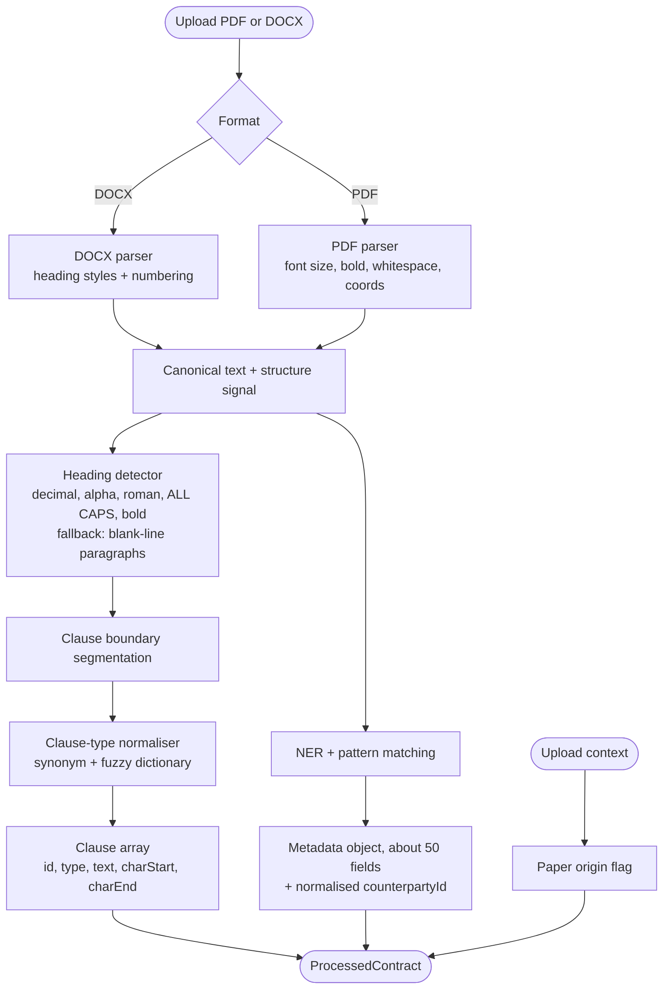
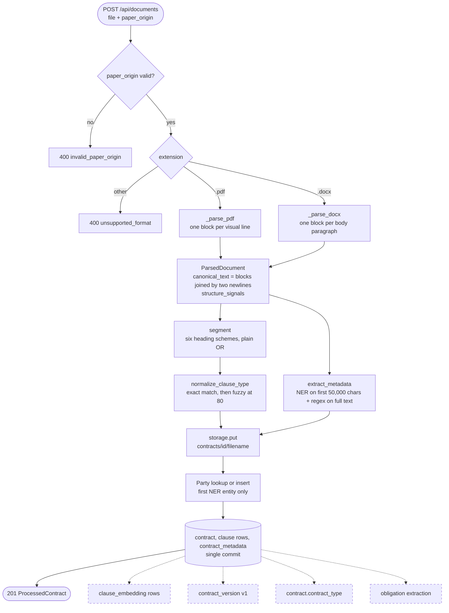
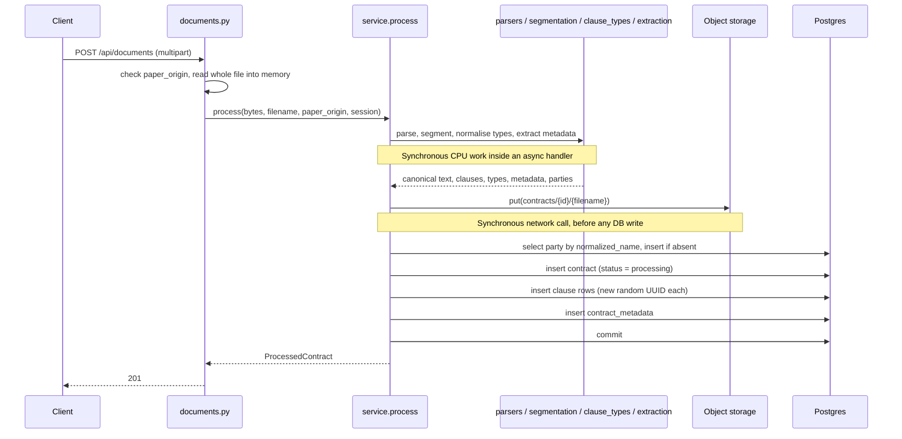
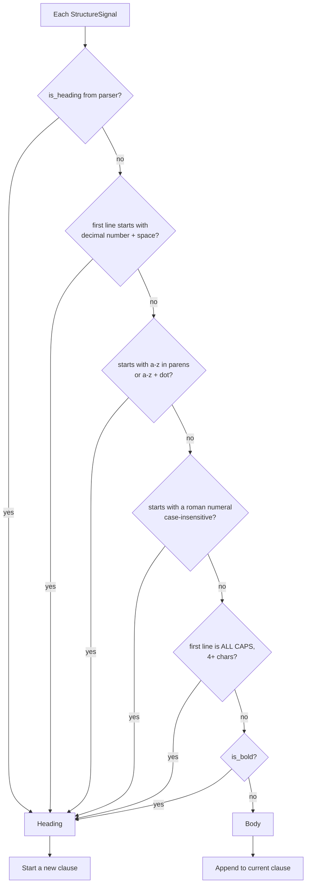
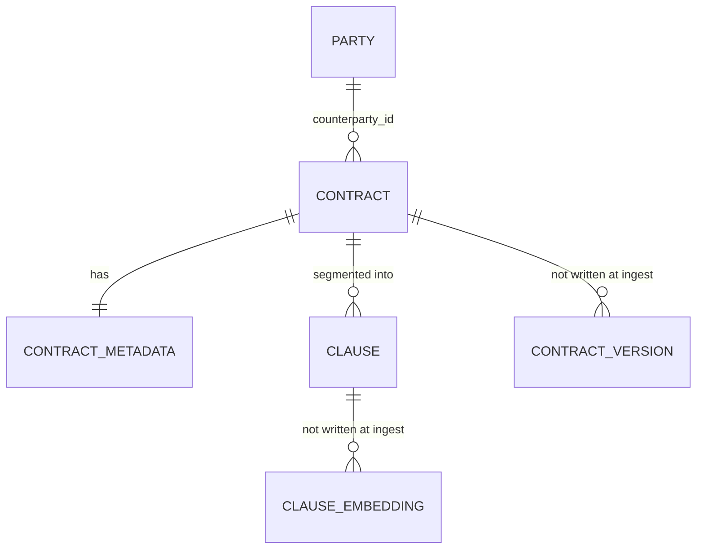
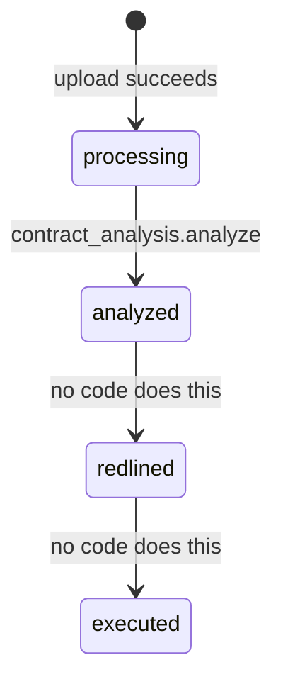

# Document processing status

**This document describes the code as it was before the change in `document_processing_plan.md` and `document_processing_implementation.md`.** The pipeline it describes (local `pdfplumber`/`python-docx` parsing, spaCy NER, 34 regex extractors, zero LLM calls) has since been replaced by an Extend-AI-based pipeline; see those two documents and `document_processing_verification.md` for the current design and its live-test results. Kept here as the historical record the plan was written against.

Date: 2026-11-16. Scope: backend document processing (S1) in `backend/app/services/document_processing/`, its route `backend/app/api/routes/documents.py`, the tables it writes, the code that consumes its output, and the planning docs in `development_docs/`.

## Summary

- **The pipeline exists end to end and is deterministic in structure.** Upload → parse → segment → type → extract → store → persist runs in one request with no LLM call. Character offsets are exact by construction.
- **It works on cleanly styled documents and breaks on typical ones.** A DOCX using Word heading styles segmented and typed correctly. A DOCX with bold run-in headings ("2. Indemnification. Supplier shall…") produced 9 clauses, all typed `other`.
- **Mis-typed clauses become false review findings.** Layer 1 compares clause types against the playbook's required list, so a contract whose headings are not recognised is reported as missing those clauses, and a missing clause is a gate hard-stop.
- **Three things the plan says happen at ingest do not happen.** Clause embeddings are never written (`embed_and_store_clauses` has no caller), `contract_type` is never set, and no version 1 row is created.
- **Metadata extraction is unreliable.** On a sample contract it returned five "parties" including `LLC`, `Customer` and `the State of Delaware`, missed the liability cap and termination notice, and reported arbitration for a clause that excludes it.
- **One extractor is not deterministic.** The date parser fills missing parts from today's date, so `"March"` parses to a different date depending on when the upload runs.
- **The tests do not exercise a real document.** 131 tests pass, but the PDF parser is tested against a mocked `pdfplumber`, the service test mocks every stage, and `tests/fixtures/` is empty.

What was and was not verified:

| Claim | How it was checked |
|---|---|
| S1 and related tests pass | Ran 10 test files (parsers, segmentation, clause types, extraction, service, documents API, determinism, versioning, version comparison, vector): 131 passed |
| Segmentation, typing and extraction behaviour on sample documents | Ran `parse` → `segment` → `normalize_clause_type` → `extract_metadata` on three DOCX files and three hand-built PDFs. No database, no storage. Results in section 8 |
| Date parser depends on the current date | Called `_try_parse_date` directly; output in section 8 |
| Embeddings, `contract_type` and version 1 are never written at ingest | Searched `backend/app` for every writer; none found. Not checked against the database |
| Corrupt or scanned files are handled badly | Parser behaviour was run. The HTTP status the API returns was read from the route code, not requested |
| Frontend expects a different clause shape | Read `frontend/lib/api/types.ts` and the route; not run in a browser |
| Concurrent session use in the review pipeline | From reading the code only |

## 1. What was planned

Sources: `Architecture.md` diagram 2, `Implementation_Plan_Backend.md` tasks T-020 to T-025, `Data_Model.md` section 2, `API_Spec.md` section S1, `Tech_Stack.md` section 6, `PRD.md` SC-1.

The plan's stated commitments for S1:

| # | Commitment | Source |
|---|---|---|
| 1 | Zero LLM calls; same input gives same output | PRD FR-8, SC-1 |
| 2 | PDF and DOCX yield the same canonical text for the same logical document | T-020 acceptance |
| 3 | Offsets are into canonical text and are never regenerated downstream | PRD FR-2 |
| 4 | Clause type is the join key for analysis, navigation, redline history and diff alignment | PRD FR-3 |
| 5 | Clause ids are stable across versions, for diff alignment | Data_Model `clause.id` |
| 6 | About 50 metadata fields | Architecture diagram 2 |
| 7 | Normalised counterparty with dedupe | T-023 |
| 8 | Embeddings are computed at ingest (code in S7, called from S1) | T-031 |
| 9 | Obligations are extracted once at ingest | PRD 3.8 |
| 10 | `contract_type` comes from upload context or S1 metadata | Architecture diagram 7 |
| 11 | The review pipeline runs S1 and the playbook fetch concurrently from an upload | Architecture diagram 11 |
| 12 | Local filesystem storage is available for development | T-010 |

## 2. What is built

### 2.1 Components

| File | Lines | Public entry point | Role |
|---|---|---|---|
| `services/document_processing/parsers.py` | 229 | `parse(file_bytes, source_format) -> ParsedDocument` | PDF and DOCX to canonical text plus one `StructureSignal` per block |
| `services/document_processing/segmentation.py` | 178 | `segment(doc) -> list[SegmentedClause]` | Classifies each block as heading or body and groups them |
| `services/document_processing/clause_types.py` | 182 | `normalize_clause_type(heading_text) -> str` | Heading text to one of 20 canonical types or `other` |
| `services/document_processing/extraction.py` | 622 | `extract_metadata(text) -> (ContractMetadataDTO, list[PartyDTO])` | spaCy NER for parties, 34 regex extractors for fields |
| `services/document_processing/service.py` | 229 | `process(file_bytes, filename, paper_origin, session) -> ProcessedContract` | Orchestrates the stages, stores bytes, writes rows |
| `api/routes/documents.py` | 197 | 4 endpoints | Upload and three reads |
| `core/storage.py` | 204 | `get_storage(settings).put/get/presign` | S3-compatible bucket only |
| `db/models/contract.py`, `clause.py` | 119, 53 | ORM | `party`, `contract`, `contract_metadata`, `contract_version`, `clause`, `clause_embedding` |

All paths are under `backend/app/`.

### 2.2 Architecture as built

Dashed nodes are planned steps that no code performs at ingest.

### 2.3 Request sequence

Only `ValueError` is caught in the route (`documents.py:101`), and it is always reported as `unsupported_format`. Any other exception goes to the generic handler.

## 3. Stage logic

### 3.1 Parsing

Both parsers produce the same shape: a list of text blocks joined with `"\n\n"`, and one `StructureSignal` per block carrying `char_start`, `char_end`, `is_bold`, `font_size`, `is_heading`, `heading_level` and `raw_text`.

| | PDF (`_parse_pdf`) | DOCX (`_parse_docx`) |
|---|---|---|
| Library | `pdfplumber.extract_words` with size and font name | `python-docx`, `doc.paragraphs` |
| Block unit | One visual line: words whose `top` is within 2pt | One non-empty body paragraph |
| Bold | Font name contains `Bold`, `bold`, `-B` or `BD` on any word in the line | Any run in the paragraph has `bold` set |
| `is_heading` | Line's largest font size ≥ 1.2 × document median | Style name is `Heading N` |
| `heading_level` | Always `None` | `N` from the style name |
| Not read | Tables as tables, columns, headers, footers, page numbers are all treated as ordinary lines | Tables, headers, footers, footnotes, text boxes, automatic list numbers |

Consequences that follow from this design:

- **PDF and DOCX do not produce the same canonical text** for the same document. A PDF paragraph wrapped over three lines becomes three blocks separated by blank lines; the DOCX paragraph is one block. This is commitment 2 in section 1.
- **PDF paragraphs are lost.** Every line break in the PDF becomes a paragraph break in canonical text. That text is what full-text search indexes, what the editor displays and what the LLM stages receive.
- **PDF words are sorted by `(top, x0)` before lines are grouped** (`parsers.py:81`). Two words on one line whose `top` differs by a fraction of a point, as happens with mixed font sizes, sort by height first, which can put them in the wrong order. This is from reading the code; the sample PDFs used one size per line and did not trigger it.
- **DOCX automatic numbering is not in `paragraph.text`**, so a numbered list paragraph arrives without its number and cannot match the decimal scheme.
- A PDF with no text layer returns an empty document rather than an error.

### 3.2 Segmentation

Rules, from `segmentation.py`:

- The six schemes are a plain OR. The output does not record which one fired.
- If no block matches any scheme, each block becomes its own clause with `heading_text = None`.
- Otherwise each heading starts a clause that runs until the next heading. Blocks before the first heading form one clause with no heading.
- `heading_text` is the **entire block** that matched, not just the title. For a run-in heading it is the whole paragraph.
- `text` is `canonical_text[char_start:char_end]`, heading included. This is why the offset invariant always holds.
- Output is flat. A sub-clause such as `(a)` is a top-level clause, not a child of its section.
- `clause_id` is `c0000`, `c0001`, … by position.

What the schemes over-match, each confirmed in section 8:

| Scheme | Also matches |
|---|---|
| Decimal | Any body line that starts with a number and a space, e.g. "30 days of the event…" |
| Roman | Any line starting with `I`, `V` or `X` and a space, e.g. "I acknowledge that…" |
| ALL CAPS | Capitalised disclaimer paragraphs, e.g. "IN NO EVENT SHALL EITHER PARTY…" |
| Bold | Any paragraph with one bold run, e.g. a bolded defined term |

### 3.3 Clause typing

`normalize_clause_type` lower-cases and strips the heading, looks for an exact key in the `_SYNONYMS` dictionary, then falls back to `rapidfuzz` `token_sort_ratio` with a cutoff of 80, then returns `other`.

- Taxonomy: 20 canonical types plus `other`.
- The input is the whole `heading_text`, so numbering, "Article"/"Section" prefixes and run-in body text are all part of what is matched.
- Short numeric prefixes survive the fuzzy match ("1. Indemnification" → `indemnification`). Longer prefixes and compound headings do not.
- Clauses with no heading are always `other`.

### 3.4 Metadata extraction

`extract_metadata` runs every extractor over the full canonical text. No extractor is scoped to the clause it concerns, and no field records where in the text it came from.

| Group | Fields | Method |
|---|---|---|
| Parties | `parties` | spaCy `en_core_web_sm`, every PERSON and ORG entity in the first 50,000 characters, deduplicated on a lower-cased, punctuation-stripped name. Role is always `"unknown"` |
| Dates | `effective_date`, `expiry_date`, `milestone_dates` | Keyword regex, then `dateutil` fuzzy parse of whatever follows |
| Term | `initial_term_days`, `renewal_term_days`, `warranty_period_days` | Regex; years × 365, months × 30 |
| Law and disputes | `governing_law`, `dispute_resolution`, `arbitration_venue` | Regex; dispute resolution is the first of arbitration, mediation, litigation whose keyword appears anywhere |
| Money | `liability_cap`, `indemnification_cap`, `total_contract_value`, `currency`, `payment_terms`, `financial_fields` | Regex on fixed phrasings. `financial_fields` keys are built from the 10 characters before each dollar amount |
| Notice and termination | `notice_period_days`, `notice_address`, `termination_notice_days`, `termination_for_convenience`, `auto_renewal` | Regex |
| Restrictions and SLA | `assignment_allowed`, `non_compete_months`, `non_solicitation_months`, `sla_uptime_percent`, `sla_response_time_hours`, `confidentiality_period_years`, `ip_ownership` | Regex |
| Presence flags | `data_processing_agreement`, `gdpr_applicable`, `force_majeure`, `entire_agreement`, `amendments_require_writing` | Keyword present → `True`, otherwise `None` |
| Lists | `limitation_of_liability_exclusions`, `survival_clauses` | Keyword list; split of the sentence after "survive termination" |

The DTO has 36 fields including the empty `extracted` catch-all. The plan says about 50.

Presence flags and most booleans can only be `True` or `None`. Only `assignment_allowed` can be `False`.

### 3.5 Counterparty

`service.py:113-130` takes `parties[0]`, the first PERSON or ORG entity spaCy finds in the document, and uses it as the counterparty. There is no notion of the user's own organisation, so when the user's company is named first, it is stored as the counterparty. The lookup is a select followed by an insert, with no handling for two uploads inserting the same name at once.

### 3.6 Persistence

| Table | Column | Value at ingest |
|---|---|---|
| `contract` | `id` | New UUID |
| | `title` | The uploaded filename |
| | `object_key` | `contracts/{id}/{filename}` |
| | `source_format` | `pdf` or `docx`, from the extension only |
| | `canonical_text` | Parser output |
| | `paper_origin` | From the form field |
| | `counterparty_id` | First NER entity, or null |
| | `status` | `processing` |
| | `contract_type` | **Never written** |
| | `current_version_id` | **Null** until a later version is uploaded |
| | `updated_at` | Set once; no code or trigger updates it |
| `clause` | `id` | New random UUID per upload |
| | `ordinal`, `clause_type`, `heading_text`, `text`, `char_start`, `char_end` | From segmentation and typing |
| `contract_metadata` | 10 promoted columns | From the DTO |
| | `extracted` | The other 25 fields as one JSON object |
| `clause_embedding` | all | **Never written** |
| `contract_version` | all | **Not written at ingest** |

Contract status over its life:

A fully processed contract stays `processing` until analysis runs. Nothing sets `redlined` or `executed`.

## 4. API surface

| Method | Path | Returns | Notes |
|---|---|---|---|
| `POST` | `/api/documents` | `ProcessedContract`: `contract_id`, `canonical_text`, `paper_origin`, `counterparty_id`, `clauses[]`, `metadata` | 201. Matches the spec |
| `GET` | `/api/documents/{id}` | Contract fields, `canonical_text`, `metadata` | Omits `contract_type` and `current_version_id` |
| `GET` | `/api/documents/{id}/clauses` | Clause list ordered by ordinal | `clause_id` is `c0000`-style, rebuilt from the ordinal |
| `GET` | `/api/documents/{id}/text` | `canonical_text` | |

**The clause UUID is never returned by these endpoints.** Both the upload response and the clause list expose `clause_id` as `c0000`. Flags, redlines, navigation and Q&A citations all identify clauses by the database UUID. A client holding the clause list cannot match a flag to a clause by id. `frontend/lib/api/types.ts:93` declares `Clause.id`, a field the backend does not send.

## 5. Who consumes S1 output

| Consumer | Reads | Depends on |
|---|---|---|
| Layer 1 structural analysis | `clause.clause_type` for every clause | Typing being right; a mis-typed clause reads as a missing required clause |
| Rule matcher, Layer 2 | `clause.clause_type`, `clause.text`, `clause.char_start` | Typing to attach a rule; segmentation for sensible clause bodies |
| Redline generation and render | `clause.text`, flag offsets | Segmentation; the non-interference check uses offsets |
| Navigation index | `clause_type`, `heading_text`, offsets | Typing; with poor typing most of the index is `other` |
| Q&A | Whole clause array | Segmentation |
| Obligations | Clause offsets for citations, metadata for grounding | Extraction quality |
| Analytics views | `contract_metadata` columns, `financial_fields` | Extraction quality |
| Repository search and facets | `canonical_text` (full text), `contract_type`, `counterparty_id`, `effective_date` | `contract_type` facet is always empty |
| Precedent search, smart search semantic leg, precedent drafting | `clause_embedding` | Always empty |
| Negotiation memory | `counterparty_id` | The first-entity rule in 3.5 |
| Playbook routing | `contract.contract_type` | Always empty; already recorded in `playbook_status.md` |
| Version comparison | Original `clause` offsets, `contract_version.canonical_text` | See section 6 |

## 6. Related flows that touch document processing

**Versions.** `repository/service.py::store_version` parses the new file for its canonical text and stores the bytes. It does not segment, type or extract. The contract's clauses, metadata and `canonical_text` stay as they were for the first upload.

**Version comparison.** `workflows/version_comparison.py` diffs the two versions' full text and assigns each change to a clause using the original upload's clause offsets. Those offsets describe version A only if version A's text equals the original upload. The original upload is not itself a version, so it cannot be compared with the first uploaded version. `core/diff/aligner.py`, the clause-id aligner the plan describes, is not called from anywhere in `app/`.

**Review pipeline.** `POST /api/review/run` and `/webhook` take a `contract_id`. Neither accepts a file and neither calls S1; the contract must already be processed. The step that runs concurrently is the playbook resolve and the clause load (`review_pipeline.py:39`), both on the same `AsyncSession`. SQLAlchemy does not support concurrent use of one async session, so this may fail against a real database. That is from reading the code and has not been run.

**Storage.** `core/storage.py` has one backend, the S3-compatible bucket. The planned local filesystem option is gone; this is a deliberate uncommitted change in the working tree. Upload cannot work without bucket credentials.

## 7. Plan against build

| # | Planned | Built | Status |
|---|---|---|---|
| 1 | Zero LLM; deterministic | No LLM import in the package; a CI step enforces it. The date fallback depends on the current date | Mostly met |
| 2 | Same canonical text from PDF and DOCX | PDF is per line, DOCX is per paragraph | Not met |
| 3 | Offsets into canonical text, carried unchanged | Clause text is sliced from canonical text; downstream reads the stored offsets | Met |
| 4 | Clause type as join key | Used everywhere as planned; accuracy is the problem | Met in structure |
| 5 | Clause ids stable across versions | New random UUID per upload; later versions are not segmented | Not met |
| 6 | About 50 metadata fields | 36 | Partly met |
| 7 | Normalised counterparty with dedupe | Punctuation and case only; first NER entity is taken as the counterparty | Partly met |
| 8 | Embeddings written at ingest | Function exists, never called | Not met |
| 9 | Obligations extracted at ingest | Separate endpoint, not triggered by upload | Not met |
| 10 | `contract_type` from upload or metadata | Never written | Not met; scheduled in the playbook work |
| 11 | Pipeline runs S1 concurrently from an upload | Pipeline starts from an existing contract | Not met |
| 12 | Local filesystem storage for development | Bucket only | Changed on purpose |
| 13 | DOCX parser uses heading styles and numbering | Heading styles only | Partly met |
| 14 | PDF parser uses font size, bold, whitespace and coordinates | Font size and bold; coordinates only to group lines | Partly met |
| 15 | Four S1 endpoints | All four exist | Met |
| 16 | `Backend_Structure.md` lists `api/deps.py` and `schemas/contract.py`, `schemas/clause.py` | Not present; each route defines its own session dependency and response models | Differs |

## 8. Probe results

The probe script is at `/private/tmp/claude-501/-Users-athish--claude-spares-spare-wmcAXT/fc58efd6-8a37-480d-ab12-49e34db3ba25/scratchpad/probe.py`. It builds documents in memory and calls the S1 functions directly. It is in a temporary folder and may not survive a reboot.

**A. DOCX with Word heading styles.** 8 blocks → 4 clauses. `Indemnification`, `Limitation of Liability` and `Governing Law` were typed correctly. The title and preamble merged into one headingless `other` clause, because the `Title` style is not `Heading N`.

**B. DOCX with no heading styles, bold run-in headings.** 12 blocks → 9 clauses, **all typed `other`**.

| Clause | Why it was split | `heading_text` |
|---|---|---|
| c0001 | Decimal + bold | "1. Definitions. In this Agreement the following terms have…" |
| c0002 | Bold defined term | "\"Confidential Information\" means all non-public information…" |
| c0003 | Decimal + bold | "2. Indemnification. Supplier shall indemnify Customer against…" |
| c0004, c0005 | Alpha | "(a) Supplier shall defend…", "(b) Customer shall give…" |
| c0006 | Decimal false positive | "30 days after receipt of notice Supplier shall assume…" |
| c0007 | Roman false positive | "I acknowledge that the above is accurate." |
| c0008 | Decimal + bold | "3. Limitation of Liability. Neither party's aggregate…" |

The table cell "$250,000" was absent from canonical text. The two automatically numbered list paragraphs had no numbers and were absorbed into c0007.

**C. PDF with bold headings and wrapped body lines.** 12 lines → 5 clauses. The two real headings were found and typed. A wrapped line starting "30 days of the event…" became its own clause, cutting the indemnification clause in two. "IN NO EVENT SHALL EITHER PARTY BE LIABLE…" became its own clause, cutting the limitation of liability clause in two. The page footer was absorbed into the last clause.

**D. PDF with no text.** 0 blocks, 0 clauses, empty canonical text, no error. From the route code, this would be stored and returned as a 201.

**E. Corrupt files.** `parse` raises `PdfminerException` for a bad PDF and `zipfile.BadZipFile` for a bad DOCX. Neither is a `ValueError`, so from the route code both would surface as a generic server error rather than a 400.

**F. Heading typing.**

| Heading | Result |
|---|---|
| "Indemnification", "1. Indemnification", "12.3 Limitation of Liability" | Correct |
| "Term and Termination", "Fees", "Insurance", "Notice", "Intellectual Property Rights; License" | Correct |
| "ARTICLE 7 - INDEMNIFICATION" | `other` |
| "Section 9. Confidentiality" | `other` |
| "7. Indemnification. Supplier shall indemnify Customer against all claims." | `other` |
| "Limitation of Liability and Disclaimer of Warranties" | `other` |
| "Payment Terms and Taxes" | `other` |
| "Data Security", "Service Levels", "Non-Solicitation", "Publicity" | `other`; no such type exists yet |

**G. Extraction** on document B plus five added sentences:

| Field | Text | Result |
|---|---|---|
| `parties` | "between Acme, Inc. and Beta LLC" | `Acme, Inc.`, `LLC`, `Customer`, `Supplier`, `the State of Delaware` |
| Counterparty stored | | `Acme, Inc.`, because it came first |
| `effective_date` | "entered into as of January 5, 2025" | Correct |
| `expiry_date` | "The Term expires on December 31, 2027." | Correct |
| `governing_law` | "governed by the laws of the State of Delaware" | Correct |
| `payment_terms` | "Fees are payable net 30." | Correct |
| `liability_cap` | "aggregate liability shall exceed $1,000,000" | Missed |
| `termination_notice_days` | "terminate this Agreement upon 60 days written notice" | Missed |
| `total_contract_value` | "$250,000" in a table | Missed; tables are not parsed |
| `dispute_resolution` | "settled by the courts of Delaware; arbitration is excluded" | `arbitration` |
| `assignment_allowed` | "may not assign … without prior written consent" | `False`, correct |
| `financial_fields` | | `{"ll_exceed": "$1,000,000"}` |

**H. Date parser**, run on 2026-11-16:

| Input | Output |
|---|---|
| "January 5, 2025" | 2025-01-05 |
| "March" | 2026-03-16 |
| "the 5th" | 2026-11-05 |
| "10 business days" | 2026-11-10 |
| "the date of last signature below" | None |

The last three non-null rows are invented from today's date. Any text after "dated", "expires", "terminates", "milestone" or "deadline" that contains a stray number or month name can produce one.

## 9. Robustness findings

Ordered by effect on the rest of the product.

### Wrong output that reaches users

1. **Run-in and prefixed headings are typed `other`.** `heading_text` is the whole block, and the matcher has no step to strip numbering, "Article N" or "Section N", or to cut at the first full stop. This is the most common heading style in commercial contracts. Probe B and F.
2. **Body lines are promoted to headings.** The decimal, roman, ALL CAPS and bold schemes each over-match, splitting real clauses into pieces. Probe B and C.
3. **PDF lines become paragraphs.** Canonical text from a PDF has a blank line after every visual line, and headers, footers and page numbers are mixed into clause bodies.
4. **The counterparty can be the user's own company**, or a non-party such as a state name. This is the grouping key for negotiation memory.
5. **Extraction returns confident wrong values.** Keyword-anywhere logic (dispute resolution), fixed phrasings (liability cap, termination notice) and unscoped search across the whole document. Nothing marks a field as uncertain.
6. **DOCX tables are dropped**, so fee schedules, SLA tables and signature blocks are not in canonical text at all.

### Planned behaviour that is missing

7. **No embeddings at ingest.** Precedent search, the semantic leg of smart search and precedent drafting have nothing to search.
8. **`contract_type` is never set.** Scheduled as a playbook task (see section 11).
9. **No version 1, and later versions are not segmented.** Version comparison is only meaningful between two uploaded versions that happen to share the original's clause layout.
10. **Clause UUIDs are not exposed** by the documents endpoints, and the frontend type expects a field the backend does not send.
11. **Sub-clauses are flat.** There is no parent, level or section number on a clause, so a rule that applies to "Indemnification" sees only the text up to the first `(a)`.

### Failure handling

12. **Scanned or empty PDFs are accepted** and stored with no text and no clauses.
13. **Corrupt files return a server error**, not a 400.
14. **The file is stored before the database commit**, with no cleanup. A failed insert leaves an orphaned object.
15. **No upload size limit**, and the content type is taken from the filename extension alone.
16. **Parsing, NER and the bucket upload are synchronous** inside an async handler, so one large upload blocks every other request on that worker.
17. **A filename containing `..`** is rejected by the storage key check with a `ValueError`, which the route reports as `unsupported_format`.
18. **No duplicate detection.** Uploading the same file twice creates two contracts.

### Determinism and consistency

19. **The date fallback uses today's date.** Probe H. This breaks the determinism claim for metadata.
20. **NER reads only the first 50,000 characters**; parties named later are not found.
21. **Status stays `processing`** after successful processing, and `updated_at` never changes.
22. **`_source_format_from_filename` is duplicated** in `document_processing/service.py` and `repository/service.py`.
23. **`contract_repo.upsert_party` exists but `process` reimplements it inline.**

## 10. Tests

| File | Tests what | Uses a real document |
|---|---|---|
| `test_parsers.py` | DOCX parsing; PDF parsing against a mocked `pdfplumber` | DOCX built in memory; PDF no |
| `test_segmentation.py` | Heading schemes and grouping on hand-built signals | No |
| `test_clause_types.py` | Synonym and fuzzy mapping | n/a |
| `test_extraction.py` | Individual extractors on short strings | No |
| `test_document_service.py` | Orchestration with parse, segment, extract, storage and session all mocked | No |
| `test_documents_api.py` | Route validation with `process` mocked | No |
| `integration/test_determinism.py` | One segmentation determinism case | No |

Gaps: no real PDF is parsed anywhere in the suite; no test runs the stages together on one document; no test writes to a database; `tests/fixtures/` holds only `.gitkeep`; there is no test for a scanned PDF, a corrupt file, a table, a run-in heading or a multi-page document; there is no accuracy measure for segmentation, typing or extraction.

## 11. Overlap with the playbook work in progress

`playbook_implementation.md` already schedules three changes inside document processing:

| Planned change | Effect on S1 |
|---|---|
| Optional `contract_type`, `party_role` and `context` form fields on `POST /api/documents`, with one model call to classify the type when it is not supplied | Closes finding 8. **It also adds an LLM call to document processing**, which contradicts the zero-LLM commitment in the PRD and will fail the CI step that forbids `core/llm` imports in this package unless the call is placed outside it |
| Clause families move to a `clause_family` table with 29 families (8 new: `service_levels`, `security`, `subprocessors`, `breach_notification`, `data_transfers`, `publicity`, `non_solicitation`, `suspension`); `_SYNONYMS` is deleted and loaded from the table | Adds the missing types from probe F. Does not fix findings 1 and 2: the matcher still receives the whole heading block |
| 12 synthetic contracts generated as DOCX "with numbered headings the segmenter can detect" | Gives the first real fixtures. Written to suit the segmenter, so they will not expose the run-in heading, table or PDF problems |

None of the playbook tasks touch parsing, segmentation logic, metadata extraction, embeddings at ingest, versions or failure handling.
