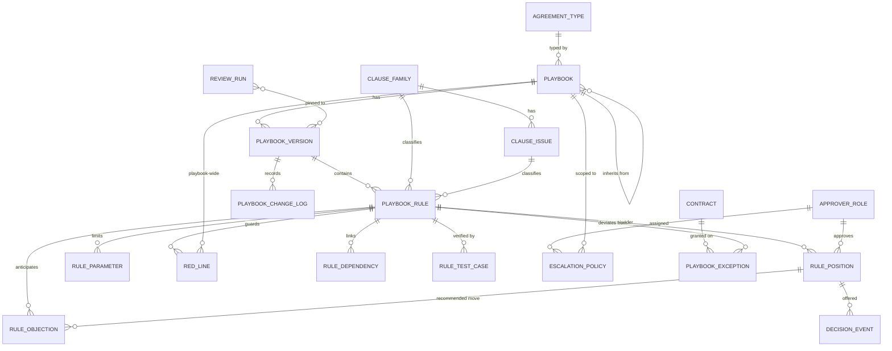

# Playbook plan: target state

This document describes the end state of the playbook: what information it holds, how it is stored, how the tables connect, and how much data the seeded playbook should contain. The steps to get there are in `playbook_implementation.md`. The current state is in `playbook_status.md`.

## 1. Vision

The playbook is a structured, versioned policy dataset. Every rule is a record a lawyer can read and the review pipeline can execute. Each finding, redline and approval cites the exact rule, position and version that produced it.

Design principles:

1. **Data, not prose.** Thresholds are numbers, red lines are testable conditions, and approvers are roles. Nothing important lives only inside a paragraph of clause text.
2. **Positions are a ladder.** A rule has one preferred position and an ordered set of fallbacks, each with its own approval level.
3. **Context changes the answer.** Deal value, data sensitivity, region and counterparty tier can change which rung is allowed and who approves.
4. **Three zones.** Every finding is green, yellow or red. The zone decides routing; the numeric score is for reporting.
5. **Layered.** A company baseline, an agreement playbook and regulatory overlays merge into one resolved rule set.
6. **Immutable once published.** A review pins the playbook versions it ran against, so results are reproducible.
7. **Testable.** Each rule carries example clauses with expected outcomes, so a change can be regression-tested before it is published.
8. **Closed loop.** Every negotiated outcome records the rule and rung, so the data shows which fallbacks are used and which positions are out of step.

**Shared infrastructure.** This project shares free-tier database and storage accounts with other projects. Everything described here lives inside a `precedent` namespace: a dedicated Postgres schema and a dedicated object-key prefix. Section 10 sets the rules, and they apply before any other work starts.

## 2. Buckets of information

| # | Bucket | What it answers | Tables |
|---|---|---|---|
| 1 | Taxonomy | What clause and issue is this? | `clause_family`, `clause_issue` |
| 2 | Playbook header | Which agreement, which side, which jurisdiction, who owns it? | `agreement_type`, `playbook` |
| 3 | Versions | Which rule set was in force, and what changed? | `playbook_version`, `playbook_change_log` |
| 4 | Rules | What is our position on this issue, and why? | `playbook_rule` |
| 5 | Positions | What language do we offer or accept, in what order? | `rule_position` |
| 6 | Parameters | What are the numeric limits? | `rule_parameter` |
| 7 | Red lines | What do we never accept? | `red_line` |
| 8 | Objections | What will the other side say, and how do we answer? | `rule_objection` |
| 9 | Dependencies | Which other rules move with this one? | `rule_dependency` |
| 10 | Test cases | How do we know the rule works? | `rule_test_case` |
| 11 | Context | Which deal facts change the answer? | `context_dimension`, `contract.context` |
| 12 | Authority | Who can approve what, and how fast? | `approver_role`, `escalation_policy` |
| 13 | Outcomes | What did we concede, to whom, under which rule? | `playbook_exception`, `decision_event` |

Buckets 1 to 12 are the playbook. Bucket 13 is produced by features that use the playbook, and feeds back into it.

## 3. Data model



Every table, view and the migration version table below is created in the `precedent` Postgres schema, never in `public` (section 10).

All primary keys are UUIDs unless stated. All tables carry `created_at`; mutable tables also carry `updated_at`, maintained on update.

### 3.1 Taxonomy

**`clause_family`**: the canonical clause type. Replaces the hard-coded synonym dictionary as the source of truth.

| Column | Type | Notes |
|---|---|---|
| `key` | text PK | e.g. `limitation_of_liability`. Matches `clause.clause_type` |
| `name` | text | Display name |
| `category` | text | `commercial`, `risk_allocation`, `data_and_security`, `term_and_exit`, `boilerplate` |
| `description` | text | One or two sentences |
| `synonyms` | jsonb | Heading synonyms used by the S1 normaliser |
| `external_refs` | jsonb | Optional mappings, e.g. `{"cuad": "Cap On Liability"}` |
| `sort_order` | int | |

**`clause_issue`**: the negotiable point inside a family. Rules attach here.

| Column | Type | Notes |
|---|---|---|
| `id` | uuid PK | |
| `family_key` | text FK → `clause_family.key` | |
| `key` | text | e.g. `cap_amount`. Unique with `family_key` |
| `name` | text | |
| `description` | text | What the issue is and why it is negotiated |
| `detection_hints` | text | How to recognise it; what absence means |

### 3.2 Playbook header

**`agreement_type`**: lookup replacing the five-value check constraint.

| Column | Type | Notes |
|---|---|---|
| `key` | text PK | `baseline`, `nda`, `saas_msa`, `dpa`, `hipaa`, `gdpr`, `vendor_msa` |
| `name` | text | |
| `kind` | text | `agreement`, `regime`, `baseline` |

**`playbook`** (existing table, extended).

| Column | Type | Notes |
|---|---|---|
| `id`, `name`, `precedence` | existing | |
| `practice_area` | text FK → `agreement_type.key` | Existing column; check constraint replaced by the FK |
| `key` | text, unique | Stable slug, e.g. `halcyon-saas-msa-vendor` |
| `layer` | text | `base`, `agreement`, `overlay` |
| `party_role` | text | `vendor`, `customer`, `mutual` |
| `paper_scope` | text | `own`, `counterparty`, `both` |
| `jurisdiction` | text | e.g. `US`, `EU`, `global` |
| `business_unit` | text, nullable | |
| `owner_role_id` | uuid FK → `approver_role.id` | Who maintains it |
| `parent_playbook_id` | uuid FK → `playbook.id`, nullable | Explicit inheritance |
| `applies_when` | jsonb | Context condition for overlays, e.g. `{"regimes": ["hipaa"]}` |
| `description` | text | |
| `status` | text | `draft`, `active`, `archived` |
| `current_version_id` | uuid FK → `playbook_version.id`, nullable | The published version in force |
| `review_cadence_days` | int | e.g. 90 |
| `next_review_at` | date, nullable | |

### 3.3 Versions

**`playbook_version`**: a snapshot of a playbook's rules.

| Column | Type | Notes |
|---|---|---|
| `id` | uuid PK | |
| `playbook_id` | uuid FK | |
| `version` | text | e.g. `1.0`, `1.1`. Unique with `playbook_id` |
| `status` | text | `draft`, `published`, `superseded` |
| `effective_from` / `effective_to` | timestamptz | `effective_to` null while in force |
| `change_summary` | text | |
| `created_by` / `approved_by` | text | Names or role keys; no user table yet |
| `published_at` | timestamptz, nullable | |

Rules: only a `draft` version is editable. Publishing freezes its rules and children, sets `playbook.current_version_id`, and marks the previous version `superseded`. A new draft is created by copying the current version.

**`playbook_change_log`**: one row per rule-level change between versions.

| Column | Type | Notes |
|---|---|---|
| `id` | uuid PK | |
| `playbook_version_id` | uuid FK | The version that introduced the change |
| `rule_key` | text | Stable rule identity |
| `change_type` | text | `added`, `modified`, `removed` |
| `field_path` | text, nullable | e.g. `parameters.cap_multiple_months.green_limit` |
| `old_value` / `new_value` | jsonb | |
| `reason` | text | Why, including any deviation data that prompted it |
| `changed_by` | text | |

### 3.4 Rules

**`playbook_rule`** (existing table, extended). One row per issue per playbook version.

| Column | Type | Notes |
|---|---|---|
| `id`, `clause_type`, `required`, `risk_weight` | existing | `clause_type` becomes FK → `clause_family.key`. `risk_weight` is fixed to a 1–10 scale |
| `playbook_id` | existing | Kept for query convenience |
| `playbook_version_id` | uuid FK | |
| `issue_id` | uuid FK → `clause_issue.id` | |
| `rule_key` | text | `{clause_type}.{issue_key}`. Unique with `playbook_version_id` |
| `title` | text | Short human title |
| `position_summary` | text | Plain-language statement of the outcome we want |
| `risk_rationale` | text | Why the position exists; what harm it prevents |
| `negotiable` | bool | False for mandatory regulatory terms |
| `default_zone` | text | Zone for a deviation that matches no position and no red line. Usually `yellow` |
| `needs_human_judgment` | bool | Surface the issue; do not auto-decide |
| `judgment_note` | text, nullable | What the human must weigh |
| `applies_when` | jsonb, nullable | Context condition for the whole rule |
| `detection_guidance` | text | Rule-specific recognition notes for the analysis prompt |
| `source_ref` | text, nullable | Policy, regulation or insurer requirement behind it |
| `authored_by` / `approved_by` | text | |
| `last_reviewed_at` | date | |

Legacy columns `preferred_language`, `acceptable_variations`, `prohibited_terms`, `fallback_language` and `escalation_threshold` are migrated into child tables and then dropped.

### 3.5 Positions

**`rule_position`**: the ladder, plus language we accept when the other side proposes it.

| Column | Type | Notes |
|---|---|---|
| `id` | uuid PK | |
| `rule_id` | uuid FK | Cascade delete |
| `kind` | text | `preferred`, `fallback`, `acceptable_variant` |
| `rung` | int | 0 for preferred; 1..n for fallbacks in the order we concede; null for variants |
| `label` | text | e.g. "Fallback 1: 18-month cap" |
| `language` | text | Complete, contract-ready clause text |
| `summary` | text | One-sentence plain-language description |
| `zone` | text | `green` (pre-approved) or `yellow` (needs the approver) |
| `approver_role_id` | uuid FK, nullable | Required when `zone = yellow` |
| `conditions` | jsonb, nullable | When this rung may be used, e.g. `{"deal_value_band": ["enterprise", "strategic"]}` |
| `give_get` | text, nullable | What to ask for in return |
| `internal_note` | text, nullable | |

Constraints: exactly one `preferred` per rule; `rung` unique per rule among fallbacks.

### 3.6 Parameters

**`rule_parameter`**: a structured, comparable value extracted from the clause.

| Column | Type | Notes |
|---|---|---|
| `id` | uuid PK | |
| `rule_id` | uuid FK | Cascade delete |
| `key` | text | e.g. `cap_multiple_months`. Unique with `rule_id` |
| `label` | text | |
| `value_type` | text | `number`, `duration_days`, `percent`, `currency_usd`, `enum`, `boolean` |
| `unit` | text, nullable | |
| `direction` | text | `higher_is_better`, `lower_is_better`, `exact`, `set_membership` |
| `preferred_value` | jsonb | |
| `green_limit` | jsonb | Furthest value still green |
| `yellow_limit` | jsonb | Furthest value still yellow; beyond it is red |
| `allowed_values` | jsonb, nullable | For `enum` |
| `extraction_hint` | text | How to read the value from clause text |
| `context_overrides` | jsonb, nullable | Per-context limits, e.g. a higher cap for strategic deals |

### 3.7 Red lines

**`red_line`**: something never accepted without the named approval, or never at all.

| Column | Type | Notes |
|---|---|---|
| `id` | uuid PK | |
| `scope` | text | `rule`, `playbook`, `global` |
| `rule_id` | uuid FK, nullable | Set when `scope = rule` |
| `playbook_id` | uuid FK, nullable | Set when `scope = playbook` |
| `key` | text | Stable identifier |
| `description` | text | Plain statement of what is prohibited |
| `condition_type` | text | `phrase`, `regex`, `parameter`, `semantic` |
| `condition` | jsonb | See below |
| `action` | text | `block` (prohibited outright) or `escalate` (needs the named approver) |
| `approver_role_id` | uuid FK, nullable | For `escalate` |
| `rationale` | text | |

Condition shapes:

- `phrase`: `{"any": ["..."], "negation_guard": true}`. The guard suppresses a match preceded by a negation in the same sentence.
- `regex`: `{"pattern": "...", "flags": "i"}`.
- `parameter`: `{"parameter_key": "cap_multiple_months", "op": "is_absent"}` or a comparison.
- `semantic`: `{"test": "The clause makes the vendor's liability uncapped for any category other than the listed carve-outs."}`. Evaluated by the analysis model and returned as a yes or no with a quote.

### 3.8 Objections

**`rule_objection`**

| Column | Type | Notes |
|---|---|---|
| `id` | uuid PK | |
| `rule_id` | uuid FK | Cascade delete |
| `objection` | text | What the counterparty says |
| `their_rationale` | text | Why they say it |
| `response` | text | Our reply, in language that can be sent |
| `talking_points` | jsonb | Short list for a call |
| `recommended_position_id` | uuid FK → `rule_position.id`, nullable | Where to move if the objection holds |
| `frequency` | text | `common`, `occasional`, `rare` |
| `counterparty_profile` | text, nullable | e.g. "large hospital systems" |

### 3.9 Dependencies

**`rule_dependency`**

| Column | Type | Notes |
|---|---|---|
| `id` | uuid PK | |
| `rule_id` | uuid FK | Cascade delete |
| `related_rule_key` | text | Resolved within the merged rule set, so it may live in another layer |
| `relation` | text | `read_with`, `trade_against`, `requires`, `conflicts_with` |
| `note` | text | e.g. "A higher cap is acceptable only if the indemnity is inside the cap" |

### 3.10 Test cases

**`rule_test_case`**

| Column | Type | Notes |
|---|---|---|
| `id` | uuid PK | |
| `rule_id` | uuid FK | Cascade delete |
| `name` | text | |
| `sample_text` | text | A clause as it might appear in a contract. Empty for a missing-clause case |
| `context` | jsonb, nullable | Deal context for the case |
| `expected_outcome` | text | `compliant`, `acceptable_variant`, `fallback`, `deviation`, `red_line`, `missing` |
| `expected_zone` | text | `green`, `yellow`, `red` |
| `expected_position_rung` | int, nullable | For `fallback` |
| `expected_red_line_key` | text, nullable | For `red_line` |
| `is_trap` | bool | True for negated or look-alike wording that must not trigger |

### 3.11 Context

**`context_dimension`**

| Column | Type | Notes |
|---|---|---|
| `key` | text PK | `deal_value_band`, `counterparty_tier`, `data_sensitivity`, `region`, `regimes` |
| `name` | text | |
| `value_type` | text | `enum`, `multi_enum` |
| `values` | jsonb | Allowed values with definitions, e.g. band boundaries in dollars |
| `source` | text | `upload`, `metadata`, `derived` |

A condition (`applies_when`, `conditions`, `context_overrides`) is a JSON object mapping a dimension key to the list of values it matches. All keys must match. An empty or null condition always matches.

### 3.12 Authority

**`approver_role`**

| Column | Type | Notes |
|---|---|---|
| `id` | uuid PK | |
| `key` | text, unique | e.g. `commercial_counsel` |
| `name` | text | |
| `function` | text | `legal`, `security`, `privacy`, `finance`, `sales`, `delivery` |
| `level` | int | Seniority; higher approves more |
| `default_sla_hours` | int | |

**`escalation_policy`**: the approval matrix.

| Column | Type | Notes |
|---|---|---|
| `id` | uuid PK | |
| `playbook_id` | uuid FK, nullable | Null means all playbooks |
| `clause_type` | text FK, nullable | Null means any clause |
| `zone` | text | `yellow` or `red` |
| `conditions` | jsonb, nullable | Context match |
| `approver_role_id` | uuid FK | Decision owner |
| `consult_role_ids` | jsonb | Functions reviewed in parallel |
| `sla_hours` | int | |
| `required_info` | jsonb | What the approver must be given |
| `priority` | int | Most specific match wins; ties broken by priority |

A position's own `approver_role_id` takes precedence over the matrix. The matrix covers deviations that match no position, and red lines with `action = escalate`.

### 3.13 Outcomes

**`playbook_exception`**: an approved departure from the playbook.

| Column | Type | Notes |
|---|---|---|
| `id` | uuid PK | |
| `contract_id` | uuid FK | |
| `review_run_id` | uuid FK, nullable | |
| `rule_id` | uuid FK | The exact frozen rule row |
| `rule_key` | text | For grouping across versions |
| `position_id` | uuid FK, nullable | The rung agreed, if any |
| `zone` | text | |
| `agreed_text` | text | |
| `parameter_values` | jsonb | Values actually agreed |
| `approver_role_id` | uuid FK | |
| `approved_by` | text | |
| `rationale` | text | |
| `give_get_obtained` | text, nullable | |
| `expires_at` | date, nullable | |
| `status` | text | `requested`, `approved`, `rejected`, `expired` |

## 4. Changes to existing tables

| Table | Change |
|---|---|
| `playbook` | New columns in 3.2. Drop `ck_playbook_practice_area`; add FK to `agreement_type`. Unique on `key` |
| `playbook_rule` | New columns in 3.4. Unique on `(playbook_version_id, rule_key)`. FK to `playbook` gains cascade delete. Five legacy columns dropped after migration |
| `clause` | `clause_type` gains FK to `clause_family.key` (with `other` as a family). New nullable `issue_keys` jsonb for issues detected inside the clause |
| `contract` | `contract_type` is populated at upload. New `party_role` text and `context` jsonb (deal value, band, tier, sensitivity, region, regimes) |
| `flag` | New `rule_key`, `position_id`, `red_line_id`, `zone`, `parameter_values` jsonb |
| `risk_score` | `score` is normalised to 0–1. New `max_zone`. `weights_version` moves to `v2` |
| `redline` | `position` check widened to allow `fallback_1`..`fallback_n`. New `position_id`, `objection_id` |
| `decision_event` | New `rule_id`, `rule_key`, `position_id`, `playbook_version_id` |
| `review_run` | New `playbook_version_ids` jsonb. `gate_decision` check gains `needs_approval` |

## 5. How the playbook is used

### 5.1 Resolution

Input: `contract_type`, `party_role`, `paper_origin` and `context`.

1. Select the active `base` playbook.
2. Select the active `agreement` playbook whose `practice_area`, `party_role` and `paper_scope` match.
3. Select every active `overlay` whose `applies_when` matches the context.
4. Take each playbook's `current_version_id`.
5. Merge rules by `rule_key`, highest `precedence` first. Convention: base 10, agreement 20, overlay 30.
6. Drop rules whose `applies_when` does not match.
7. Return the merged rules with children, plus the source playbook and version for each rule.

The response is a list. Each item carries `source_playbook_id`, `source_playbook_name` and `source_version`.

### 5.2 Evaluating a clause against a rule

In order; the first match decides:

1. A red line matches → **red**.
2. A parameter is beyond `yellow_limit` → **red**; beyond `green_limit` → **yellow**.
3. The text matches the preferred position or an acceptable variant → no finding.
4. The text matches a fallback rung → that rung's zone.
5. Otherwise → a deviation in the rule's `default_zone`.

A required rule with no matching clause is a `missing` finding, red by default.

### 5.3 Score and gate

- Flag points = severity base (1, 3 or 9) × `risk_weight` (1–10). Ungoverned flags use weight 1.
- Contract score = total points ÷ (9 × sum of `risk_weight` over resolved rules), capped at 1.0.
- The gate is driven by the worst zone:

| Worst zone | Gate decision | Routing |
|---|---|---|
| None or green | `auto_applied` | None |
| Yellow | `needs_approval` | Approver from the position, else the escalation matrix |
| Red | `escalated` | Matrix; `block` red lines cannot be approved below the top legal role |

A quality failure in redline generation still forces `escalated`.

### 5.4 Redlines and negotiation

- The preferred redline uses rung 0 language.
- Alternatives are the rule's fallback rungs, in order, filtered by `conditions`. The model adapts defined terms; it does not invent positions.
- The counterparty comment draws on the matching objection's `response`.
- Toggling steps one rung and records `fallback_1`, `fallback_2`, and so on.
- A yellow rung creates a `playbook_exception` in `requested` status.

### 5.5 Drafting

A drafting request for a clause type resolves the playbook and returns rung 0 language before trying frequency reuse or the model.

## 6. Governance

- **Ownership:** each playbook has an owning role and a review cadence. The baseline and commercial playbooks are reviewed every 90 days; regulatory overlays every 180 days or on a regulatory change.
- **Change control:** edits happen in a draft version. Publishing requires a change summary, an approver, and a run of the version's test cases that meets the pass threshold, 95% by default.
- **Audit:** `playbook_change_log` records every rule-level change with its reason.
- **Feedback:** a periodic report groups `playbook_exception` and `decision_event` by `rule_key` and rung. A fallback used in most deals is a candidate to become the preferred position. A rule that is red in most deals is misaligned with the market.

## 7. Seed data targets

The seeded playbook belongs to a fictional company, Halcyon Care, Inc., a healthcare SaaS vendor. Its profile is in `playbook_implementation.md`.

### 7.1 Playbooks

| Key | Layer | Role | Precedence | Rules |
|---|---|---|---|---|
| `halcyon-baseline` | base | mutual | 10 | 12 |
| `halcyon-mutual-nda` | agreement | mutual | 20 | 14 |
| `halcyon-saas-msa-vendor` | agreement | vendor | 20 | 36 |
| `halcyon-dpa-processor` | agreement | vendor | 20 | 18 |
| `halcyon-vendor-msa-customer` | agreement | customer | 20 | 24 |
| `halcyon-hipaa-overlay` | overlay | vendor | 30 | 14 |
| `halcyon-gdpr-overlay` | overlay | vendor | 30 | 12 |
| **Total** | | | | **130** |

### 7.2 Minimum per rule

| Item | Minimum |
|---|---|
| Preferred position | 1 |
| Fallback rungs | 2 for negotiable rules; 0 allowed when `negotiable = false` |
| Acceptable variants | 1 |
| Risk rationale | Required, at least two sentences |
| Parameters | At least 1 wherever the clause contains a number, period or amount |
| Red lines | At least 1 for every rule with `risk_weight` of 7 or more |
| Objections | 2 for negotiable rules |
| Test cases | 5: compliant, acceptable variant, fallback, deviation, and a red line or trap. A rule with `negotiable = false` has no fallback, so it carries a missing-clause case or a second deviation in its place |

### 7.3 Minimum totals

Two rows are application reference data inserted by a migration, not by the seed (section 11.3): `clause_family` and `agreement_type`. Every other row is loaded from the seed folder.

| Table | Current seed | Target minimum |
|---|---|---|
| `clause_family` (migration) | 20, in code | 29, including `other` |
| `clause_issue` | 0 | 95: 90 used by rules and at least 5 reserved |
| `agreement_type` (migration) | 5, as a constraint | 7 |
| `playbook` | 5 defined in the old script; 0 rows in the database | 7 |
| `playbook_version` | 0 | 9 (seven at 1.0, two at 1.1) |
| `playbook_change_log` | 0 | 20 |
| `playbook_rule` | 29 | 130 in force |
| `rule_position` | 0 (46 one-line variations) | 520 |
| `rule_parameter` | 0 | 90 |
| `red_line` | 0 (65 literal phrases) | 140, including 12 global and 128 or more on rules |
| `rule_objection` | 0 | 240 |
| `rule_dependency` | 0 | 60 |
| `rule_test_case` | 0 | 650 |
| `context_dimension` | 0 | 5 |
| `approver_role` | 0 | 9 |
| `escalation_policy` | 0 | 36 |

Supporting synthetic data, for demonstrations and end-to-end tests:

| Dataset | Target |
|---|---|
| Synthetic contracts | 12 documents across the five agreement types, own and counterparty paper |
| Negotiation history | 150 decision events and 40 exceptions across 15 fictional counterparties |

## 8. What each bucket enables

| Bucket | Feature |
|---|---|
| Issues | Findings at the level lawyers negotiate, not whole clauses |
| Positions | Playbook-sourced alternatives and a real fallback toggle |
| Parameters | Deterministic threshold checks; context-specific limits |
| Red lines | Hard stops that survive paraphrase and ignore negated wording |
| Objections | Counterparty comments and negotiation prep grounded in policy |
| Dependencies | Trade-off warnings when one concession affects another rule |
| Test cases | Regression testing before publish; evaluation of the analysis model |
| Authority | Approval routing with named roles and time limits |
| Versions | Reproducible reviews and an audit trail |
| Outcomes | Fallback-usage analytics and data-driven playbook updates |

## 9. Assumptions and open decisions

- **Fictional company.** Halcyon Care is invented. All playbook text is synthetic and original, and is not legal advice.
- **No user table.** `authored_by`, `approved_by` and similar fields are text until authentication exists.
- **Seed format.** Seed content is authored as YAML files and loaded by code in `backend/seed/`. This adds `pyyaml` to a separate `seed` dependency group, not to the application's dependencies (section 11).
- **Buy-side playbook.** `halcyon-vendor-msa-customer` is included to exercise `party_role`. It can be dropped without affecting the rest; the rule total falls to 106.
- **This reverses a documented scope decision.** `Architecture.md` puts playbook versioning and audit out of scope. The planning docs should be updated when this plan is accepted.

## 10. Project partitioning on shared infrastructure

The free-tier accounts behind this project are shared with other projects. No table, file or vector belonging to Precedent may sit where another project's data could collide with it or be mistaken for it.

### 10.1 What the project uses today

Checked on 2026-11-16 by reading `backend/.env` and connecting to the database read-only.

| Store | Configured? | Current state | Partitioned? |
|---|---|---|---|
| Neon Postgres | Yes; database `neondb`, through the pooled endpoint | 16 application tables, 6 views and `alembic_version`, all in the `public` schema. Every table has 0 rows. Migrations are at `009`. No other project's objects are present yet | **No** |
| pgvector | Yes; extension `vector` 0.8.0 installed in `public` | `clause_embedding` exists and is empty | Shared by design |
| Object storage (Cloudflare R2) | **No.** All four storage variables are empty | Files go to the local folder `/tmp/precedent-storage`, which holds only a health-check file. Keys look like `contracts/{id}/{filename}`, with no project prefix | Not yet relevant; would not be once R2 is set. The local fallback itself must go (10.4) |
| Qdrant | **Not used.** No client, setting or dependency | Vectors are stored in Postgres | Not applicable |
| Anthropic API | Key is empty in `.env` | Not a data store | Not applicable |

The risk is in Postgres. The table names are generic (`contract`, `party`, `alert`, `flag`, `obligation`), and `alembic_version` is the default name any other Alembic project would also use in `public`. A second project in the same database would collide on both.

### 10.2 Rules

One setting, `PROJECT_NAMESPACE`, with the value `precedent`, drives every partition. Nothing else may hard-code the name.

| Store | Rule |
|---|---|
| Postgres tables and views | All in the schema named by the namespace. Nothing owned by this project in `public` |
| Migration history | `alembic_version` lives in the project schema, so each project keeps its own history |
| Extensions | `vector` stays in `public` and is shared. This project never drops or upgrades it without checking other projects |
| Raw SQL | Every hand-written statement names the schema explicitly or is built from the setting |
| Database role (optional hardening) | A role `precedent_app` with rights only on the project schema, used by the application. Migrations keep using the owner role. Not scheduled as a task in the implementation plan |
| Object storage | A bucket per project where the vendor allows it. Otherwise one shared bucket with every key under `precedent/`. The prefix is applied inside the storage backend, so stored `object_key` values stay logical and unprefixed |
| Local file storage | Not allowed. See 10.4 |
| Vector store, if one is ever added | Collection names start with `precedent_`, and every point carries a `project` payload field. Not needed while vectors live in Postgres |
| Synthetic and seed data | Loaded only into the project schema. Loader and scripts refuse to run when the schema is `public` |
| Verification | A read-only check script confirms nothing of this project sits outside its namespace. It runs before the seed load and before any destructive step |

### 10.3 Clean-up required before development

| # | Item | Action |
|---|---|---|
| 1 | 16 tables, 6 views and `alembic_version` are in `public` | Move all 23 objects into the `precedent` schema with `ALTER ... SET SCHEMA`. This keeps constraints, indexes and migration history, and is reversible. Because every table is empty, dropping and re-running migrations would also work, but moving avoids a destructive step |
| 2 | Models, migrations and raw SQL assume the default schema | Make the code schema-aware first, so the application works immediately after the move |
| 3 | Object keys have no project prefix | Add the prefix in the storage backend now, before any file reaches a shared bucket. No existing remote files need moving |
| 4 | `vector` extension is in `public` | Leave it. It is shared |
| 5 | Object storage falls back to a local folder when the cloud settings are empty, which they are today | Configure the cloud bucket, remove the local backend from the code, and delete the local folder. See 10.4 |

No row-level data needs fixing: the database is empty and no remote files exist. The steps are tasks 0.3 to 0.7 in `playbook_implementation.md`.

### 10.4 Cloud only: no local databases or local storage

All persistent project data lives in the cloud from the first day. Nothing is stored locally, even temporarily, so nothing ever has to be migrated later.

**What is local today** (checked 2026-11-16 by searching the backend, scripts, tests, migrations and frontend):

| Item | Where | State | Action |
|---|---|---|---|
| Local file backend | `FilesystemStorageBackend` in `backend/app/core/storage.py`; the factory selects it whenever `OBJECT_STORAGE_ENDPOINT` is empty | Active now, because all four storage variables are empty | Remove the class and the fallback. Missing storage settings become a startup error |
| Local storage folder | `/tmp/precedent-storage` | Holds one file, `__health_check__` (2 bytes). No contract files | Nothing to migrate. Delete the folder |
| Storage unit tests | `backend/tests/unit/test_storage.py` uses the local backend | — | Rewrite against an in-memory test double and a mocked S3 client. Tests write nothing to disk |
| Docs and comments | `storage.py` docstring, `.env.example`, `backend/README.md` describe local storage as the development mode | — | Rewrite to say cloud storage is required |
| Database | — | Already cloud only. No SQLite, no local Postgres, no Docker database. CI uses a placeholder URL and mocked sessions | None |
| Browser storage | — | The frontend uses no `localStorage`, `sessionStorage` or IndexedDB | None; keep it that way |

**Rules:**

1. There is one storage backend, the S3-compatible one, and one database, the cloud Postgres. The code has no local alternative to fall back to.
2. The application refuses to start if the database URL or any of the four object-storage settings is missing.
3. Scripts never write project data to disk. Seed loaders write to the database; uploads go to the bucket.
4. Files a process must handle in transit, such as an upload being parsed, stay in memory. If a library needs a real file, it gets a temporary file that is deleted in the same request.
5. Unit tests use in-memory doubles and mocks. They need no cloud access and leave nothing behind.
6. The partition check also fails if a local storage folder for this project exists.

**What is not covered by this rule**, because it is source or tooling and not project data:

- Seed content and the synthetic contract corpus under `backend/seed/`. These are source files kept in git. The loaded rows and uploaded files they produce exist only in the cloud.
- The embedding model weights that `sentence-transformers` downloads to the machine's model cache. They are a downloadable dependency, not data.
- The application processes themselves, which run on the developer's machine during development.

**Prerequisite from the project owner:** a Cloudflare R2 bucket and an access key pair. Creating these is an account action only the owner can take. Nothing that stores a file can be built or run until the four `OBJECT_STORAGE_*` values are in `backend/.env`.

## 11. Seed code isolation

All seed generation, loading and validation code, the seed content, and the tests for that code live in one folder, `backend/seed/`, with a sub-folder per seed category. The folder is fully separate from the application: deleting it must not affect the application, its workflows, its features or its tests.

The folder sits under `backend/` because its loaders use the application's database models and settings, and must run in the same Python environment.

### 11.1 Target structure

```text
backend/seed/
  README.md
  common/        shared helpers for seed code only
  playbooks/     models, validator, loader, report, and data/halcyon/ content
  contracts/     generator and data/halcyon/ synthetic contracts
  history/       models, loader and data/halcyon/ negotiation history
  tests/         tests for seed code, run separately from the application suite
```

A future category, for example obligations or users, is added as another sub-folder with the same shape: code at the top, content under `data/`.

### 11.2 Rules

| # | Rule |
|---|---|
| 1 | Dependencies run one way. Seed code may import from `app`. Nothing in `app`, `migrations`, `scripts` or the application tests imports from `seed`, reads its files or calls its commands |
| 2 | No seed code, seed content or seed test exists outside `backend/seed/` |
| 3 | Seed tests are not part of the application suite. The application suite passes with the folder absent |
| 4 | Libraries only seed code needs go in a separate `seed` dependency group |
| 5 | Data the application needs in order to run is reference data and comes from migrations, not from seed. Today that is agreement types and clause families with their heading synonyms |
| 6 | Every feature works with no seed data loaded: empty playbook, role and policy tables are a valid state |
| 7 | Product features are not seed. The playbook bootstrap, the rule test runner and the publish flow stay in `app` and never read seed files |
| 8 | An automated guard in the application suite and in CI enforces rule 1 |

### 11.3 Reference data versus seed data

| Data | Needed for the application to run? | Source |
|---|---|---|
| Agreement types (7) | Yes; playbooks and contracts reference them | Migration |
| Clause families (29) and synonyms | Yes; the document pipeline classifies clauses with them | Migration |
| Clause issues | No | Seed, or created through the API |
| Context dimensions, approver roles, escalation policies | No; company-specific | Seed, or created through the API |
| Playbooks, versions, rules and all rule children | No | Seed, or created through the API |
| Synthetic contracts and negotiation history | No | Seed |

### 11.4 Current state and clean-up

Checked 2026-11-16.

| Item | Current location | Action |
|---|---|---|
| Seed loader, with 29 rules as a Python literal | `backend/scripts/seed_playbooks.py`, beside the application's monitor job | Replace with a loader in `backend/seed/playbooks/`; delete the old file |
| Seed tests | `backend/tests/unit/test_seed_playbooks.py`, inside the application suite | Replace with tests in `backend/seed/tests/`; delete the old file |
| Setup instructions | `backend/README.md` lists seeding as a required setup step | Point to the new command and mark it optional |
| Planning docs | `development_docs/Backend_Structure.md` places the seed script under `scripts/` | Update |
| `backend/seed/` | Does not exist | Create with the structure above |
| Application imports of seed code | None found; two comments mention the seed | Keep it that way with the guard |

The work is tasks 0.8, 0.2, 2.1, 2.2, 5.2, 5.3 and 5.6 in `playbook_implementation.md`. Task 5.6 is a removal drill: the folder is moved away, the application is tested and started without it, and the folder is restored.
